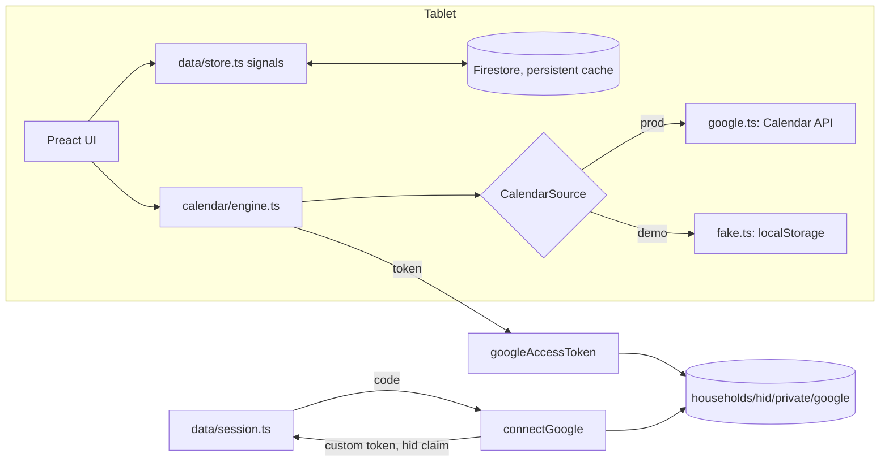
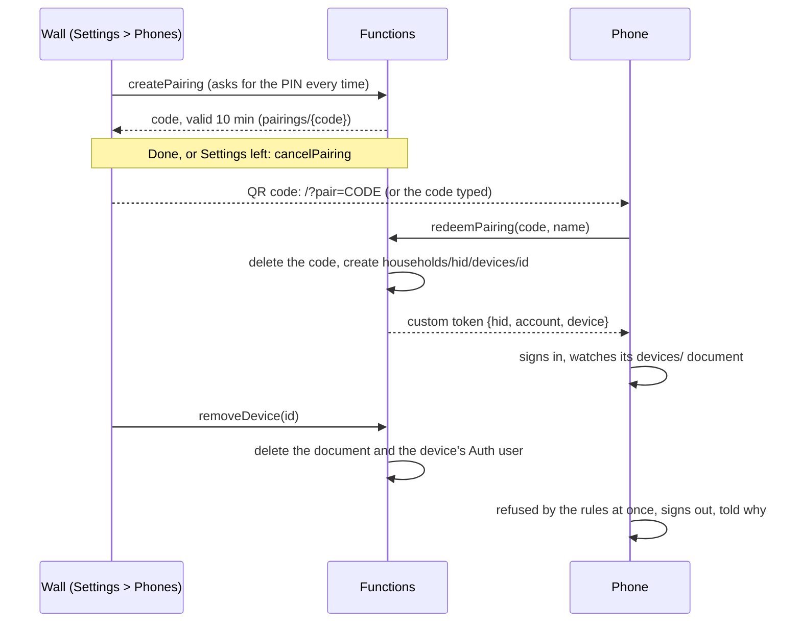
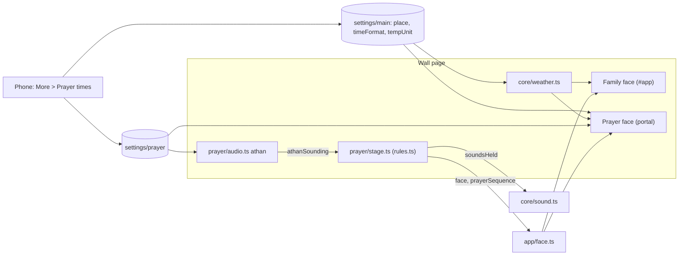

# Manwar: maintainer notes

Family wall-calendar web app for an Android tablet (landscape; Chrome's
installed app or Fully Kiosk Browser), modeled on the Skylight Calendar 2
with Plus, with a prayer-time clock as the wall's second face and a phone
companion for parents on the same URL. Research and product decisions:
`research/README.md` (start there; the numbered reports hold the detail and
the images). Scope: Home, Calendar, Lists, Tasks, Rewards, Meals, Recipes,
Sleep, Settings, the prayer face; the phone has Today, Tasks, Lists,
Calendar and More. Not built: Photos, Disney, Magic Import, Sidekick, push
notifications.

## Deployment configuration

Everything that ties the repo to one deployment lives in a few places; the
docs refer to them rather than repeating the values. `<project>` below means
the default project in `.firebaserc`.

| What                                                              | Where                                                                                                                                                                           |
| ----------------------------------------------------------------- | ------------------------------------------------------------------------------------------------------------------------------------------------------------------------------- |
| Firebase project                                                  | `.firebaserc` (default)                                                                                                                                                         |
| Web config (API key, app id, auth domain) and the OAuth client id | `src/config.ts`; hosts derive from it (`canonicalHost` = authDomain, `<project>.web.app` forwards there)                                                                        |
| Functions params                                                  | `functions/.env`: `GOOGLE_OAUTH_CLIENT_ID` (must equal `googleClientId`; `tests/unit/config.test.ts` checks) and `FUNCTIONS_SERVICE_ACCOUNT` (the runtime account's full email) |
| Secrets                                                           | Secret Manager: `GOOGLE_OAUTH_CLIENT_SECRET`, `ALLOWED_ACCOUNTS`                                                                                                                |
| Deploy identity                                                   | GitHub repository variables `GCP_WORKLOAD_IDENTITY_PROVIDER`, `GCP_DEPLOY_SERVICE_ACCOUNT`                                                                                      |

- Run gcloud as an account with Owner on the project (pass `--account` where
  the machine's gcloud default is a different account). Deploys go through
  `.github/workflows/deploy.yml` on push to main (or Run workflow), keyless
  via Workload Identity Federation (pool `github`, provider `github`,
  restricted to this repository) as the `github-deployer` service account.
  Repo admin (variables, alerts) needs a `gh` login with admin on the repo.
- Functions run as the `manwar-functions` service account. Give its full
  email: firebase-tools does not expand the `name@` short form when it
  grants the account access to secrets.
- The OAuth client is the one Firebase auto-created for Google sign-in
  ("Web client (auto created by Google Service)"). Its client id and secret
  are readable from `identitytoolkit.googleapis.com/admin/v2/projects/<project>/defaultSupportedIdpConfigs/google.com`.
  Its registered JavaScript origins are `https://<project>.firebaseapp.com`
  and `http://localhost` (any port), not web.app; its one authorized
  redirect URI is Firebase's handler, `https://<project>.firebaseapp.com/__/auth/handler`,
  which the installed app's sign-in comes back to. Editing either needs
  the Cloud Console signed in as an owner (no public API, and the
  console's own client API does not take a gcloud token).
- Accounts: each connected Google account is its own household (`hid` =
  `g` + the Google subject id); the Firestore rules keep households apart.
  Only accounts in the `ALLOWED_ACCOUNTS` secret (emails, comma separated)
  may connect or get Calendar tokens, so strangers cannot run up the bill.
  Change it with `gcloud secrets versions add ALLOWED_ACCOUNTS --data-file=- --project <project>`
  and redeploy the Functions (re-run the workflow). No account names belong
  in the repo. The rules do not read the allowlist: an account taken off it
  loses Calendar tokens and pairing, but its wall and phones keep their
  Firestore sign-ins until their Auth users are disabled (the wall's uid is
  its `hid`, its phones' start `<hid>.phone.`).
- A monthly budget alert ($10) watches the project's billing.

## Architecture

- **Data**: everything app-side is in Firestore under `households/{hid}/<collection>`
  (`src/data/types.ts` is the model; `Collections` in `store.ts` maps names
  to types). `data.<collection>` signals hold live snapshots; writes
  (`put`/`patch`/`remove`/`batch()`) apply locally at once, so UI code does
  not await them. `transaction()` is the one that does not queue: a read
  and write on the server for a phone acting on the wall (the timer), it
  fails at once offline (one retry, not Firestore's five), so the phone
  can say so. `settings/main` is one document merged over
  `DEFAULT_SETTINGS` (`data/settings.ts`). Firestore ends a listener for
  good on an error, so `listen()` in the store reports it (`loadError`,
  shown on the loading screen, and as Not syncing in the top bar once the
  wall is up) and subscribes again after 30 seconds.
- **Several tablets, one household**: `put` (a whole document) is for new
  documents only. A change to an existing one writes only the fields it
  changes (`patch`, `saveEdited` for editors, `upsert` to create or merge,
  `fieldChanges` turns undefined into a field delete; `arrayUnion`/
  `arrayRemove` for one element of a list), so another tablet's change to
  the other fields survives, and a document deleted elsewhere is not
  written back. Writes start from the store's current document, not the
  copy an editor opened with. A new grocery item's id comes from its list
  and its item key (`groceryItemId` in `lists/logic.ts`), so two devices
  adding "milk" before either hears of the other write one item; an id
  already taken on the list (an item renamed since) falls back to a fresh
  one. An editor or popover whose document is
  deleted elsewhere closes itself through `useCloseWhenGone`
  (`ui/overlays.tsx`), with a toast for an editor, and refuses the PIN
  pad, confirmation or choice it had open (they asked about what is gone);
  an editor's save also treats an archived document as gone. The settings document
  follows the same rule: `saveSettings` merges, so a change names only the
  fields it changes (`{ filter: { weather: false } }`, never the whole
  filter from this tablet's copy), and the change builders in
  `data/settings.ts` (`filterChange`, `profileShownChange`, `hiddenChange`,
  `mealCategoryChange`, `windowChange`, `relockChange`, `pinChange`,
  `listAdd`/`listRemove`) cover the shared lists and maps; a form with a
  draft writes `changedFields(opened, draft)` (the Sleep menu).
  `mealCategories` is stored as a map by category id for that reason
  (`categories` in `meals/state.ts` gives them in order). A merge never
  deletes a nested key: `pinChange(null)` passes `deleteField()` for that.
- **Calendar events** live in the household's Google calendars. `calendar/engine.ts`
  fetches a window around today (six weeks back, four months ahead, widened
  to the days the latest view shows: it asks with `ensureRange` and lets them
  go with the release it returns, its effect's cleanup, so the window narrows
  back once the view pages on or unmounts), caches a snapshot
  in localStorage for offline display (marked with its household: another
  household opening drops the calendars and ignores it), polls every 3
  minutes, and joins each
  event with `EventMeta` (Firestore `eventMeta`, keyed by
  `metaKey(calendarId, seriesId ?? id)`). An occurrence's own document
  overrides its series' document field by field (empty `profiles` = inherit,
  `[NOBODY]` = no one: what a profile delete leaves on a document it empties,
  so an occurrence waits in triage, which assigns it alone (`triageScope`)
  instead of the series);
  write through `assign`/`setCountdown`/`updateEvent`, which touch only the
  document they mean to change, and only its fields they change (a write
  without profiles adds none, `arrayUnion()`, so it cannot clear an
  assignment another tablet made that has not arrived yet; the editor
  passes `updateEvent` only the people and countdown it changed,
  `metaChanges` in `features/calendar/form.ts`). `assign` with no one
  writes `[NOBODY]`, so the event goes back to triage, a holiday or one
  occurrence of a series with people included. `refresh()` called during a fetch gets one
  more fetch after it (each Google request gives up after 30 seconds, so a
  dead connection cannot stall the queue or a save awaiting it), and a
  calendar that fails keeps its last events. A calendar hidden in Settings
  (on any tablet: the engine follows `hiddenCalendars`) leaves the wall at
  once, the snapshot's events of it too (`shownOnly`), and one shown again
  is fetched. The fetched window counts as loaded once any shown calendar
  answered in it (the next poll asks a failed one again), so page turns
  inside it do not refetch everything; a fetch no calendar answered leaves
  the loaded window as it was. `loadedRange` is that window (or the
  snapshot's), null before either: a view shows a day outside it as not
  loaded yet, never as empty (`isLoaded`; the wall's views through
  `NotLoaded` and `dayCount` in `views/common.tsx`). A range asked for
  while a fetch is out is compared with the window that fetch asks for.
  `passesHidden(ev, hidden)` is the profile filter rule (an event shows
  while any of its people does, and always when it is for everyone or no
  one); `passesFilter` applies the household's filter with it.
  Events with no meta are **unassigned** and listed in `unassigned` (the
  triage queue, badge on the Calendar rail item). `[EVERYONE]` means the
  whole family. A Google holiday calendar's events
  (`isHolidayCalendar`, `calendar/types.ts`: ids ending
  `#holiday@group.v.calendar.google.com`) are the family's without meta,
  so they never wait in triage (`profilesOf`); one assigned to people is
  theirs, and one whose only person was deleted (NOBODY) waits like any
  other. The demo's holidays calendar has Google's US holidays id, so the
  demo follows the same rule. Countdowns past the window (setting Always) come from
  `CalendarSource.nextOccurrence`, for each countdown with no occurrence
  from today on in the window (a birthday last month is asked for next
  year's), asked hourly and only of calendars that
  answered the fetch; when it finds nothing left (deleted, declined, over)
  the meta gets `countdown: false`, so no tablet asks again. New events get their id from
  `newEventId()` once per editor, so a retried save updates instead of
  duplicating; the engine remembers which calendars a failed save of an id
  went to, and a retry to another calendar moves the event from there
  (`events.move`) instead of adding a second copy. The snapshot names its household; a change of household
  clears everything and drops another household's snapshot, and a fetch
  that outlives its household is discarded.
- **Google mapping** (`calendar/google.ts`, the API boundary): working
  locations, focus time, cancelled stubs and invitations the household
  declined are not on the wall; birthdays, Gmail events and locked copies
  are read-only (the API refuses their times and text), as are events on a
  calendar shared read-only and invitations only the organizer may change:
  `readOnly` says which, set with `editable` by one function; hidden details
  read Busy. Writes keep what the editor does not show: reminders are written
  only when the reminder was changed (`keepReminders`), notes only when the
  event had some or the editor gave some (`''` clears), every timed write names
  the event's own zones (the tablet's for new or formerly all-day events),
  All events leaves the series times out when they were not changed, a
  changed repeat replaces only the RRULE line (EXDATEs stay), EXDATEs move
  with a series (or a new This and following series) whose time or day
  changes (`moveRecurrence`; a timed series and its EXDATEs move on the
  tablet's wall clock, so a day later across a clock change keeps the time
  of day), a series changed between timed and all-day takes its EXDATEs
  and UNTIL into its new kind (Google takes an EXDATE only where it names
  an occurrence: a date on an all-day series, a date-time on a timed one;
  a date made a date-time is written in UTC), a weekly rule's BYDAY days move with an occurrence moved to
  another weekday when the repeat was not edited (`shiftByday`; the demo
  source and meal plans do the same with `shiftRepeat`), and This and
  following copies guests, color and
  reminders to the new series and cuts the old one at the occurrence's
  `originalStart` (where the series had it, not where it was moved to); a
  COUNT rule continues with what is left, counting the old series'
  instances by `originalStartTime`. A 401 drops the cached token and retries once;
  requests give up after 30 seconds.
- **Rate limits**: a 429, or a 403 whose reason is `rateLimitExceeded` or
  `userRateLimitExceeded`, is `RateLimited` (with Retry-After when the
  response has a readable one); any other 403 stays an ordinary error. A
  background read (`background: true` in `call`) fails at once, and the
  engine pauses the background sync: `refresh()` does nothing until the
  pause ends (1 minute, doubling per limit in a row up to 30, or longer if
  Retry-After says so), then one fetch runs. A save is never held by the
  pause: it retries a limit twice (1 s and 2 s plus jitter, or a
  Retry-After up to 5 s) and otherwise fails saying when to try again.
  Google accepting a save, and Sync now, resume the sync (`syncNow`); the
  fetch they wait for runs even when the fetch running at the time is
  limited and pauses the sync again, and any fetch Google answers without
  a limit ends the pause.
- **Tasks**: `tasks/engine.ts` is pure (occurrences from schedules; late
  chores; Up for Grabs; repeat-after-done via `Task.lastDone`), unit-tested.
  A new repeat-after-done chore added in the evening starts tomorrow
  (`withRepeatMode` in `features/tasks/draft.ts`, shown in the editor), so
  it is not late the next morning.
  `tasks/state.ts` has the reactive views and the writes. Stars use an
  append-only ledger (`ledger` collection) plus `Profile.stars` kept equal
  to the sum by `batch().stars()` in the same batch. Undo writes a reversing
  entry and marks the original `undoneAt`. Every write there reads the
  current state from the store (never the caller's copy) and holds its keys
  through `exclusive()` until the store shows the write (`whenShown` in the
  store: snapshots in sync and none of the star collections' listeners
  down waiting to resubscribe, since a dead listener never shows it and
  Firestore's in-sync event does not wait for it; a listener of other data
  being down holds nothing), as the local snapshot lags the write by milliseconds
  and a second tap in between would award or charge twice; writes return
  null when they did nothing.
  Check-offs on another day are stamped on that day (`madeAt`), and are
  written only for an occurrence still on that day (`stillOn`: not for a
  task deleted or reassigned on another tablet while its popover was open).
  `HISTORY_DAYS` bounds the task views, late carry-over, the writes and the
  store's `taskStates` query, which moves with today: at the day change the
  store opens the new query and closes the old one once the new one has
  delivered (`listen()` returns the reopen), so nothing the views need
  drops out in between. The ledger listener holds the household's
  newest `LEDGER_LIVE` entries; the star history sheet reads older pages on
  Show older (`rewards/history-state.ts`, shown without Undo). Balances never
  depend on the window. What no guard on one device sees (two devices
  checking off one occurrence at once, a phone offline checking off,
  unchecking or redeeming against what another device did meanwhile)
  `firestore.rules` refuse, the whole batch: a task state is only created
  or deleted (never written over, never deleted when gone), so a change to
  one is a delete and a create, never an update; a ledger entry is added,
  and marked `undoneAt` once; a `redeem` entry may not leave the balance
  below zero (`getAfter` on the profile); a one-time reward's `redeemedBy`
  stamp is never written over. A `remove` (Give and Remove go through
  `exclusive()` too, keyed by the balance) may leave it below zero: the
  form stops at the balance shown, and a removal from a stale copy is a
  parent's call. The device's own change rolls back,
  `exclusive()` says so in a toast, and the write's promise resolves false
  (the redeemed dialog closes on it). A check-off is written only where no
  state is (a skip is undone first). `completeTask` returns the state it
  wrote, and the check-off toast's Undo takes back only that one
  (`sameCheckOff`): not a check-off made after it on another device.
- **Parental lock** (`core/lock.ts`): with a PIN set, only checking off tasks
  is open; wrap every other mutation in `asParent(() => ...)` or
  `await requireParent()`; an editor asks again on Save, since the lock can
  relock behind an open sheet. Unchecking is open too, except when the
  stars it takes back were spent since (the balance no longer covers them):
  then it asks for the PIN (`tasks/actions.ts`). The pad blurs the focused
  field when it opens, so the on-screen keyboard closes. Repeated wrong PINs pause the pad
  (`core/pin.ts`); the miss count and the pause are kept in localStorage
  (`manwar.pinPause.v1`, `core/lock.ts`), so a reload does not reset them.
  The countdown reads `currentTime()`, not the once-a-second `nowMs`. The Calendar filter is a view preference and
  stays open.
- **Display** (`core/display.ts`): night window switches to the dark theme
  and dims (under Fully Kiosk, which can set the backlight), sleep window
  blanks the screen, a tap wakes it and it stays awake until 3 minutes pass
  without a touch (`wokenUntil`, on the monotonic clock, `performance.now()`:
  a wall clock set back does not keep the wall awake; the rule gets it as
  the time the wake has left). "Sleep now" is kept in
  localStorage and the backlight is not touched until the settings load, so
  a reload at night does not light the screen. The rule itself (woken, then
  Sleep now until the window's end or 7:00, then a timer's hold, then the
  window) is pure in `core/sleep.ts`, shared with the phone's guess. A new
  timer run ends Sleep now (`holdSleepForTimer`, `endForcedSleep`), so a
  timer started from a phone shows on the wall; the run already there when
  the wall opens does not, as it may be older than the Sleep now. The
  prayer clock's athan sequence (`prayerSequence`, app/face.ts) outranks
  all of it, Sleep now included: `sleeping` is false while it runs, so the
  backlight is up for it, and the wall sleeps again when it ends untouched
  (a tap during it keeps the wall awake 3 minutes, as any touch does).
- **Sounds** (`core/sound.ts`): synthesized pops and chimes, and notes read
  aloud (`speak`), go through `whenFree`: while an athan sounds
  (`soundsHeld`, set by prayer/stage.ts) each kind waits, and the last of
  each plays once it ends. `tone` resumes an audio context the browser
  suspended. A note is announced (its chime, read aloud) once it is seen:
  the wall awake and on the family face (`features/messages`), so one that
  came while the wall slept waits for someone to wake it, not for an athan
  that lit the screen for its sequence.
- **Activity** (`core/activity.ts`): the one source of "someone is using the
  wall" (pointer, key and input events; the on-screen keyboard sends no
  pointer events). Idle return, relock, sleep, the update check, the
  prayer face's resting rule and a phone's last-seen stamp read it.
  `idleFor` is on the monotonic clock (`performance.now()`), so a wall
  clock set back does not hold idle return or an update for that long.
- **Shell**: `app/tabs.tsx` lists the tabs; each feature exports a `TabDef`
  (`app/tab.ts`) from `src/features/<tab>/index.tsx` with `Body`, optional
  top-bar `Controls`, `onAdd` (the + button) and `title`.

## Phone companion

Parents' phones open the same URL and get a different app on the same
household data (`src/phone/`). Only the wall pairs phones and removes
them (a phone may unpair itself); a paired phone is a parent's, so in the
phone layout it never asks for the PIN.

- **Layout** (`app/layout.ts`, `chooseLayout`): chosen once per page
  load: `?layout=` in the URL, else a choice made on the device (the
  layout switches below and the pairing screen's This is the wall, stored
  in `manwar.layout.v2`), else a paired phone (`manwar.claims.v1` with a
  device) is a phone, else Fully Kiosk (`underFully`) is a wall, else the
  screen: a short side under 480 CSS px is a phone whatever the device
  signed in as (a phone once signed in with the household's Google
  account is still a phone), under 600 too unless the device remembers
  the household as the wall (claims without a device: a small tablet, or
  one with a larger display size), otherwise a wall. Only a choice is
  stored; what a device signed in as follows its session. The pairing
  screen's link to the wall layout shows with the form only (not while a
  signed-in phone loads), and never on a screen under 480 CSS px
  (`alwaysPhone`). Switching stores
  and reloads, so the wall's services (display schedule, wake lock, idle
  return, seeding, remote commands) never start on a phone
  (`app/start.ts`). More > This phone asks before it switches to the wall
  layout, saying what changes (a paired device then asks for the PIN, and
  the screen follows the wall's night and sleep schedule); the wall's
  Settings > About offers the phone layout back on a paired device or a
  screen whose short side is under 600 CSS px (`chooseLayout`'s rule).
  `html[data-layout]` scopes the phone's CSS
  (`phone/phone.css`: rem is 62.5% of the phone's font size, and shared
  sheets, dialogs, popovers and toasts are re-laid for a narrow screen).
- **Identity**: a paired phone's Auth user is `<hid>.phone.<deviceId>` with
  claims `hid`, `account`, `device`. `firestore.rules` count it a member
  only while `devices/{device}` exists (one extra read per request, for
  phones only); devices are written only by the Functions, except a phone
  stamping its own `lastSeenAt` (`watchDevice` in `data/session.ts`: on
  opening, on being shown again and on a touch, at most hourly, as a phone
  page stays open for days). `googleAccessToken` refuses a removed
  phone too. `session.pairedDevice()` is the device id on a paired phone;
  `core/lock.ts` turns the lock off there in the phone layout only (a
  paired device switched to the wall layout is a wall, and asks). A phone
  removed while offline never hears it from its device watch; once its
  token is refused, Auth signs it out by itself, and a phone's sign-out
  this page did not ask for (`leave()`: disconnect, unpair, a refused
  sign-in) shows the removed message too. A phone signed in as the wall
  (not paired) is not in the wall's Phones list; This phone says to pair
  it instead and offers Sign out (`disconnect()`, behind the PIN when one
  is set), which signs out that device only.
- **Pairing limits** (`functions/src/index.ts`): Add a phone asks for the
  PIN even while the wall is unlocked (`requireParent` with `fresh`),
  since what it grants outlasts the unlock. A code shown is put away
  (`cancelPairing`, naming the code, so a cancel that lands late never
  takes the next one) on Done or when Settings closes, and `createPairing`
  clears codes any household left expired. `redeemPairing` needs no
  sign-in, so it runs on one instance and each instance refuses calls
  past 30 a minute (bursts of 15) before any database read
  (`rateLimiter`, off in the emulator, where the e2e suite pairs hundreds
  of phones). That bounds what a stranger can add to the bill to the
  calls themselves.
- **No household data at rest on a phone**: phones use Firestore's memory
  cache (`data/firebase.ts`; the wall's is persistent) and keep no
  calendar snapshot (`calendar/engine.ts`), so a phone removed or lost
  keeps only what it had open. What that costs, and how it is met:
  - A cold start has nothing to show: on a phone a collection counts as
    loaded (`ready`, `data/store.ts`) only once the server has answered
    for it (its listeners hear metadata changes, so an empty collection's
    answer counts too), and the loading screen says when the household
    cannot be reached, or why its data is not coming in.
  - Changes made offline wait in memory: `unsentWrites` counts those the
    server has not answered, the status line says how many wait, and the
    update reload (`app/start.ts`) waits for them.
  - Where the phone was (tab, open list, More and Calendar views, for the
    session) and a note being written are cleared when the household
    signs out (`phone/PhoneApp.tsx`).
- **Shell** (`phone/PhoneApp.tsx`): pairing screen until signed in, then a
  header, the status line (household not syncing, calendar trouble) and a
  bottom tab bar. Tabs are `PhonePage`s (`phone/nav.ts`) listed in
  `phone/pages.ts`, each in `src/phone/<tab>/`; More's rows are
  `MoreItem`s in `phone/more/index.tsx`, and the row open is `moreView`
  (`phone/more/view.ts`, apart from the rows, so a row's module can open
  another row without importing the list that imports it); each row's
  view is keyed by its id, so one opened from another's view gets its own
  Back entry and opening-tap guard. An inner view sets the header's
  back arrow through `PhonePage.back`, which a tap on the tab shown also
  runs (the tab goes to its top). Lists keeps its open list and More its
  view while another tab shows; Calendar comes back on today's agenda
  (leaving it resets `agendaStart` and `calView`), so Today's See all
  always opens the agenda. The tab and those inner views (`phoneTab`,
  `openListId`, `moreView`, `calView`) are kept in sessionStorage
  (`stored(..., 'session')`, `lib/stored.ts`), so the update reload after
  two idle minutes, or a phone bringing back a tab it put away, opens
  where the parent was; overlays and the agenda's day are not kept, and
  only ids are (no household data at rest), so a list deleted while the
  page was away closes with a toast that names no title.
  On a short landscape screen (`max-height: 500px` and wider than 4:3)
  the header, status line and tab bar shrink, its labels beside the
  icons, and Lists and Tasks tighten their own heads; controls stay at
  least 4.8rem. With
  `viewport-fit=cover`, content keeps all four safe-area insets
  (`--safe-l`, `--safe-r` for the landscape notch) and backgrounds run to
  the edges; a feature's CSS that zeroes the body's padding puts the side
  insets back (the open list, the agenda).
- **Back gesture** (`ui/back.ts`): on the phone each open overlay
  (`useOverlay` calls `useBack`) or inner view holds one history entry;
  Back closes the top one, and a view closed another way gives its entry
  back. Entries keep level order whatever order they were taken in
  (`BackLevel`: the shell's 'tab', a tab's inner 'view', then 'overlay'),
  since Preact runs a child's layout effects before its parent's: a tab
  coming back with its list open takes the list's entry first, and Back
  must still close the list before leaving the tab. The stack brings the
  browser's entries to its depth once per task (a microtask), so a view
  closed and another opened together (Edit
  swapping the event sheet for the editor) share one entry, and it pushes
  nothing while its own traversal is on the way: Chrome applies a push
  made then and traverses past it. It starts with the phone
  (`startBack`), going back over the entries a reload left. Use
  `useBack('view', onClose, true)` in any phone inner view that should
  close on Back. A navigation away from the page (the switch to the wall
  layout) goes through `leavePage`: the confirmation that asked closes as
  it starts, and the traversal giving its entry back would cancel the
  reload, so the stack gives nothing back from then on.
  In e2e, wait for `history.state.manwarBack` to reach the expected depth
  before `page.goBack()` (Playwright's goBack targets an entry).
- **Double taps on the phone** (`ui/overlays.tsx`): phone sheets fade
  in where they stay (a sliding one is not under a tap aimed at it yet,
  which then closes it on the scrim). A full-width sheet and a popover
  laid out as a bottom sheet cover the spot that opened them, so they drop
  the rest of that double tap inside them, as dialogs do (`useOverlay`'s
  `content`); a view that opens in place of what was tapped spreads
  `useOpeningTapGuard()` on its root (it drops the pointerdown, mousedown
  and click, so no field under the second tap takes focus either; every
  More row's view gets it from `MoreView`'s wrapper). An
  overlay that a tap closes takes
  the rest of that double tap with it (`swallowRestOfTap`, the very next
  tap only; not when Back or something else closed it), or it would press
  what was under (the tab bar, another task's circle). Call
  `swallowRestOfTap()` for any tap that puts another screen under the
  finger (Today's rows opening Tasks, Give closing its form). The tab bar
  is `data-tap-through`: it loses only a real double tap's second tap
  (`detail` 2). In e2e, a tap within 450 ms and 6rem of the one that
  opened an overlay or view is dropped: wait half a second first (the PIN
  pad's keys, a confirmation's button, the editor's X after the header's
  +).
- **Today** (`phone/today/`): the wall's running timer and the note it
  shows, what is next (`nextUp`, `today/logic.ts`: today's all-day events
  and the timed ones not over, and tomorrow's once no timed event is left
  today), each person's progress (`todayProgress`; a tap opens their
  tasks), tonight's dinner from the meal plan (category `dinner`, with
  Ingredients for a recipe, or Plan dinner, which opens More > Meals with
  the plan sheet on tonight's dinner) and the countdowns. Next up and the
  countdowns follow the phone's people filter (`hiddenPeople` in
  `phone/calendar/state.ts`, passed to `eventsOn(day, hidden)` and
  `countdownsFor(hidden)`), so Today and the Calendar tab show the same
  events, and both say the same while nothing is loaded (`notLoaded`). An
  event tapped on Today opens its details on the Calendar tab
  (`openDetail`): Back closes them, then leaves the tab, as for an event
  tapped on the agenda. The header says Today and
  no button on it names a tab, so a test that opens a tab by name finds
  only the tab.
- **Tasks** (`phone/tasks/`): one person's today, or the Up for Grabs
  chores with the ones done and who did them, through the wall's
  `TaskCard`, `ColumnHead`, details, claim dialog, editor and
  celebrations (`features/tasks`; every rule and write is the wall's).
  A celebration ends on its own time (`celebrate`), so one left by Back
  before or during the rain does not play on the next visit.
  The person picked is kept on the phone (`tasksFor`,
  `manwar.phoneTasksFor.v1`); the one shown falls back to the first while
  it is gone (`shownPerson`). The header's + opens the editor for that
  person or as Up for Grabs (`editTask('new', forList)`, `draftForList`).
  At midnight the tab moves to the new day and closes details or a claim
  about the old one.
- **Stars and rewards** (More, `phone/stars/`): balances and the rewards to
  add and edit. A person's stars open in a sheet where the wall opens its
  star history (`historyFor`: `StarsHost` takes `HistoryHost`'s place on
  the phone, the Tasks tab's star pill included): Give and Remove with a
  note (`Adjust`), the rewards they can redeem (`redeem`), the history
  with Undo (`HistoryList`), and the reward editor and redeemed dialog.
- **People** (More, `phone/people/`): the household's people, to add,
  edit, reorder and delete, through the same writes as the wall's
  Settings > Profiles (`features/settings/profiles.ts`) and the same
  editor (`useProfileEditor` and `ProfileFields` in
  `settings/ProfileFields.tsx`; the two differ only in words and layout):
  a save writes only the fields changed since the editor opened
  (`changedFields` over `profileFields`), so a change another device made
  to the others is kept, a name left as it opened is never refused as
  taken (`draftProblem`), and a delete says what it archives and takes
  the person off (`describeProfileDelete`) before it asks. Today, Tasks
  and Stars with no people offer Add a person (`addFirstPerson`), which
  opens the editor in More > People; the editor belongs to the view and
  does not come back with it later. The shared task editor and claim
  dialog say where people are added on this device (`addPeopleWhere`,
  `ui/profile.tsx`).
- **Calendar tab** (`phone/calendar/`): the agenda (`agenda.ts`, pure:
  the days from a start day, all-day rows first, the Now line on today,
  free days folded into one line) from today or a day gone to; scrolling
  near the end adds days, shown only inside `loadedRange` and asked for
  with `ensureRange` (let go when the agenda unmounts, so the polls go back
  to the usual window). The day at the top (`lookingAt`) gives the header
  its month and is where + adds an event; at midnight it stays in place.
  The person filter is per phone (`shownPeople`, localStorage) on the
  wall's rule (`passesHidden`), and Today follows it too. Event details and the editor are the
  wall's (`CalendarOverlays`), re-laid in `phone/calendar/calendar.css`;
  on the phone the details link the location to maps and say why a
  read-only event cannot be changed (`readOnlyText`). To assign lists
  `unassigned` with a chip per person: a tap writes at once (`assign`,
  with the scope `triageScope` gave the row when it first showed, kept
  for the visit), a row stays in place once assigned (here or on another
  device) so nothing shifts under a finger, a second tap on the same chip
  within the double-tap time is dropped, and taps build on what the last
  one wrote until the store shows it.
- **Demo calendar failures**: the demo source fails as Google's would
  while the browser is offline, and for the calendars listed in
  localStorage `manwar.demoCalendarDown.v1` (JSON ids, or `"all"`), for
  tests of sync failures, offline edits and the snapshot.
- **Lists tab** (`phone/lists/`): every list as a row (its first open
  items, the open count), and one list full screen on the wall's own body:
  `ListItems` (`features/lists/ListCard.tsx`: Add item, sections, Done
  group, item editor, long-press reorder) inside a `.list-card` the phone
  lays out under its header. The Add item field keeps focus between items
  (its Enter key is a return on the phone). The header's menu hides the
  done items (the Done group's collapse), clears them with Undo
  (`clearDone` returns them, `restoreItems` puts them back on lists that
  still exist; the wall confirms instead), adds a section, opens
  `ListEditor` (Delete list moves into the form on a phone; `onCreated`
  opens a new list) and deletes the list. A list deleted on another device
  closes with a toast; one deleted here (`deletedOnThisDevice`) or one
  whose editor said so already does not repeat it.
- **More rows**: Meals (`phone/meals/`: tonight's dinner with its
  ingredients, the week by day and category from `weekByDay`, this week's days before today folded into one row, planning
  through `PlanMealSheet` on `planTarget`, a meal's `MealPopover`, which
  has no Open recipe on a phone), Note to the wall (`phone/notes/`: from
  whom, remembered per phone, read aloud, the notes the wall shows or
  holds, Dismiss with Undo (`restoreMessage`); the draft survives Back, and a reload in sessionStorage,
  as the update check may reload an idle phone), Wall timer
  (`phone/timer/`: presets, any minutes, the countdown, Stop or Done,
  through the server, so an offline phone says it could not reach the
  wall; a timer replaced elsewhere is a new view) and Wall screen
  (`phone/wallscreen/`: Sleep now,
  Wake up, what was last asked and by whom), Prayer times
  (`phone/prayer/`: below, under Prayer face) and People. What the wall's screen is
  doing is a guess (`wallAsleepGuess`, by the wall's own rule in
  `core/sleep.ts` from the last command, the timer and the sleep window; a
  touch on the wall is not shared), said as "likely"; the note view offers
  Wake the wall when a note waits behind a sleeping screen.
- **Shared with the wall through Firestore**: the timer
  (`features/timer/state.ts`: a wall's runs live in its own document,
  `timers/<its id>` (`manwar.wallId.v1`, made once per tablet), so a
  second tablet neither shows nor ends them, and a phone's in
  `timers/wall` (`PHONE_TIMER`), shown on every wall; the run on screen is
  the latest of those (`latestRun`). Each start is a new `run` written
  over the last in its document, and a stop is stamped under its run's id
  in `stopped`, so a stop that lands late stops nothing newer; the wall
  writes at once, a phone through `transaction()`, which also refuses a
  start over a timer the phone had not seen; the wall's sleep hold is
  derived from the documents it shows) and
  the screen (`commands/display`: a phone asks the wall to sleep or wake
  through `transaction()`, so an offline phone is told at once rather
  than queueing a request the wall would no longer take;
  `followDisplayCommands` applies each nonce once, only within 10 minutes
  of being sent). A phone's request that fails says so with
  `wallRequestError` (`data/errors.ts`).

## Prayer face

The wall's second face is the prayer-time clock (`src/prayer/`):
full-screen themes (calligraphy, classic, kids, gallery, night), the athan
sequence with its recordings, previews and the photo library. It runs in
the same page as the family face, so the athan sounds whatever the wall
shows; a phone never runs it.

- **Loading**: `app/face.ts` is all the shell knows (the chosen `face`,
  `prayerSequence`, `shownFace`, `prayerBusy`, the `prayerLayer` slot,
  `athanBlocked`). The wall's start (`app/start.ts`) imports
  `prayer/start.ts` once the household is ready (media indexes, the athan
  controller, the stage rules, and the layer), and tries again, backing
  off, when the module does not load; after the last try the page reloads
  once the update gate says nothing would be interrupted. The prayer face
  renders in a portal on `document.body`; while it is mounted
  (`useCoverFamily`, `ui/Face.tsx`), `#app` is `inert`, the family face's
  own overlays on the page are inert too (`coverFamily`) and a field there
  loses focus, and `html[data-face='prayer']` pins the root font size to
  the standard scale (the wall's text size would push its layouts out of
  their canvas). Unmounting gives them back, so a sign-out that takes the
  shell away while the prayer face shows leaves the Connect screen usable.
  Playwright's role queries ignore inert: scope a spec's queries to
  `.prayer-face`.
- **The place** is the household's, `settings/main.place` (`Place` in
  `data/types.ts`: name, lat, lon and its IANA time zone, which the prayer
  clock keeps the place's calendar day by), chosen with one picker
  (`ui/PlacePicker.tsx`: this device's location, or a search as the name is
  typed; `core/place.ts` checks every answer, and leaves out a search
  result without a time zone) in the wall's Settings > Location (behind
  the PIN) and the phone's More > Prayer times. It is written whole
  (`saveSettings({ place })` names all four fields). The weather and the
  prayer clock both read it; the prayer face's setup card, and its own
  Location section, open Settings > Location (`chooseLocation`,
  `ui/nav.ts`). The prayer face shows times in the household's
  `timeFormat` (`clockFace`) and the weather in its `tempUnit`.
- **One weather service** (`core/weather.ts`): the wall alone fetches
  Open-Meteo for the place (current conditions and ten days), every 15
  minutes and when the browser is back online, into `weather`; the top
  bar, the calendar's days and the prayer face (`useWeather`, when its
  `showWeather` is on) show it, and hide the current reading once it is
  `STALE_WEATHER_MS` old (`currentWeather`, `app/status.ts`).
- **The move to one place** (`app/migrate.ts` `movePlace`, planned by
  the pure `planPlaceMove` in `data/placeMove.ts`): on every wall start,
  the old `settings/main.weather` and `settings/prayer.place` (and the
  prayer clock's own `clock24h` and `weather`) become `settings/main.place`
  in one batch over both documents: the prayer clock's place first (it has
  the time zone), else the weather's with its zone looked up
  (`timezoneAt`); a turned-off prayer weather becomes `showWeather: false`.
  A household already moved has nothing left to write, and a failure (the
  lookup offline) is tried again, backing off.
- **The rules** (`prayer/stage.ts` applies them; pure in
  `prayer/rules.ts`, unit-tested): the real clock's athan sequence
  (countdown, athan, dua, iqamah countdown; not a settings preview) shows
  over whichever face was chosen and hands it back when it ends or is
  closed; a new note, a timer starting or a timer ending brings the family
  face (shown after the sequence, if one is on); `FACE_IDLE_MS` (`WAKE_MS`,
  three minutes) without a touch, and the wall falling asleep, return to
  the resting face (`restingFace`: `settings.restingFace`, Settings >
  Display; Family while a note waits, a timer runs or the household has no
  place yet) and put the prayer face's settings, picker, viewer and
  preview away. Resting on Prayer, the wall asleep shows the night clock
  instead of the black sleep screen (dimmed to 8 % under Fully Kiosk, which
  can set the backlight), with no takeover on it (`clockView`), and a tap
  on it wakes the wall (`sleeping` && the prayer face: `wake()`). A
  sleeping wall (`scheduledSleep`, before the athan's hold) is woken only
  by a phase that sounds (`inSequence`, `sounds`: the athan's recording
  on; never the iqamah countdown), so the iqamah countdown and an athan
  turned off pass on the dark night clock. The rail's Prayer button and
  the prayer face's calendar button (`.face-switch`, hidden during the
  sequence) switch by hand. Leaving the prayer face puts its screens away.
  The wall's sounds wait for the whole sequence (`soundsHeld` =
  `athanSounding` or `prayerSequence`). A tap (a click: on a touchscreen
  pointerdown does not let a page start sound) unlocks a blocked athan.
  The update reload waits while `prayerBusy` (`prayerBusyNow`: the
  sequence now or starting within `BUSY_AHEAD_MS`, three minutes; the
  settings, the viewer, a preview). `?face=prayer|family` opens on a face
  (tests, screenshots).
- **Previews** (settings > Preview > Moments): `startPreview` moves the
  clock (below) until `previewEnd`: 20 minutes at most, and 30 s before the
  real clock's next takeover (`ClockState.nextTakeover`, the tahajjud
  athan included when it is on), so a preview left running never hides a
  real athan; none starts while the real sequence is on or within a minute
  of it (`previewRefusal` says why in the panel), and starting one leaves
  a sounding athan alone.
- **Settings**: the household's `settings/prayer` document
  (`prayerSettingsDoc` in the store, one more listener `ready` waits for),
  parsed by `sanitizeSettings` (`prayer/core/settings.ts`: the stored
  document is outside input) in `prayer/settingsStore.ts`, which the
  phone uses too. `updateSettings(patch)` writes only what the patch
  changes, field by field (`settingsChanges`: maps recurse; lists are
  values), so the wall and a phone changing different settings both keep
  theirs; every write goes through `savePrayer`, and one the server
  refuses says so in a toast (`notSaved`, `ui/overlays.tsx`). No PIN:
  prayer settings are open on the wall. The wall's panel and the phone's
  Prayer times take their words from one table (`LABELS`,
  `prayer/core/labels.ts`) and their ranges from `RANGES` (`limits`). The
  backlight belongs to the wall's display schedule (the prayer clock has
  no brightness settings of its own).
- **Device-local**: dismissals (`manwar.prayer.dismissed.v1`, so a reload
  cannot bring back an athan someone stopped; ids start with their day,
  and only yesterday's and later are kept) and uploads (IndexedDB
  `manwar-prayer`: photos and recordings, outside input to `parseUpload`;
  their object URLs are revoked when an upload is deleted). A tablet
  names its uploaded recordings in the settings document (`recordings`,
  `prayer/recordings.ts` `listedRecordings`) so a phone can choose one; a
  tablet without that file plays the default athan (`recordingFor`), and
  nothing writes the choice away (another tablet or the phone may have
  it). Deleting an upload on its tablet resets the athans that used it.
- **Sound** (`prayer/audio.ts`): each phase's sound starts once
  (`handled`, by preview run, slot and phase, pruned to yesterday on); a
  recording that could not be fetched is tried again 5 s later while its
  phase lasts (the athan joins part-way), and a play the browser blocked
  is retried by the next tap only while its phase lasts. Recordings play
  from in-memory blobs (media elements fetch in byte ranges, which the
  runtime cache does not answer reliably offline); `preloadSounds` warms
  those the settings use and lets go of the others.
- **Media** (`public/prayer/`, about 30 MB): not in the precache
  (`globIgnores` in vite.config.ts), so phones never download it. The
  service worker caches each file as the wall uses it (CacheFirst, in a
  cache named by the media's content, `PRAYER_MEDIA_CACHE`; the indexes
  NetworkFirst), and `warmMedia` (`prayer/store.ts`) drops the caches of
  earlier media and fetches the rest in the background a minute after the
  page opens, once the household has a place and a service worker controls
  the page. The prayer code and its fonts (about 750 KB) are in the
  precache, phones included: an update can be applied while the wall is
  offline, and the athan must not wait for the network. `MEDIA`
  (`prayer/core/media.ts`) is the prefix in code; the stylesheets' few
  `url()`s name `/prayer/` themselves.
- **Styles**: the prayer face was drawn on the browser's defaults, so
  Manwar's page-wide resets are reverted inside it (`box-sizing`, the
  button and field resets; the root sets its own font size, line height
  and color). Every prayer rule is scoped under `.prayer-face`; its
  keyframes are `pf-` prefixed and the class names Manwar also uses
  (`btn chip ph picker row seg settings small toggle`) are `pf-` prefixed
  in the prayer code (`on`, `current` and `big` are kept: Manwar's rules
  for them sit under its own containers). Keep both when adding prayer
  styles. Manwar components (the place picker) are not drawn inside it.
- **Phone** (`phone/prayer/`): More > Prayer times sets the household's
  place (`PlacePicker`, through `asParent`: no PIN on a paired phone) and
  edits the calculation (method, Asr madhab, high-latitude rule,
  adjustments), iqamah and Jumu'ah, each athan's recording, volume and the
  sequence's parts, Ramadan and the Hijri adjustment; themes, photos and
  the night clock are set on the wall. Times show on the place's clock
  (`placeTime`), wherever the phone is (an unknown zone falls back to the
  phone's clock), in the household's time format. Today shows the next
  prayer (`prayerNow`, recomputed each minute) and opens Prayer times on a
  tap. The phone runs only the light prayer core (`core/settings`,
  `core/labels`, `core/schedule`, `core/prayer`, `core/calendar`,
  `core/media`'s index loader, `recordings.ts`, the settings store), never
  the prayer face, its store, its audio or the weather.
- **The clock inside**: `prayer/core/schedule.ts` is a pure function from
  (now, three days of prayer times for the place, settings, athan
  lengths, dismissed ids) to `ClockState` (current and next prayer,
  countdown, period, takeover phase, `nextTakeover`, theme), unit-tested
  (`tests/unit/prayer-*.test.ts`, the place in `prayer-fixtures.ts`).
  Takeover phases are time windows, not timers: `pre` [athan-60 s, athan),
  `athan` [athan, athan+recording), `dua` 75 s, `iqamah` [iqamah-60 s,
  iqamah); a reload mid-athan rejoins the recording at its offset. A
  dismissed id ends a phase early (the phases after it still come) or a
  calligraphy window. `prayer/core/clock.ts` runs on the app's clock
  (`currentTime()`, `lib/clock.ts`, so `?now=` is the same instant
  everywhere), faster with `?speed=` (the prayer clock only), and moved by
  previews through `startPreview`/`endPreview`, which move the clock and
  the dismissals in one batch; `previewing` and `speed` are signals. Day
  keys are `toISODate`, Jumu'ah times `dateAt` (`lib/date.ts`).
- **Content and assets** are generated, never hand-edited:
  `uv run scripts/prayer/content/build.py` (Quran and hadith of the day,
  `src/prayer/content/*.json`), `scripts/prayer/audio/process.py`
  (recordings), `scripts/prayer/calligraphy/process.py` (calligraphy SVG
  masks), `scripts/prayer/gallery/process.py` (the photo library, its
  captions, suggested backgrounds and text tones, from
  `src/prayer/core/photo-layout.json`), `scripts/prayer/art/rays.py`.
  Each folder's `CREDITS.md` comes from its manifest. Run prettier on
  `src` and `tests` only (the manifests are the scripts' own JSON layout).
- **Gotchas**: Uthmani Quran text needs Amiri Quran (`isUthmani()` →
  `.quranic`, with a taller line height); daily items are filtered by
  English length for tight layouts (`dailyItem`); taglines from Saheeh
  International carry translator brackets (`splitTagline` strips them);
  `Crossfade` keeps the outgoing layer for `ms`, `fadeOut` when the new
  content is empty; large one-line text (clocks) needs `line-height` on
  its container too. Chrome blocks autoplay until a tap unless the app is
  installed (or Fully's "Autoplay audio" is on): `audioBlocked` shows a
  badge on the prayer face and a notice in the wall's top bar, and any tap
  lets the athan play. e2e specs launch Chromium with
  `--autoplay-policy=no-user-gesture-required` (playwright.config.ts).

## Layout system

The UI is drawn on a 1600x1000 design canvas: `html { font-size: min(0.625vw, calc(var(--app-h) * 0.01)) }` (`--app-h` is `100vh`),
so `1rem` = 10 design px. Use rem for every size. Tokens are CSS variables in
`styles/base.css`; profile colors go in `--c` and are tinted with
`.tint-solid` or `color-mix` against `--tint-base`, so dark mode works. Display text uses the serif
(`--font-display`, Newsreader), UI text the sans (Figtree).

- **On-screen keyboard** (`core/viewport.ts`): the viewport meta asks for
  `interactive-widget=resizes-content`, so Chrome shrinks the layout
  viewport to the space above the keyboard, as Fully Kiosk's WebView does
  anyway. Sheets, dialogs and popovers are fixed to that viewport and end
  above the keyboard. The scale must not follow: while a text field has
  focus and only the height shrank, `--app-h` keeps the full height and the
  field is scrolled into view. The phone's scale does not follow the
  viewport, so there only the field is kept in view
  (`keepFieldAboveKeyboard`). Safari on iPhone has no interactive-widget:
  its keyboard shrinks only the visual viewport, so the phone follows
  `visualViewport` and puts its gaps to the page in `--vv-top` and
  `--vv-bottom` (0 where the page resizes, and while pinch-zoomed);
  `phone/phone.css` ends the shell, sheets, popovers, dialogs and toasts
  above them. Test it by focusing a field and shrinking the viewport
  height (`tests/e2e/layout-fit.spec.ts`, and the editor in
  `tests/e2e/phone-calendar.spec.ts`), or on the phone with a stand-in
  `visualViewport` (`tests/e2e/phone-overlays.spec.ts`).
- **The + button** covers the bottom-right corner. A scroller that can pass
  under it ends with `padding-bottom: var(--fab-clear)`; Month gives the
  corner day fewer lines (`useFit` in `views/Month.tsx`).
- **Touch targets**: every control takes at least `--touch` (5.6rem). Small
  pills, segments, toggles and chips get a centered `::before` hit area from
  the shared rule at the top of `ui/ui.css`; add a class there rather than a
  per-feature `::after`. A control with `overflow: hidden` clips its own hit
  area: size it to `--touch` instead. The growth must not reach over another
  control (it would take that control's taps): a control flush against one
  (the Meals `+` under its cell's list) stays out of the rule
  (`tests/e2e/layout-fit.spec.ts` checks the edges).
- **Text on a profile or category color** uses the color's ink,
  `color: lch(from var(--c) calc((50 - l) * infinity) 0 0)` (white on dark
  colors, black on light ones). The palette has both kinds. Write it as
  `color: #fff` and, nested in the same rule, `@supports (color: lch(from
red l c h)) { color: <the ink>; }`: a WebView without relative colors
  does not drop a declaration with `var()` in it but computes it to the
  inherited color, and the minifier merges two `color` declarations into
  the last (`tests/unit/css-ink.test.ts`).
- **Sizes for the room**: no text under 1.3rem. The glance text is bigger:
  top bar date and time 4.2rem, progress pills 2rem, task titles 2rem,
  event titles 1.6rem (schedule blocks) to 1.8rem (cards).

## Running it

- Demo mode (`?demo` in the URL) runs against the Firebase emulators with a
  fake calendar and seeds a demo family on first load. Emulators need JDK 21:
  `tmux new -d -s manwar-emu 'JAVA_HOME=~/opt/jdk-21 PATH=~/opt/jdk-21/bin:$PATH npx firebase-tools@15 emulators:start --only auth,firestore,functions --project demo-manwar'`
  and `tmux new -d -s manwar-dev 'npx vite --port 5173 --host 0.0.0.0'`, then
  open `http://localhost:5173/?demo`. Restart the emulators to reset the demo
  data; clear localStorage key `manwar.demoCalendar.v1` to reset demo events.
- `?now=2026-11-04T11:44` pins the clock's start (screenshots, tests); the
  prayer clock reads it too, and `?speed=60` runs only the prayer clock
  faster. `?face=prayer` opens the wall on the prayer face. The demo seed
  sets no place, so the demo has neither weather nor athans until one is
  set, and the athan never interrupts a spec that did not ask for it;
  `tests/e2e/prayer-helpers.ts` writes the place (Chicago) through the
  emulator's REST API (`openWall`) and reads the prayer settings back
  (`prayerDoc`).
- `?seed=none` (with `?demo=<new name>`) seeds a demo household the way a
  real one starts: no people, only the Grocery List. A household is seeded
  once in its life: the seed sets `settings.seededAt`, and a household
  with people or lists gets it set too. Seeding runs only after a server
  read confirms the household was never seeded and is empty (an offline
  start with a cold cache must not seed; it asks again every 3 seconds
  until the server answers), and the real seed uses the fixed list id
  `grocery` so two tablets on their first run do not make two lists.
- Screenshots: `node tests/visual/shoot.mjs out.png "now=2026-11-04T11:44" [steps.json]`
  (`W`, `H`, `WAIT`, `BASE` env). Look at them; e2e tests only prove that
  things render.
- `npm test` (unit, `TZ=America/Chicago`), `npx tsc --noEmit`,
  `npm run test:e2e` (needs the emulators), `cd functions && npm test`.
- Phone: `?demo=<name>&layout=phone` opens the phone layout signed in as
  the demo wall (for the phone's screens); `?demo=<name>&pair=<code>` (or
  `pair=` empty) pairs like a real phone through the Functions emulator,
  which runs `functions/lib`: `npm run build --prefix functions` after
  changing the Functions. There the allowlist is the demo accounts
  (`@manwar.local`), as the emulator has no Secret Manager.
  `tests/e2e/phone-helpers.ts` opens and pairs phones (Pixel 7 contexts).

## Brand

`src/ui/brand.ts` is the one definition of the name: the Arabic مَنْوَر is
the name and logo everywhere (nav rail, tab title, manifest, icons); the
transliteration "Manwar" and the meaning accompany it on the sign-in screen
and in Settings > About (`Wordmark`, `LogoMark` in `src/ui/Logo.tsx`, Reem
Kufi 700 with full diacritics). The PNG icons and `docs/logo.png` are
generated from it: `node scripts/icons/render.mjs` after any brand change.

## Gotchas

- Preact 11: element attribute types are `import type { ButtonHTMLAttributes } from 'preact'`, not `JSX.HTMLAttributes`.
- Firestore field paths cannot contain `*`; `lastDoneKey()` maps Up for Grabs to `any`.
- Text the family types (names, titles, list items, recipe lines, messages)
  may be Arabic: render it in a `<bdi>` (or `dir="auto"` on its own block),
  or its punctuation and leading numbers land on the wrong side. In a
  string that cannot hold markup (a dialog title or body, a toast), wrap
  the name in `isolate()` (`lib/text.ts`). A box that
  cuts the text with an ellipsis takes `dir="auto"` itself (an inner bdi
  shows an Arabic title's end, cut at its start); a line-clamped one aligns
  to `start`, since Chrome draws no clamp ellipsis on a right-to-left block
  aligned left. Fields need nothing: `installAutoDirection` (`ui/bidi.ts`,
  a Preact `options.vnode` hook installed in `main.tsx`) gives every text
  `<input>` and `<textarea>` `dir="auto"`, so typed Arabic runs right to
  left and an empty field's placeholder stays at the left; an explicit
  `dir` wins.
- Column rows that scroll sideways (`.pcols`, `.tp-cards`) snap. Four
  `.pcols` columns fill the width; from five on they narrow by `--peek`
  so the next column shows its edge (the row goes on), and Home's cards
  overflow with part of the next one showing. A vertical
  scroller inside one contains the y axis only (`overscroll-behavior-y`), or
  a sideways swipe on the cards never pages the row; `useStartInView`
  (`tasks/DayView.tsx`) keeps a row at its start when a column is put in
  front (Up for Grabs appearing), which the browser would otherwise re-snap
  past.
- Up and Down buttons on a reorderable list move with their row: route taps
  through `moveTarget` (`settings/logic.ts`) so a quick run of taps on one
  spot keeps moving the row it started with.
- `autoFocus` does nothing after the first focus on the page (the button
  that opened a sheet has it): focus a field with `useAutoFocus`
  (`ui/controls.tsx`), a ref that calls `focus()` once it is mounted. Its
  `on` defaults to true, so pass a boolean, never an optional prop that may
  be undefined (a field that focuses as it mounts raises the keyboard, and
  with a PIN set the PIN pad, wherever it appears).
- Overlays (`Sheet`, `Modal`, `Popover`, the calendar `Menu`) portal to
  `document.body`, register through `useOverlay(onClose)` and spread its
  `box` on the dialog element. On the phone that makes the box modal
  (`aria-modal`, `useModalFocus`): it takes focus once the render's effects
  ran and only when nothing in it has focus (a `useAutoFocus` field keeps
  it, and the keyboard), and gives focus back to what had it when it
  closes, if that is still in the page. The wall keeps focus where it is.
  A `Popover` that shows a title takes it as `label`. `useOverlay`'s `scrim`
  handler lets the second tap of the double tap that opened the overlay
  through, and one that opens under that tap (a centered dialog; on the
  phone every sheet and popover) puts `content` on its box
  (onClickCapture) so it presses nothing in it (a PIN key, OK, the phone
  editor's X where the header's + was). Use it for any custom overlay. `openEditor`
  refuses only the second tap of a double tap on Save (`tapMark`,
  `secondTapOf`), since the wall's + sits under it. Idle return closes every registered overlay (`closeOverlays()`).
  The sleep screen uses `useScrimClose` (the same rule) and, after a waking
  tap, stays a moment (fading) to take the rest of that double tap. In e2e
  tests, close by tapping away from the control that opened it.
- The Google connection goes by redirect, not Google Identity Services'
  popup: the popup must hand its code back to the page that opened it,
  which fails in an installed app (it opens outside the app) and in an
  Android tablet's Chrome tab ("The Google window was closed before
  finishing", and no code reached `connectGoogle`). The page goes to
  Google's consent page and comes back with the code to the redirect URI
  already registered, Firebase's `/__/auth/handler`
  (`data/googleRedirect.ts`). Manwar never uses that handler; the service
  worker answers a navigation there with the app itself when its `state`
  starts `manwar-` (`navigateFallbackDenylist` in vite.config.ts lets that
  one through), so the app needs an active service worker before it leaves
  (`redirectToGoogle` waits up to 20 seconds for a first visit's to
  install, showing Connecting), and a browser without service workers
  cannot connect. The request (its `state` and PKCE verifier) is kept in
  localStorage (`manwar.googleRedirect.v1`); a return that does not answer
  it, or comes after 15 minutes, is refused and leaves it in place (another
  tab's). `finishRedirect` in `session.ts` puts the address back to `/`,
  waits for Auth to restore, and then decides by `auth.currentUser`: a
  first sign-in reports on the sign-in screen, a reconnect keeps the wall
  on screen and says how it went in a toast (`reconnectNote`). Calendar
  token requests wait for the exchange (`exchanging`), and the update
  reload waits while `googleBusy`. A page restored from the back/forward
  cache in Connecting (Back from Google's page) returns to the sign-in
  screen. `connectGoogle` takes only the handler on the project's own host
  (`exchangeRedirect`) and requires the verifier (`isCodeVerifier`), so a
  code from the address bar or a log is worth nothing alone. Consent is
  asked on every connection (`prompt=consent`), so each returns a refresh
  token and connecting again always repairs a lost one; `connectGoogle`
  still keeps the stored one when a connection returns none.
  `googleAccessToken` clears a refresh token Google refused only while the
  document is unchanged (`lastUpdateTime`), so a connection stored meanwhile
  survives.
- Sessions (`data/session.ts`): the household id is the ID token's `hid`
  claim. Reading claims refreshes an expired token, which fails offline, so
  the last household is remembered per user (`manwar.claims.v1`) and
  opened from it; with nothing remembered the screen waits for the network.
  Only a refused sign-in (`isSignInRefused`: revoked, disabled, deleted)
  signs the wall out; any other refresh failure (a failing token service,
  rate limits) is treated like being offline.
  Show Firebase errors with `errorMessage()` (`data/errors.ts`): the
  Functions SDK appends " [403]" and reports a failed request as
  "internal [0]". A token refusal only a reconnect fixes sets
  `googleProblem`. A Calendar token request answers for the account
  connected when it was made: one still on its way when another account
  connects (or the wall disconnects) neither caches its token nor sets
  `googleProblem` (`connection` in session.ts). The top bar offers the
  reconnect, and a calendar
  whose sync keeps failing says how old its events are (`app/status.ts`):
  the engine keeps each calendar's last good fetch (`syncedAt`, also in the
  snapshot), so one failing calendar is named with its own age while the
  others stay current.
- Registered-or-not check without signing in: request
  `accounts.google.com/o/oauth2/v2/auth?client_id=...&redirect_uri=...` and
  look at the redirect; `signin/identifier` means registered, `authError`
  (base64, contains `redirect_uri_mismatch`) means not. For JS origins use
  `redirect_uri=storagerelay://https/<host>?id=x`.
- Worktrees under `.claude/worktrees/` with a symlinked `node_modules` need
  Vite's `server.fs.allow` widened, or font files return 403.

## Feature modules

- `features/calendar`: `index.tsx` (tab), `state.ts` (`openEditor`),
  `ProgressStrip.tsx`,
  `model.ts` (per-day items; meals come from `features/meals/state.ts`
  `calendarMeals`), `views/` (Schedule, Day, Week, Month), `CalendarPane.tsx`
  (Home). Class prefixes `cal-`, `ev-`, `evd-`.
- `features/tasks` and `features/rewards`: Tasks filter is per device
  (localStorage). `TodayPane.tsx` fills the container Home gives it.
- `features/lists`, `features/meals`, `features/recipes`: pure logic in
  `logic.ts`, `plan.ts`, `ingredients.ts` (unit-tested); the ingredients
  modal merges into the default grocery list without duplicates;
  `MealCategoriesEditor` is mounted by Settings.
  - `itemWords` (`lists/logic.ts`) is the one tokenizer for item
    matching: "Already on the list" (`itemKey`: the words, the last one
    singular) and the grocery suggestions both read it. It ignores case,
    accents and Arabic diacritics (`lib/text.ts` `fold`), parentheticals,
    the note after a comma (`,` or `،`), punctuation, emoji and the Arabic
    article (`ال` alone is no word), so "البيض" and "بيض" are one item;
    an emoji-only item is its own key. `itemsByKey` gives a list's open
    item and latest checked-off one per key: Add item, the ingredients
    modal and the merge follow it. Recipe search folds the same way.
    Ingredient lines lose pasted bullets and "1." numbering
    (`stripMarker`) on save and on display.
  - Add item on a grocery list keeps a leading quantity in its own field
    (`typedItem` in `lists/suggest.ts`, by `parseIngredient`): "2 gal
    milk" adds Milk with 2 gal, suggests by "milk", and a suggestion
    picked takes the quantity typed.
  - The `isDefaultGrocery` flag only ever passes to a grocery list (on
    delete, or to a new grocery list when none has it); with none, the
    next Add to grocery list makes a "Grocery List".
  - A done item added again (Add item, the ingredients merge) or unchecked
    writes only what that changes (`reopenedChanges`, `done: false`), so a
    rename or move made elsewhere is kept; when the server refuses it
    because the item was cleared meanwhile on another device (the merge's
    whole batch with it), it is written back whole (`reopenedItem`) while
    its list is there. The item editor writes only the fields it changed
    (`itemChanges`), a move to another section at the top of that section.
    The ingredients merge decides from the list as it is when Add is
    pressed (`planMerge`): what was put on the list while the modal was
    open is not added twice. An undo that puts removed items back (Clear
    done, an item deleted) skips lists deleted since and ids an item has
    now (`restorable`: a grocery "milk" added again has the cleared one's
    id). A refused item or list write says so in a toast (`notSaved`).
    Batches are not split: Firestore has no per-commit write cap (only
    the 10 MiB request size).
  - Grocery suggestions (`lists/suggest.ts`, pure; `lists/memory.ts`):
    every item put on a grocery list (typed, a suggestion tapped, a
    recipe's ingredients) is remembered in `groceryMemory`, one document
    per `itemKey` (id `memoryId`: a hash of the key) shared by every
    grocery list, with its latest spelling, a `count` (an increment, so
    two devices adding at once both count) and `lastAt`. The wall keeps
    it (`keepGroceryMemory`, after the first-run seed) once the server has
    answered for the settings, lists, items and memory (`whenConfirmed` in
    the store; the listeners hear metadata changes, so a warm cache's
    unchanged answer counts): it merges documents whose id or key does not
    follow from their text (`planMemoryTidy`: counts summed, the latest
    text kept, written whole so two walls write the same), then, once in a
    household's life (`settings.groceryMemorySince`), starts it from what
    the grocery lists hold (`memorySeed`) in a transaction that only
    creates documents, so a count a phone raised is never reset.
    A grocery list's Add item shows up to eight suggestions while text is
    typed: every word typed must match a word of the item (by its start,
    the same word in the plural, from four letters one slip). Items whose
    first word matches the first word typed by its start come first, the
    rest after: people type a name from its start, so for "b" "brown
    sugar" is above "chicken breast" however often the chicken is bought.
    Within each group one score orders them: how closely the words match,
    less a little per word of the item nothing typed asks for, plus how
    often and how lately it was added (so for "egg" the eggplant bought
    weekly is above the eggs bought once months ago). An item open on this
    list shows "On the list" and a tap adds nothing; a tap adds the name
    only, at the top (a checked-off one comes back in its section, as
    typing it does); the trash forgets it (with Undo), leaving the list as
    it is. Suggestion buttons keep the field's focus and swallow the rest
    of a double tap.
  - Recipe saves write only the fields changed in the editor
    (`recipeChanges` in `recipes/text.ts`, from `recipeFields`/`recipeDraft`,
    the editor's own fields), so another parent's edit to the rest is kept.
  - `IngredientsHost` is mounted once per layout (`app/tabs.tsx`
    `Overlays`, `phone/PhoneApp.tsx`), so `openIngredients` works from any
    tab (the planned-meal toast).
  - Editing one occurrence of a repeating meal goes through
    `plan.editOccurrence`; moving it to another day shifts a weekly
    rule's weekdays with it.
- `prayer/`: the prayer face (above, under Prayer face): `core/` pure
  logic, `ui/` the face (`Face.tsx`), its themes, takeover, viewer and
  settings panel, `store.ts` and `audio.ts` the wall's clock and sound,
  `stage.ts` the rules between the faces, `settingsStore.ts` and
  `recordings.ts` the parts a phone uses.
- `features/settings`: `profiles.ts` has the profile writes (save,
  move, delete with what it archives) and `ProfileFields.tsx` the
  editor (`useProfileEditor`, `ProfileFields`), shared by Settings >
  Profiles and the phone's People.
- `features/home`, `features/settings`, `features/messages`, `features/timer`:
  a running timer holds off scheduled sleep (`sleepHeldUntil` in
  `core/display.ts`).
