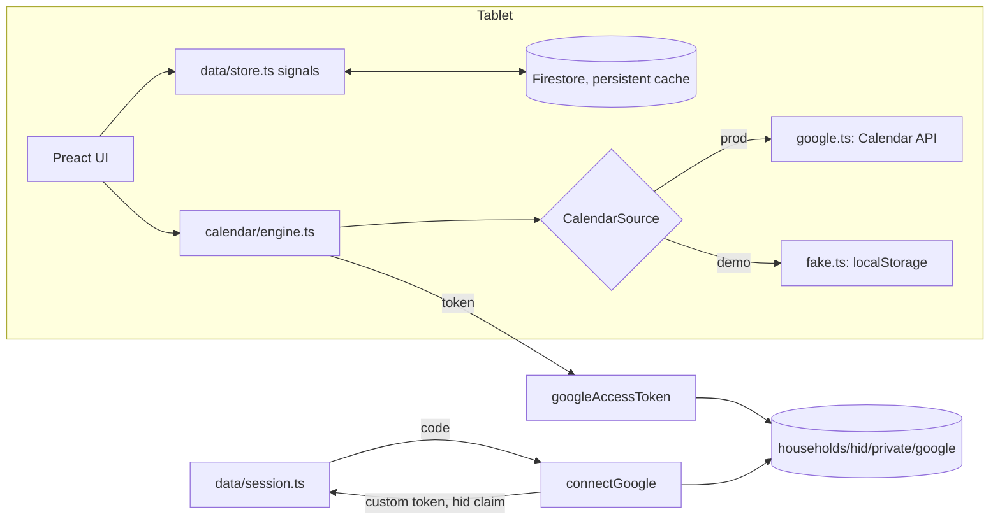

# Manwar: maintainer notes

Family wall-calendar web app for an Android tablet (landscape, Fully Kiosk
Browser), modeled on the Skylight Calendar 2 with Plus. Research and product
decisions: `research/README.md` (start there; the numbered reports hold the
detail and the images). Scope: Home, Calendar, Lists, Tasks, Rewards, Meals,
Recipes, Sleep, Settings. Not built: Photos, Disney, Magic Import, Sidekick.

## Accounts and infrastructure

- Firebase/GCP project `manwar-home` (owner faisal.shah@gmail.com). Pass
  `--account faisal.shah@gmail.com` to gcloud; the gcloud default is another
  account. `firebase` CLI login on this machine is stale; use gcloud or the
  GitHub workflow.
- GitHub repo `faisal-shah/manwar` (public). The default `gh` account is
  `faisal-shah-sabeel`; use `GH_TOKEN=$(gh auth token --user faisal-shah)` for
  repo admin.
- Deploys: `.github/workflows/deploy.yml` on push to main, keyless via
  Workload Identity Federation (pool `github`, provider `github`, restricted
  to this repo) as `github-deployer@manwar-home.iam.gserviceaccount.com`.
- Functions run as `manwar-functions@manwar-home.iam.gserviceaccount.com`.
  Secret `GOOGLE_OAUTH_CLIENT_SECRET` in Secret Manager; non-secret params in
  `functions/.env` (`GOOGLE_OAUTH_CLIENT_ID` must equal `googleClientId` in
  `src/config.ts`; `tests/unit/config.test.ts` checks).
- The OAuth client is the one Firebase auto-created for Google sign-in
  ("Web client (auto created by Google Service)"). Its client id and secret
  are readable from `identitytoolkit.googleapis.com/admin/v2/projects/manwar-home/defaultSupportedIdpConfigs/google.com`.
  Its registered JavaScript origins are `https://manwar-home.firebaseapp.com`
  and `http://localhost` (any port), not web.app, so the canonical origin is
  `manwar-home.firebaseapp.com` and `main.tsx` forwards web.app there. Editing
  the client's origins needs the Cloud Console (no public API).
- Household Google account: `household@example.com` (the only account
  `connectGoogle` accepts).
- Budget alert "manwar-home monthly", $10.

## Architecture

- **Data**: everything app-side is in Firestore under `households/{hid}/<collection>`
  (`src/data/types.ts` is the model; `Collections` in `store.ts` maps names
  to types). `data.<collection>` signals hold live snapshots; writes
  (`put`/`patch`/`remove`/`batch()`) apply locally at once, so UI code does
  not await them. `settings/main` is one document merged over
  `DEFAULT_SETTINGS` (`data/settings.ts`).
- **Calendar events** live in the household's Google calendars. `calendar/engine.ts`
  fetches the loaded window (`ensureRange` widens it), caches a snapshot in
  localStorage for offline display, polls every 3 minutes, and joins each
  event with `EventMeta` (Firestore `eventMeta`, keyed by
  `metaKey(calendarId, seriesId ?? id)`; instance keys override series keys).
  Events with no meta are **unassigned** and listed in `unassigned` (the
  triage queue, badge on the Calendar rail item). `[EVERYONE]` means the
  whole family.
- **Tasks**: `tasks/engine.ts` is pure (occurrences from schedules; late
  chores; Up for Grabs; repeat-after-done via `Task.lastDone`), unit-tested.
  `tasks/state.ts` has the reactive views and the writes. Stars use an
  append-only ledger (`ledger` collection) plus `Profile.stars` kept equal
  to the sum by `batch().stars()` in the same batch. Undo writes a reversing
  entry and marks the original `undoneAt`.
- **Parental lock** (`core/lock.ts`): with a PIN set, only checking off tasks
  is open; wrap every other mutation in `asParent(() => ...)` or
  `await requireParent()`.
- **Display** (`core/display.ts`): night window switches to the dark theme
  and dims (Fully Kiosk), sleep window blanks the screen, a tap wakes it for
  3 minutes.
- **Shell**: `app/tabs.tsx` lists the tabs; each feature exports a `TabDef`
  (`app/tab.ts`) from `src/features/<tab>/index.tsx` with `Body`, optional
  top-bar `Controls`, `onAdd` (the + button) and `title`.

## Layout system

The UI is drawn on a 1600x1000 design canvas: `html { font-size: min(0.625vw, 1vh) }`,
so `1rem` = 10 design px. Use rem for every size. Tokens are CSS variables in
`styles/base.css`; profile colors go in `--c` and are tinted with the
`.tint-solid`/`.tint-mid`/`.tint-light` helpers (or `color-mix` against
`--tint-base`) so dark mode works. Display text uses the serif
(`--font-display`, Newsreader), UI text the sans (Figtree).

## Running it

- Demo mode (`?demo` in the URL) runs against the Firebase emulators with a
  fake calendar and seeds a demo family on first load. Emulators need JDK 21:
  `tmux new -d -s manwar-emu 'JAVA_HOME=~/opt/jdk-21 PATH=~/opt/jdk-21/bin:$PATH npx firebase-tools@15 emulators:start --only auth,firestore,functions --project demo-manwar'`
  and `tmux new -d -s manwar-dev 'npx vite --port 5173 --host 0.0.0.0'`, then
  open `http://localhost:5173/?demo`. Restart the emulators to reset the demo
  data; clear localStorage key `manwar.demoCalendar.v1` to reset demo events.
- `?now=2026-11-04T11:44` pins the clock's start (screenshots, tests).
- Screenshots: `node tests/visual/shoot.mjs out.png "now=2026-11-04T11:44" [steps.json]`
  (`W`, `H`, `WAIT`, `BASE` env). Look at them; e2e tests only prove that
  things render.
- `npm test` (unit, `TZ=America/Chicago`), `npx tsc --noEmit`,
  `npm run test:e2e` (needs the emulators), `cd functions && npm test`.

## Gotchas

- Preact 11: element attribute types are `import type { ButtonHTMLAttributes } from 'preact'`, not `JSX.HTMLAttributes`.
- Firestore field paths cannot contain `*`; `lastDoneKey()` maps Up for Grabs to `any`.
- Overlays (`Sheet`, `Modal`, `Popover`) portal to `document.body`.
- The Google connection uses the Google Identity Services popup code flow
  (`redirect_uri` 'postmessage'), so only the page origin must be registered.
  Google returns a refresh token on the first consent only; `connectGoogle`
  keeps the stored one when a later connection returns none. Under Fully Kiosk,
  "Enable Popups" must be on for the consent window.
- Registered-or-not check without signing in: request
  `accounts.google.com/o/oauth2/v2/auth?client_id=...&redirect_uri=...` and
  look at the redirect; `signin/identifier` means registered, `authError`
  (base64, contains `redirect_uri_mismatch`) means not. For JS origins use
  `redirect_uri=storagerelay://https/<host>?id=x`.
- Worktrees under `.claude/worktrees/` with a symlinked `node_modules` need
  Vite's `server.fs.allow` widened, or font files return 403.

## Feature modules

- `features/calendar`: `index.tsx` (tab, `openEditor`, `ProgressStrip`),
  `model.ts` (per-day items; meals come from `features/meals/state.ts`
  `calendarMeals`), `views/` (Schedule, Day, Week, Month), `CalendarPane.tsx`
  (Home). Class prefixes `cal-`, `ev-`, `evd-`.
- `features/tasks` and `features/rewards`: Tasks filter is per device
  (localStorage). `TodayPane.tsx` fills the container Home gives it.
- `features/lists`, `features/meals`, `features/recipes`: pure logic in
  `logic.ts`, `plan.ts`, `ingredients.ts` (unit-tested); the ingredients
  modal merges into the default grocery list without duplicates;
  `MealCategoriesEditor` is mounted by Settings.
- `features/home`, `features/settings`, `features/messages`, `features/timer`:
  a running timer holds off scheduled sleep (`sleepHeldUntil` in
  `core/display.ts`).
