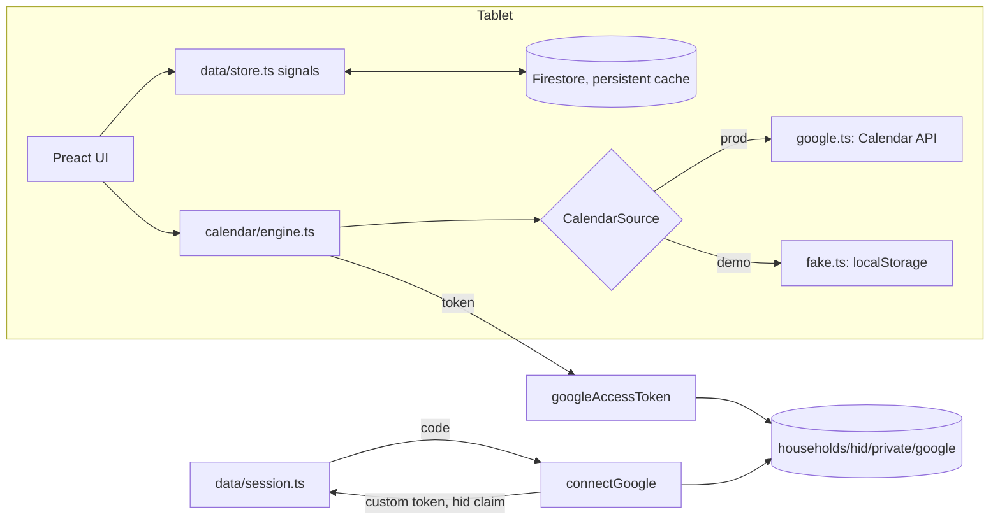

# Manwar: maintainer notes

Family wall-calendar web app for an Android tablet (landscape, Fully Kiosk
Browser), modeled on the Skylight Calendar 2 with Plus. Research and product
decisions: `research/README.md` (start there; the numbered reports hold the
detail and the images). Scope: Home, Calendar, Lists, Tasks, Rewards, Meals,
Recipes, Sleep, Settings. Not built: Photos, Disney, Magic Import, Sidekick.

## Deployment configuration

Everything that ties the repo to one deployment lives in a few places; the
docs refer to them rather than repeating the values. `<project>` below means
the default project in `.firebaserc`.

| What | Where |
|---|---|
| Firebase project | `.firebaserc` (default) |
| Web config (API key, app id, auth domain) and the OAuth client id | `src/config.ts`; hosts derive from it (`canonicalHost` = authDomain, `<project>.web.app` forwards there) |
| Functions params | `functions/.env`: `GOOGLE_OAUTH_CLIENT_ID` (must equal `googleClientId`; `tests/unit/config.test.ts` checks) and `FUNCTIONS_SERVICE_ACCOUNT` (the runtime account's full email) |
| Secrets | Secret Manager: `GOOGLE_OAUTH_CLIENT_SECRET`, `ALLOWED_ACCOUNTS` |
| Deploy identity | GitHub repository variables `GCP_WORKLOAD_IDENTITY_PROVIDER`, `GCP_DEPLOY_SERVICE_ACCOUNT` |

- Run gcloud as an account with Owner on the project (pass `--account` where
  the machine's gcloud default is a different account). Deploys go through
  `.github/workflows/deploy.yml` on push to main (or Run workflow), keyless
  via Workload Identity Federation (pool `github`, provider `github`,
  restricted to this repository) as the `github-deployer` service account.
  Repo admin (variables, alerts) needs a `gh` login with admin on the repo.
- Functions run as the `manwar-functions` service account. Give its full
  email: firebase-tools does not expand the `name@` short form when it
  grants the account access to secrets.
- The OAuth client is the one Firebase auto-created for Google sign-in
  ("Web client (auto created by Google Service)"). Its client id and secret
  are readable from `identitytoolkit.googleapis.com/admin/v2/projects/<project>/defaultSupportedIdpConfigs/google.com`.
  Its registered JavaScript origins are `https://<project>.firebaseapp.com`
  and `http://localhost` (any port), not web.app; editing them needs the
  Cloud Console (no public API).
- Accounts: each connected Google account is its own household (`hid` =
  `g` + the Google subject id); the Firestore rules keep households apart.
  Only accounts in the `ALLOWED_ACCOUNTS` secret (emails, comma separated)
  may connect or get Calendar tokens, so strangers cannot run up the bill.
  Change it with `gcloud secrets versions add ALLOWED_ACCOUNTS --data-file=- --project <project>`
  and redeploy the Functions (re-run the workflow). No account names belong
  in the repo.
- A monthly budget alert ($10) watches the project's billing.

## Architecture

- **Data**: everything app-side is in Firestore under `households/{hid}/<collection>`
  (`src/data/types.ts` is the model; `Collections` in `store.ts` maps names
  to types). `data.<collection>` signals hold live snapshots; writes
  (`put`/`patch`/`remove`/`batch()`) apply locally at once, so UI code does
  not await them. `settings/main` is one document merged over
  `DEFAULT_SETTINGS` (`data/settings.ts`). Firestore ends a listener for
  good on an error, so `listen()` in the store reports it (`loadError`,
  shown on the loading screen) and subscribes again after 30 seconds.
- **Several tablets, one household**: `put` (a whole document) is for new
  documents only. A change to an existing one writes only the fields it
  changes (`patch`, `saveEdited` for editors, `upsert` to create or merge,
  `fieldChanges` turns undefined into a field delete; `arrayUnion`/
  `arrayRemove` for one element of a list), so another tablet's change to
  the other fields survives, and a document deleted elsewhere is not
  written back. Writes start from the store's current document, not the
  copy an editor opened with. An editor or popover whose document is
  deleted elsewhere closes itself through `useCloseWhenGone`
  (`ui/overlays.tsx`), with a toast for an editor.
- **Calendar events** live in the household's Google calendars. `calendar/engine.ts`
  fetches a window around today (six weeks back, four months ahead, widened
  to the days the latest view asked for with `ensureRange`), caches a snapshot
  in localStorage for offline display, polls every 3 minutes, and joins each
  event with `EventMeta` (Firestore `eventMeta`, keyed by
  `metaKey(calendarId, seriesId ?? id)`). An occurrence's own document
  overrides its series' document field by field (empty `profiles` = inherit);
  write through `assign`/`setCountdown`/`updateEvent`, which touch only the
  document they mean to change. `refresh()` called during a fetch gets one
  more fetch after it, and a calendar that fails keeps its last events.
  Events with no meta are **unassigned** and listed in `unassigned` (the
  triage queue, badge on the Calendar rail item). `[EVERYONE]` means the
  whole family. Countdowns past the window (setting Always) come from
  `CalendarSource.nextOccurrence`. New events get their id from
  `newEventId()` once per editor, so a retried save updates instead of
  duplicating. The snapshot names its household; a change of household
  clears everything and drops another household's snapshot, and a fetch
  that outlives its household is discarded.
- **Google mapping** (`calendar/google.ts`, the API boundary): working
  locations, focus time, cancelled stubs and invitations the household
  declined are not on the wall; birthdays, Gmail events and locked copies
  are read-only (the API refuses their times and text); hidden details read
  Busy. Writes keep what the editor does not show: reminders are written
  only when the reminder was changed (`keepReminders`), notes only when the
  event had some or the editor gave some (`''` clears), every timed write names
  the event's own zones (the tablet's for new or formerly all-day events),
  All events leaves the series times out when they were not changed, a
  changed repeat replaces only the RRULE line (EXDATEs stay), and This and
  following copies guests, color and reminders to the new series and cuts
  the old one at the occurrence's `originalStart` (where the series had it,
  not where it was moved to). A 401 drops the cached token and retries once;
  requests give up after 30 seconds.
- **Tasks**: `tasks/engine.ts` is pure (occurrences from schedules; late
  chores; Up for Grabs; repeat-after-done via `Task.lastDone`), unit-tested.
  `tasks/state.ts` has the reactive views and the writes. Stars use an
  append-only ledger (`ledger` collection) plus `Profile.stars` kept equal
  to the sum by `batch().stars()` in the same batch. Undo writes a reversing
  entry and marks the original `undoneAt`. Every write there reads the
  current state from the store (never the caller's copy) and holds its keys
  through `exclusive()` until `onSnapshotsInSync` fires, since the local
  snapshot lags the write by milliseconds and a second tap in between would
  award or charge twice; writes return null when they did nothing.
  Check-offs on another day are stamped on that day (`madeAt`), and are
  written only for an occurrence still on that day (`stillOn`: not for a
  task deleted or reassigned on another tablet while its popover was open).
  `HISTORY_DAYS` bounds the task views, late carry-over, the writes and the
  store's `taskStates` query. The ledger listener holds the household's
  newest `LEDGER_LIVE` entries; the star history sheet reads older pages on
  Show older (`rewards/history-state.ts`, shown without Undo). Balances never
  depend on the window. Two devices completing the same occurrence in the
  same instant can still both award (the balance is an increment).
- **Parental lock** (`core/lock.ts`): with a PIN set, only checking off tasks
  is open; wrap every other mutation in `asParent(() => ...)` or
  `await requireParent()`. Repeated wrong PINs pause the pad
  (`core/pin.ts`, in memory). The Calendar filter is a view preference and
  stays open.
- **Display** (`core/display.ts`): night window switches to the dark theme
  and dims (Fully Kiosk), sleep window blanks the screen, a tap wakes it and
  it stays awake until 3 minutes pass without a touch. "Sleep now" is kept in
  localStorage so a reload at night does not light the screen.
- **Activity** (`core/activity.ts`): the one source of "someone is using the
  wall" (pointer, key and input events; the on-screen keyboard sends no
  pointer events). Idle return, relock, sleep and the update check read it.
- **Shell**: `app/tabs.tsx` lists the tabs; each feature exports a `TabDef`
  (`app/tab.ts`) from `src/features/<tab>/index.tsx` with `Body`, optional
  top-bar `Controls`, `onAdd` (the + button) and `title`.

## Layout system

The UI is drawn on a 1600x1000 design canvas: `html { font-size: min(0.625vw, 1vh) }`,
so `1rem` = 10 design px. Use rem for every size. Tokens are CSS variables in
`styles/base.css`; profile colors go in `--c` and are tinted with the
`.tint-solid`/`.tint-mid`/`.tint-light` helpers (or `color-mix` against
`--tint-base`) so dark mode works. Display text uses the serif
(`--font-display`, Newsreader), UI text the sans (Figtree).

## Running it

- Demo mode (`?demo` in the URL) runs against the Firebase emulators with a
  fake calendar and seeds a demo family on first load. Emulators need JDK 21:
  `tmux new -d -s manwar-emu 'JAVA_HOME=~/opt/jdk-21 PATH=~/opt/jdk-21/bin:$PATH npx firebase-tools@15 emulators:start --only auth,firestore,functions --project demo-manwar'`
  and `tmux new -d -s manwar-dev 'npx vite --port 5173 --host 0.0.0.0'`, then
  open `http://localhost:5173/?demo`. Restart the emulators to reset the demo
  data; clear localStorage key `manwar.demoCalendar.v1` to reset demo events.
- `?now=2026-11-04T11:44` pins the clock's start (screenshots, tests).
- `?seed=none` (with `?demo=<new name>`) seeds a demo household the way a
  real one starts: no people, only the Grocery List. A household is seeded
  once in its life: the seed sets `settings.seededAt`, and a household
  with people or lists gets it set too. Seeding runs only after a server
  read confirms the household was never seeded and is empty (an offline
  start with a cold cache must not seed; it asks again every 20 seconds
  until the server answers), and the real seed uses the fixed list id
  `grocery` so two tablets on their first run do not make two lists.
- Screenshots: `node tests/visual/shoot.mjs out.png "now=2026-11-04T11:44" [steps.json]`
  (`W`, `H`, `WAIT`, `BASE` env). Look at them; e2e tests only prove that
  things render.
- `npm test` (unit, `TZ=America/Chicago`), `npx tsc --noEmit`,
  `npm run test:e2e` (needs the emulators), `cd functions && npm test`.

## Brand

`src/ui/brand.ts` is the one definition of the name: the Arabic مَنْوَر is
the name and logo everywhere (nav rail, tab title, manifest, icons); the
transliteration "Manwar" and the meaning accompany it on the sign-in screen
and in Settings > About (`Wordmark`, `LogoMark` in `src/ui/Logo.tsx`, Reem
Kufi 700 with full diacritics). The PNG icons and `docs/logo.png` are
generated from it: `node scripts/icons/render.mjs` after any brand change.

## Gotchas

- Preact 11: element attribute types are `import type { ButtonHTMLAttributes } from 'preact'`, not `JSX.HTMLAttributes`.
- Firestore field paths cannot contain `*`; `lastDoneKey()` maps Up for Grabs to `any`.
- Overlays (`Sheet`, `Modal`, `Popover`) portal to `document.body`. Their
  scrims close through `useScrimClose`, which lets the second tap of the
  double tap that opened them through; use it for any custom scrim. In
  e2e tests, close by tapping away from the control that opened it.
- The Google connection uses the Google Identity Services popup code flow
  (`redirect_uri` 'postmessage'), so only the page origin must be registered.
  Google returns a refresh token on the first consent only; `connectGoogle`
  keeps the stored one when a later connection returns none. Under Fully Kiosk,
  "Enable Popups" must be on for the consent window.
- Sessions (`data/session.ts`): the household id is the ID token's `hid`
  claim. Reading claims refreshes an expired token, which fails offline, so
  the last household is remembered per user (`manwar.claims.v1`) and
  opened from it; with nothing remembered the screen waits for the network.
  Show Firebase errors with `errorMessage()` (`data/errors.ts`): the
  Functions SDK appends " [403]" and reports a failed request as
  "internal [0]". A token refusal only a reconnect fixes sets
  `googleProblem`; the top bar then offers the reconnect, and a calendar
  whose sync keeps failing says how old its events are (`app/status.ts`).
- Registered-or-not check without signing in: request
  `accounts.google.com/o/oauth2/v2/auth?client_id=...&redirect_uri=...` and
  look at the redirect; `signin/identifier` means registered, `authError`
  (base64, contains `redirect_uri_mismatch`) means not. For JS origins use
  `redirect_uri=storagerelay://https/<host>?id=x`.
- Worktrees under `.claude/worktrees/` with a symlinked `node_modules` need
  Vite's `server.fs.allow` widened, or font files return 403.

## Feature modules

- `features/calendar`: `index.tsx` (tab, `openEditor`, `ProgressStrip`),
  `model.ts` (per-day items; meals come from `features/meals/state.ts`
  `calendarMeals`), `views/` (Schedule, Day, Week, Month), `CalendarPane.tsx`
  (Home). Class prefixes `cal-`, `ev-`, `evd-`.
- `features/tasks` and `features/rewards`: Tasks filter is per device
  (localStorage). `TodayPane.tsx` fills the container Home gives it.
- `features/lists`, `features/meals`, `features/recipes`: pure logic in
  `logic.ts`, `plan.ts`, `ingredients.ts` (unit-tested); the ingredients
  modal merges into the default grocery list without duplicates;
  `MealCategoriesEditor` is mounted by Settings.
  - "Already on the list" (`itemKey`) and recipe search ignore case,
    accents and Arabic diacritics (`lib/text.ts` `fold`); an emoji-only
    item is its own key. Ingredient lines lose pasted bullets and "1."
    numbering (`stripMarker`) on save and on display.
  - The `isDefaultGrocery` flag only ever passes to a grocery list (on
    delete, or to a new grocery list when none has it); with none, the
    next Add to grocery list makes a "Grocery List".
  - `IngredientsHost` is mounted once in `app/tabs.tsx` `Overlays`, so
    `openIngredients` works from any tab (the planned-meal toast).
  - Editing one occurrence of a repeating meal goes through
    `plan.editOccurrence`; moving it to another day shifts a weekly
    rule's weekdays with it.
- `features/home`, `features/settings`, `features/messages`, `features/timer`:
  a running timer holds off scheduled sleep (`sleepHeldUntil` in
  `core/display.ts`).
