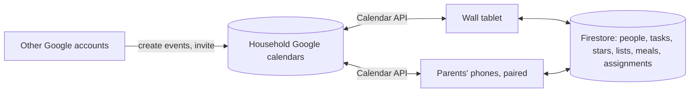

# مَنْوَر · Manwar

_Manwar_ (مَنْوَر), from نور (light), is Arabic for a skylight: a place where
light comes in.

A family wall calendar for a tablet, in the spirit of the Skylight Calendar 2
with Plus: the household's Google calendars color-coded by person, chores and
routines with stars and rewards, lists, a weekly meal plan and recipes. The
tablet's second face is a prayer-time clock with the athan. Parents' phones
pair with the wall and get a companion app on the same address.

Live: the Firebase Hosting address of the project in `.firebaserc` (its auth
domain, in `src/config.ts`).

The product research behind it, with screenshots, is in
[research/](research/README.md).

## What it does

| Tab          |                                                                                                                                                         |
| ------------ | ------------------------------------------------------------------------------------------------------------------------------------------------------- |
| **Home**     | Calendar, today's tasks and lists side by side; timer; wall messages                                                                                    |
| **Calendar** | Schedule (1-7 day time grid), Day, Week and Month views; filter by person; countdowns; events created here are saved to the household's Google calendar |
| **Lists**    | Grocery, to-do and other lists with sections; checked items sink to Done                                                                                |
| **Tasks**    | A column per person: morning, afternoon and evening routines and chores, with stars, late chores and Up for Grabs                                       |
| **Rewards**  | Rewards each person can redeem with stars; full star history with undo                                                                                  |
| **Meals**    | A week of breakfast, lunch, dinner and snacks; planned meals show on the calendar                                                                       |
| **Recipes**  | Recipes with ingredients and steps; add ingredients to the grocery list                                                                                 |
| **Prayer**   | The prayer-time clock: full-screen themes, the athan with a countdown and the dua after it, the iqamah countdown, a night clock                         |

**Sleep** blanks the screen on a schedule or on demand; a tap wakes it, and
it stays awake while someone is using it.
**Settings** covers people, calendars, display (night mode, text size, hidden
tabs), weather, the parental PIN and meal categories.

### Two faces: family and prayer

The tablet shows either the family calendar or the prayer clock; the
**Prayer** button on the left switches to the prayer clock, and the calendar
button under its gear switches back. Whichever is showing, each prayer's
athan comes to the front with its one-minute countdown, plays, and then hands
the screen back; it wakes a sleeping wall too (an athan whose sound is turned
off shows only while the wall is awake). A note or timer sent from a phone
brings the family face
(after the athan, if one is playing), and the wall's own chimes wait for the
athan to end. After three minutes without a touch, and at night, the tablet
goes back to its resting screen (Settings → Display → Resting screen: Family
or Prayer times; resting on Prayer times, the night screen is the prayer
clock's dim night clock). The prayer clock's gear opens its own settings
(location, calculation, iqamah, Jumu'ah, athans, themes, photos); they are
the household's, so a parent's phone can change them too.

### Who an event belongs to

Events live in the Google account the wall is signed in with. On the wall,
each event is assigned to one or more people (or Everyone); the assignment is
stored by the app and never shows in Google Calendar. Events
that arrive from elsewhere start unassigned: they show in grey and wait in
**Calendar → To assign** until a parent picks who they are for. Events on
Google's holiday calendars (Holidays in United States, Islamic holidays and
the like) are the whole family's from the start and never wait there.

### Who can sign in

Any Google account can be the wall's account, but only accounts on the
deployment's allowlist can connect (the `ALLOWED_ACCOUNTS` secret in the
Firebase project's Secret Manager; see [CLAUDE.md](CLAUDE.md)). Everyone else
gets a "not on the allowlist" message, so strangers cannot use the backend.

### Kid mode

With a parent PIN set (Settings → Parental lock), anyone can browse and check
off tasks and list items. Adding, editing, deleting, giving stars and
redeeming rewards ask for the PIN, which then stays unlocked until the tablet
has been idle for a few minutes. After five wrong PINs in a row the pad pauses
for 30 seconds, longer after each further five.

### Parents' phones

A parent's phone opens the same address and gets a phone app for the jobs a
parent does away from the wall: today at a glance, checking off a chore for a
child, giving or taking stars and redeeming rewards, lists, the calendar
(with adding events and assigning new ones), a note that pops up on the wall,
the wall's timer, putting the wall to sleep or waking it, the meal plan, the
family's people (added, edited, reordered and deleted as in the wall's
Settings → Profiles), and the prayer times (More → Prayer times: the place,
how the times are calculated, iqamah and Jumu'ah, and each athan's
recording and volume; Today shows the next prayer).

Phones are paired from the wall only: **Settings → Phones → Add a phone**
asks for the PIN and shows a code for ten minutes; scan it with the phone's
camera (or type it on the phone) and name the phone. A paired phone never
asks for the PIN. The wall lists the paired phones and removes them; a phone
can also unpair itself (**More → This phone**). A phone keeps the household's
data in memory only, so a lost or removed one keeps none of it.

## Setting up the tablet

1. Open the live address above in Chrome on the Android tablet and choose
   **Install app** (Chrome's menu). The installed app plays the athan without
   a tap and keeps the screen on while it is open; keep it in front (a
   tablet asleep or showing another app plays nothing).
   **Fully Kiosk Browser** is the alternative that also starts the app when
   the tablet boots and dims the backlight at night: set its start URL to
   the live address, and in its settings turn on Web Content Settings →
   **Enable Popups** (needed once, for the Google consent window), Web Content
   Settings → **Autoplay audio** (the athan and chimes), and Advanced Web
   Settings → **Enable JavaScript Interface** (dimming and blanking the
   screen).
2. Open the app, tap **Connect Google account** and sign in with the Google
   account whose calendars the wall should show (a shared family account
   works well). Google warns that the app is unverified: choose
   **Advanced → Go to Manwar**, then allow calendar access (leave both
   calendar permissions ticked; the wall refuses a connection without them).
   Each Google account gets its own household: its own people, tasks, lists
   and meals.
3. In Settings, add the family's profiles, pick the weather location and set a
   parental PIN.
4. Tap **Prayer** and choose where the family lives (or set it from a paired
   phone, More → Prayer times); the prayer clock's gear has the rest.
5. Pair the parents' phones: Settings → Phones → Add a phone.

If the wall loses its Google connection (access revoked, or the calendar
has not synced for a while), the top bar says so; tap the note to reconnect
in Settings → Google Calendar.

A paired phone adds events in its Calendar tab, saved to the household's
Google calendar. Events can also be created in that Google account's
calendar, or that account invited to an event from your own Google account.
To have a whole personal calendar appear, share it with that account.

## Development

See [CLAUDE.md](CLAUDE.md) for the architecture, the demo mode against the
Firebase emulators, and the test commands. Pushes to `main` run the tests and
deploy hosting, Firestore rules and Cloud Functions.
