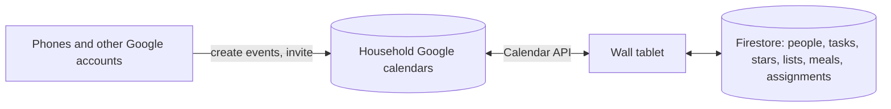

# مَنْوَر · Manwar

*Manwar* (مَنْوَر), from نور (light), is Arabic for a skylight: a place where
light comes in.

A family wall calendar for a tablet, in the spirit of the Skylight Calendar 2
with Plus: the household's Google calendars color-coded by person, chores and
routines with stars and rewards, lists, a weekly meal plan and recipes.

Live: **https://manwar-home.firebaseapp.com** (`manwar-home.web.app` forwards
there).

The product research behind it, with screenshots, is in
[research/](research/README.md).

## What it does

| Tab | |
|---|---|
| **Home** | Calendar, today's tasks and lists side by side; timer; wall messages |
| **Calendar** | Schedule (1-7 day time grid), Day, Week and Month views; filter by person; countdowns; events created here are saved to the household's Google calendar |
| **Lists** | Grocery, to-do and other lists with sections; checked items sink to Done |
| **Tasks** | A column per person: morning, afternoon and evening routines and chores, with stars, late chores and Up for Grabs |
| **Rewards** | Rewards each person can redeem with stars; full star history with undo |
| **Meals** | A week of breakfast, lunch, dinner and snacks; planned meals show on the calendar |
| **Recipes** | Recipes with ingredients and steps; add ingredients to the grocery list |

**Sleep** blanks the screen on a schedule or on demand; a tap wakes it.
**Settings** covers people, calendars, display (night mode, text size, hidden
tabs), weather, the parental PIN and meal categories.

### Who an event belongs to

Events live in the Google account the wall is signed in with. On the wall,
each event is assigned to one or more people (or Everyone); the assignment is
stored by the app and never shows in Google Calendar. Events
that arrive from elsewhere start unassigned: they show in grey and wait in
**Calendar → To assign** until a parent picks who they are for.

### Who can sign in

Any Google account can be the wall's account, but only accounts on the
deployment's allowlist can connect (the `ALLOWED_ACCOUNTS` secret in the
Firebase project's Secret Manager; see [CLAUDE.md](CLAUDE.md)). Everyone else
gets a "not on the allowlist" message, so strangers cannot use the backend.

### Kid mode

With a parent PIN set (Settings → Parental lock), anyone can browse and check
off tasks and list items. Adding, editing, deleting, giving stars and
redeeming rewards ask for the PIN, which then stays unlocked until the tablet
has been idle for a few minutes.

## Setting up the tablet

1. Install **Fully Kiosk Browser** on the Android tablet and set its start URL
   to `https://manwar-home.firebaseapp.com`.
2. In Fully: Web Content Settings → **Enable Popups** on (needed once, for the
   Google consent window); Web Content Settings → **Autoplay audio** on (chimes);
   Advanced Web Settings → **Enable JavaScript Interface** on (lets the app dim
   and blank the screen at night).
3. Open the app, tap **Connect Google account** and sign in with the Google
   account whose calendars the wall should show (a shared family account
   works well). Google warns that the app is unverified: choose
   **Advanced → Go to Manwar**, then allow calendar access. Each Google
   account gets its own household: its own people, tasks, lists and meals.
4. In Settings, add the family's profiles, pick the weather location and set a
   parental PIN.

To add events from a phone, create them in that Google account's calendar,
or invite that account to an event from your own Google account. To have a
whole personal calendar appear, share it with that account.

## Development

See [CLAUDE.md](CLAUDE.md) for the architecture, the demo mode against the
Firebase emulators, and the test commands. Pushes to `main` run the tests and
deploy hosting, Firestore rules and Cloud Functions.
