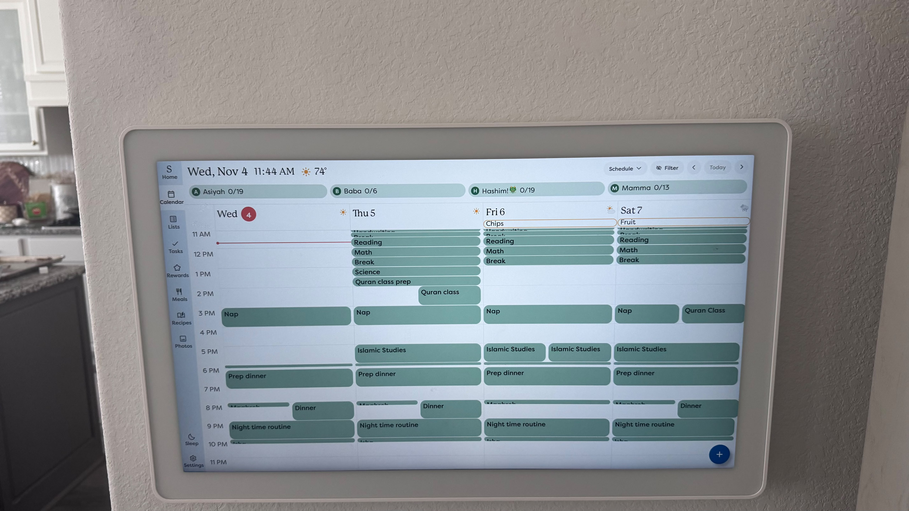
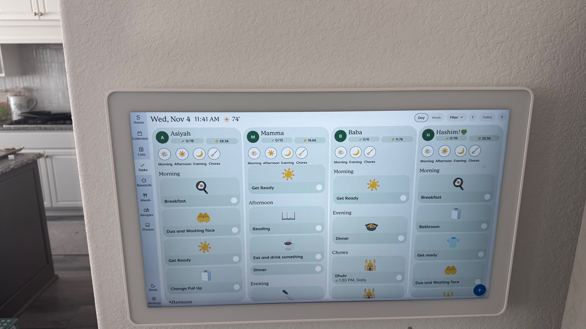

# The user's own Skylight device (photos, 2026-11-04)

Two photos of the user's wall-mounted Skylight, taken 2026-11-04 around 11:40.
The hardware may be the original 15" Calendar rather than Calendar 2; the
software is what the family uses day to day. Treat these as the real-world
reference for how the family uses the product, and cross-check visual details
against the Calendar 2 captures in [04-ui-gallery-and-design.md](04-ui-gallery-and-design.md).

Scope confirmed by the user from these tabs: **Calendar, Lists, Tasks, Rewards,
Meals, Recipes** (plus the Home, Sleep and Settings chrome). **Photos is out.**

## Calendar tab, "Schedule" view

### Global chrome

- **Left nav rail** (narrow, full height, slightly darker than the content).
  Icon above a small sans label, top to bottom:
  `S` logo "Home", Calendar (calendar glyph), Lists (list glyph), Tasks
  (check mark), Rewards (star outline), Meals (fork and knife), Recipes (open
  book), Photos (picture glyph). Pinned at the bottom: Sleep (crescent moon),
  Settings (gear). The selected tab has a lighter tile behind it.
- **Top bar**, left: `Wed, Nov 4  11:44 AM  [sun] 74°` in a large serif face
  (moderate contrast, book-like). Weather is an icon plus the current
  temperature, no unit letter.
- **Top bar**, right (calendar): view dropdown labelled with the current view
  (`Schedule ▾`), `Filter` with an eye-slash icon, `<`, `Today`, `>`. Controls
  are low-contrast pills on the light background.
- **Floating action button**: a dark blue circle with a white `+`, bottom right.
- **Background**: a pale blue wash that shifts toward teal/grey, with white-ish
  translucent surfaces on top of it.

### Profile row

Under the top bar, one pill per family member, sharing the full width equally:
`(A) Asiyah 0/19`, `(B) Baba 0/6`, `(H) Hashim! [frog emoji] 0/19`,
`(M) Mamma 0/13`.

- Avatar is a dark green circle with a white initial.
- Display names can contain punctuation and emoji ("Hashim!" plus an emoji).
- `0/19` is tasks completed / tasks due today for that profile (same numbers
  as the Tasks tab, see below). The calendar therefore surfaces task progress.
- All four profiles use the same dark green avatar and the same teal event
  color in this household, so profile color is a per-profile setting that this
  family left uniform (or chose identically).

### Time grid

- Four day columns: `Wed 4`, `Thu 5`, `Fri 6`, `Sat 7` (today plus the next
  three). Day name and date number in the serif face; today's number sits in a
  red filled circle.
- A small weather icon at the right of each day header (sun, sun, sun behind
  cloud, cloud with precipitation), i.e. a daily forecast per column.
- Hour labels on the left (`11 AM` … `11 PM`); faint horizontal hour lines;
  the grid is vertically scrolled so the current time sits near the top.
- **Now line**: thin red horizontal line with a dot at its left end, drawn
  across today's column only.
- **Timed events**: filled, rounded rectangles in a muted teal with dark text,
  title at the top-left, no time shown in the block. Block height is
  proportional to duration.
- **Overlap**: concurrent events split the column into side-by-side lanes
  (`Nap` + `Quran Class` on Sat; `Islamic Studies` twice on Fri; a short
  prayer event + `Dinner` at 8 PM). Lane width is shared evenly.
- **Short events** (10-15 min, e.g. `Handwriting`, `Break`, prayer times) are
  drawn as thin bars whose text is clipped rather than hidden, so their
  presence is visible even when unreadable.
- **All-day items** (`Chips` on Fri, `Fruit` on Sat) are outlined pills (light
  fill, warm tan border) in a strip under the day header. These look like
  meal-plan snacks surfacing on the calendar; to be confirmed in
  [03-tasks-rewards-lists-meals.md](03-tasks-rewards-lists-meals.md).

### What the family puts on it

Homeschool blocks (Handwriting, Break, Reading, Math, Science, Quran class
prep), Quran class, Islamic Studies, Nap, Prep dinner, Dinner, prayer times
(Maghrib, Isha; Dhuhr appears as a task), Night time routine. Most are
recurring weekday/weekly events. Prayer times are entered by hand as events or
tasks today; automatic prayer-time events would remove that chore.

## Tasks tab, "Day" view

- **Top bar right**: `Day | Week` segmented control (Day selected, outlined
  pill), `Filter ▾`, `<`, `Today`, `>`.
- **One column card per profile** (Asiyah, Mamma, Baba, Hashim), rounded
  corners, translucent light surface. Column order here differs from the
  calendar's profile row (Asiyah, Mamma, Baba, Hashim vs Asiyah, Baba, Hashim,
  Mamma).
- **Column header**: avatar circle, name in the serif face, then two pills:
  `✓ 0/19` (done/due today) and `☆ 28.5K` (star balance; also 19.6K, 11.7K,
  32.5K). Balances in the tens of thousands imply either large per-task star
  values or long accumulation without redemption. The balance is abbreviated
  with K.
- **Section shortcuts**: a row of circular icon buttons with labels:
  Morning (sun behind cloud), Afternoon (sun), Evening (crescent moon), Chores
  (broom). A profile with no Afternoon items shows only Morning, Evening,
  Chores, so empty sections are omitted. Tapping one presumably scrolls the
  column to that section.
- **Section headers** in the serif face: Morning, Afternoon, Evening, Chores.
  Morning/Afternoon/Evening are routine time-of-day groups; Chores is its own
  group.
- **Task card**: rounded tile; a large emoji centered in the upper part
  (frying pan with egg "Breakfast", open palms "Dua and Washing face", sun
  "Get Ready", toilet roll "Change Pull Up", open book "Reading", hot drink
  "Eat and drink something", pot of food "Dinner", mosque "Dhuhr", T-shirt
  "Get ready", toilet roll "Bathroom"); title at the bottom-left in a sans
  semibold; an empty white completion circle at the bottom-right.
- **Compact card**: a task with no emoji (`Dinner` under Mamma) renders as a
  single short row with only the title and the circle.
- **Subtitle**: a chore can show its time and repeat rule, e.g.
  `⟳ 1:30 PM, Daily` under `Dhuhr`.
- Columns scroll independently; cards continue below the fold.
- Same blue `+` FAB bottom right.

## Design cues to carry into the build

- Serif display face for dates, names and section headers; clean sans for
  event titles, labels and controls.
- Soft, low-contrast surfaces on a pale tinted background; color comes from
  profile colors and emoji, not from chrome.
- Generous touch targets (task cards are roughly 1/4 column wide by 1/10
  screen tall even in compact mode).
- Glanceable progress everywhere: done/due counts on the calendar profile row
  and the task headers; star balances on task headers.
