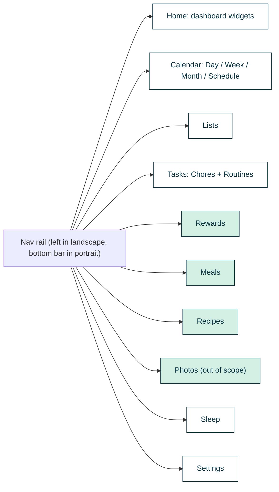
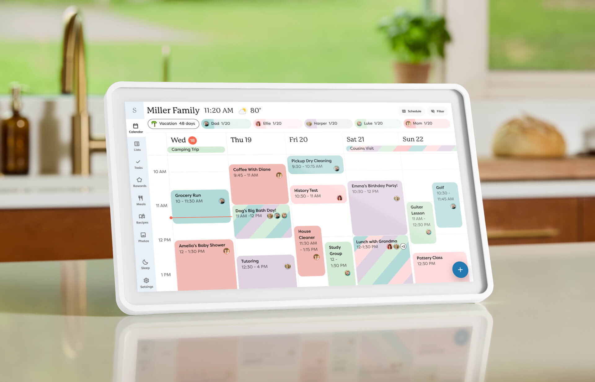
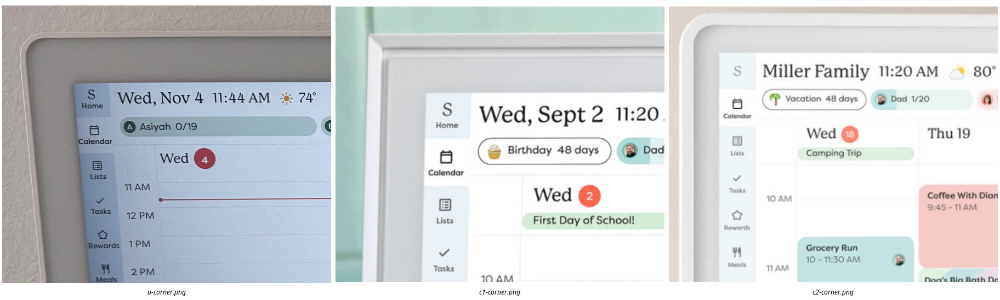
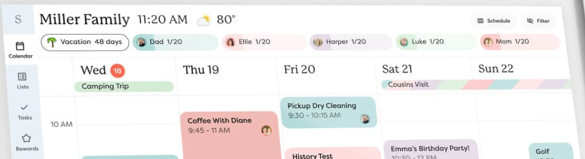
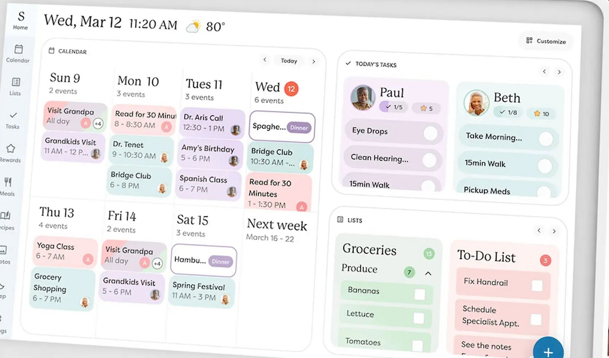
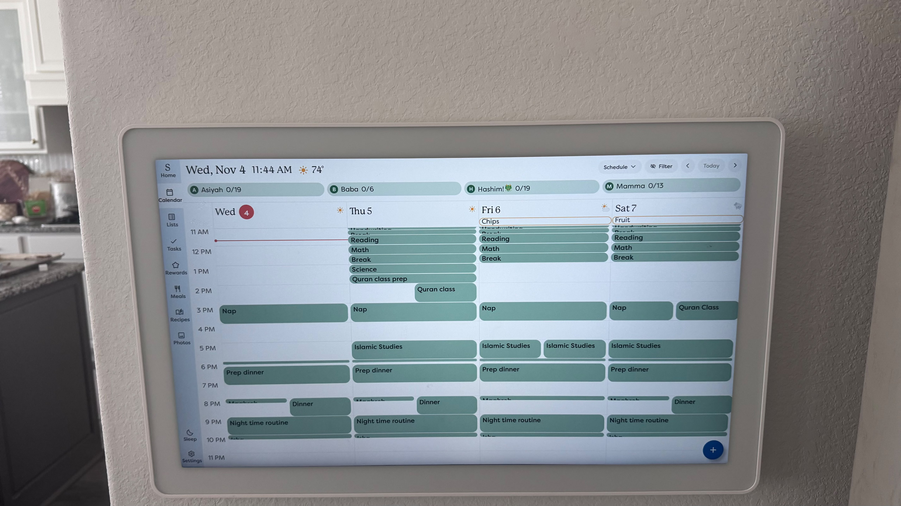
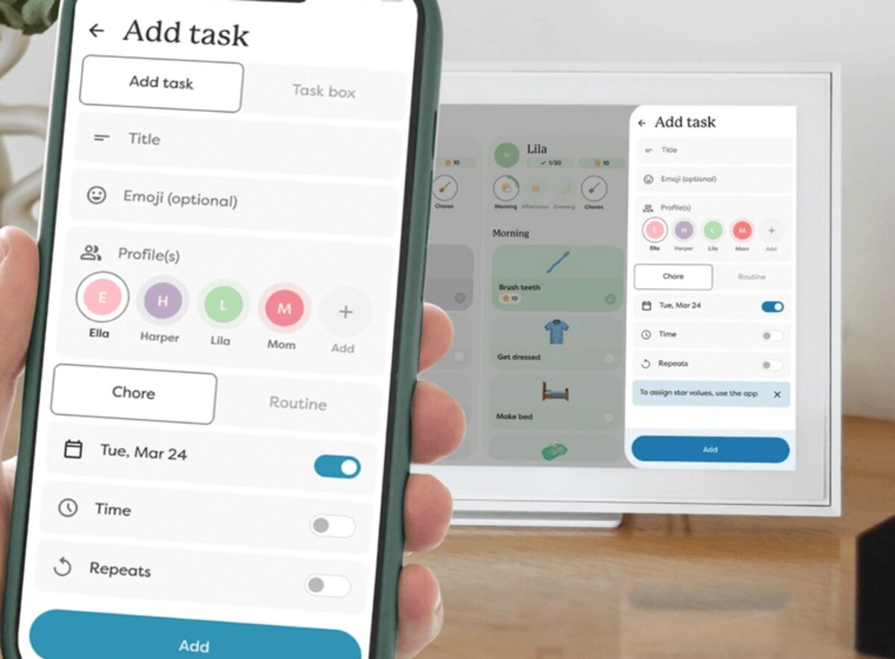
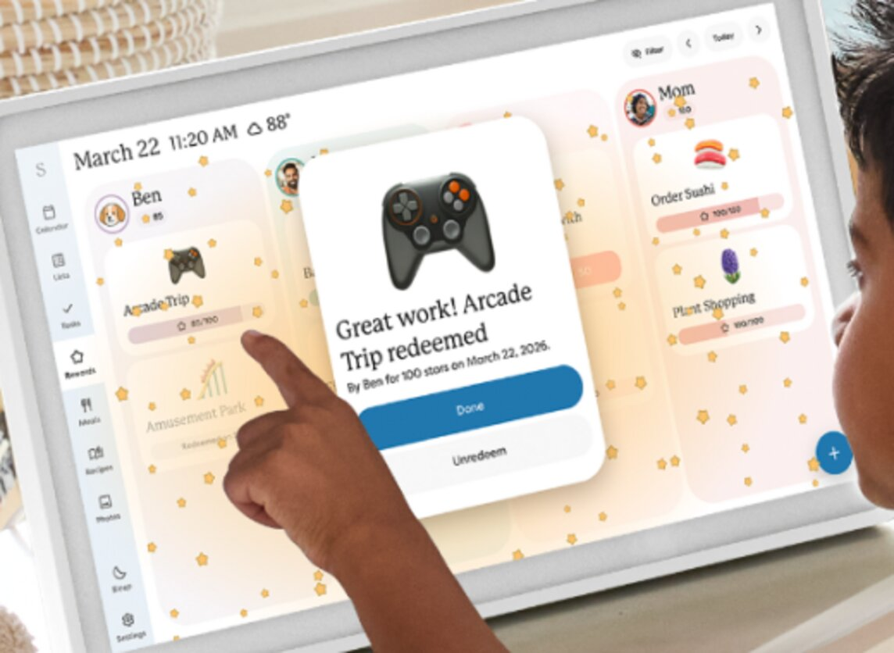
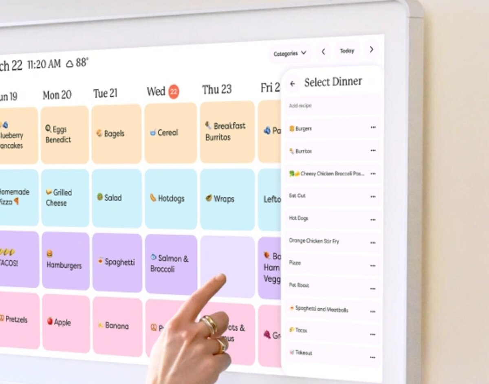

# 01 - Skylight Calendar 2 with Plus: product, hardware, plans, marketed UI

Research slice: myskylight.com product/marketing pages, hardware, plan tiers, and
product imagery. Captured 2026-11-04. All images live in
`assets/product/` (104 files, about 16 MB, every file under 1.4 MB).

Conventions used below:

- **States:** = the source says this verbatim or near-verbatim.
- **Observed:** = visible in a marketing render or screenshot (I looked at it).
- **Inferred:** = my interpretation; verify before building on it.

Out of scope for the clone, so only catalogued and not analysed: Disney Mode,
Magic Import (Sidekick event import), Photo Screensaver/albums.

---

## 1. Overview

Skylight Calendar is a Wi-Fi touchscreen family hub. It merges synced external
calendars with on-device profiles, a chore/routine checklist, custom lists,
and (paid) rewards, meal planning, and recipes. A mobile app (iOS/Android) and
a web portal (`app.ourskylight.com`, "Skylight Cloud") edit the same data.

Product family as sold on 2026-11-04:

| Model | Screen | Status |
|---|---|---|
| 10" Calendar | 10" FHD (per compare page) | current, countertop only |
| 15" Calendar (original, now "with Refurbished Memory") | 15" FHD | current, budget option |
| **15" Calendar 2** | 15" FHD | flagship, launched 2026-03-17 |
| 27" Calendar Max | 27" QHD | current, wall only |
| Calendar for Care | Calendar 2 hardware with a care-focused setup | current |

**States (calendar page FAQ):** "Both devices run the same Skylight software, so
all Calendar families continue to enjoy the same powerful free and paid features."
The 10", 15", Calendar 2, and Calendar Max therefore share one software UI. The
differences are screen size, orientation, and hardware.

The software UI shell, as currently shipped (from marketing renders dated 2026
and the user's own device photos):

Green nodes mark tabs whose content is a Plus feature. **Inferred:** whether a
non-Plus device hides those tabs or shows them with an upsell is not stated
anywhere.

---

## 2. Hardware

### 2.1 Calendar 2 (the model being cloned)

| Spec | Value | Source |
|---|---|---|
| Screen | 15" diagonal | PDP "Product Details" |
| Resolution | 1920 x 1080 FHD | PDP, compare page |
| Dimensions | 15" x 9.12" x 1.13" | PDP, compare page (Reviewed.com measured 15.8 x 9.9 x 1.4 in, presumably with frame) |
| Storage | 16 GB | PDP, compare page |
| Memory | 3 GB | compare page (Calendar 1: 2 GB; Max: 4 GB) |
| Frame | Removable magnetic Snap Frame | PDP |
| Mounting | "Adjustable tilt-capable countertop stand & wall Mount with bubble level" | PDP |
| Stand | "180° Tabletop Stand: A flexible stand makes viewing easy on the eyes (portrait-mode only)" | PDP image 12 (see open questions) |
| Performance | "3x" processing speed vs original | 2026-03-17 press release (via search results) |
| Display | "brighter display"; Reviewed.com: "60% brighter than the original, per Skylight" | PDP copy; Reviewed |
| Auto-brightness | Yes | PDP image 12 |
| Power | Plug-in only, no battery | FAQ |
| Connectivity | Wi-Fi; "needs a WiFi connection at all times to operate" | FAQ |
| Speakers | Not listed for Calendar 2 (listed for Max) | PDP specs |

Snap Frame styles and colors (from gallery filenames and the style picker):
Classic (White, Black, Sage, Lagoon), Wood (Walnut, Birch), Shadow Box
(Charcoal, Silver). **States (search result, accessory page):** Calendar 2 Snap
Frames are not compatible with Calendars sold before 2026-02-18.

### 2.2 Lineup comparison (compare-calendars page, parsed from the HTML table)

| | 10" Calendar | 15" Calendar (Refurb. Memory) | 15" Calendar 2 | 27" Calendar Max |
|---|---|---|---|---|
| Dimensions | 11.75" x 8.5" x 1.25" | 15.37" x 9.37" x 1.25" | 15" x 9.12" x 1.13" | 26.13" x 16" x 1.5" |
| Placement | Countertop | Countertop or Wall | Countertop or Wall | Wall |
| Snap Frames | Not available | Not available | Classic, Wood, Shadow Box | Classic, Wood, Shadow Box |
| Storage | 16 GB | 16 GB | 16 GB | 16 GB |
| Memory | 2 GB | 2 GB (Refurbished) | 3 GB | 4 GB |
| Resolution | 1920 x 1080 FHD | 1920 x 1080 FHD | 1920 x 1080 FHD | 2560 x 1440 QHD |
| "Starting at" (2026-11-04) | $149.99 | $249.99 | $289.99 | $569.99 |
| Free features row | Sync, Chore Chart & Task Manager, Custom Lists, Mobile App | same | same | same |

### 2.3 Calendar Max (27") differences

- **States:** "the same features loved in our 15" and 10" versions, but boasts a
  27" diagonal screen and is exclusively designed for wall mounting." Cannot be
  placed on a stand.
- **States:** "can be mounted in a landscape or portrait orientation, and it
  adjusts automatically." Anti-glare screen. Dual 4-watt speakers. 12 V adapter.
  Wall bracket with bubble level.
- **States (FAQ):** no new Calendar Max is planned.
- **Observed UI differences** (these come from orientation and size, not
  different features):
  - Portrait: the nav rail moves to a bottom bar
    ([maxpdp-02](assets/product/maxpdp-02-chores-portrait.jpg),
    [maxpage-hero](assets/product/maxpage-hero-portrait-tasks.jpg)).
  - Portrait meal plan transposes the grid: days become rows and meal
    categories become columns
    ([maxpdp-05](assets/product/maxpdp-05-meal-plan-portrait.jpg)).
  - Portrait schedule shows 3 days instead of 5
    ([maxpage-portrait-schedule-3day](assets/product/maxpage-portrait-schedule-3day.jpg)).
  - The 27" landscape fits 5-6 profile columns on Rewards/Tasks
    ([detail-calmax-rewards-redeem-button](assets/product/detail-calmax-rewards-redeem-button.jpg)).

### 2.4 Calendar (original) vs Calendar 2

- **States (FAQ):** "Calendar 2 introduces several long-requested upgrades,
  including interchangeable Snap Frames, a redesigned tabletop stand, and
  improved processing power. Both devices run the same Skylight software."
- **Observed:** the original has a rectangular, picture-frame bezel with square
  corners, a visible inner mat step, and a metal bar stand. Calendar 2 has a
  thick bezel with large rounded corners, modelled on Calendar Max
  ([pdp-15](assets/product/pdp-15-gen-card-calendar-1.png) vs
  [pdp-16](assets/product/pdp-16-gen-card-calendar-2.png)).
- **States (Cal 1 PDP image 12):** the original supports "Wall-mount or
  countertop display, in either landscape or portrait mode."

### 2.5 The user's device: hardware identification

**Inferred, high confidence: the user's device is a Calendar 2 (Classic, light
color), not the original.** The outer corner radius and single rounded bezel
match the Calendar 2 renders. They do not match the original's square,
stepped-mat frame.

### 2.6 Calendar for Care

Marketed for aging relatives and caregivers ("Care, with More Compassion").
**States:** Reminders, Remote Access (via the app), Medication Tracking,
Color-Coded Events, and **Hide Tabs** ("Simplify what's shown on screen by
minimizing unused tabs and features") are listed with no Plus pill. Paper to
Digital, Photos & Videos, **Messages** ("typed memo or voice recording"), and
Meal Planning carry the "Plus Feature" pill. Care imagery is the best reference
for the **Home dashboard** (section 5.2).

---

## 3. Plans and pricing

### 3.1 Calendar Plus subscription

| Item | Value | Source |
|---|---|---|
| Price | **$79/year** ("that's just 22c/day") | PDP, Plus page |
| Trial | First month free for new subscribers, then $79/year; "Cancel anytime" | PDP selling plan text |
| Scope | **One subscription per household**: "You can use a single Calendar Plus subscription across every Skylight Calendar in your home" | meal-planning blog FAQ |
| Bundled | "Calendar Plus includes Buddy Plus features. Only one subscription needed per household." | PDP strings |
| Promotions | "Individual Calendar Plus subscriptions are excluded from marketing promotions and discounts." | Plus page |
| Activation | Check out with the same email the Calendar is tied to ("found in the profile tab of the Skylight app") | PDP disclosure string |
| Earlier price | Third-party reviews say Plus was "recently raised from $39" | search results (unverified) |

**States (PDP "Purchase without Plus" copy):** "You will not be able to use
Rewards, Messages (both devices), Photo Screensaver, Magic Import, Meal Planning
(Calendar), or Timers (Buddy)." Base features stay free: "You can still use all
of Calendar & Buddy's standard features for free forever."

### 3.2 Device prices

**Observed on the live PDP, 2026-11-04** (Playwright, session `research-a`;
screenshot in [pdp-live-screenshot-2026-11-04.png](assets/product/pdp-live-screenshot-2026-11-04.png)):

| Calendar 2 style | With Plus Plan ("One-Time Purchase + One Free Month Of Plus") | Without Plus |
|---|---|---|
| Classic (White/Black/Sage/Lagoon) | **$289.99** ("Save $30 with Plus Plan") | **$319.99** (or 4 x $80.00 Shop Pay) |
| Wood (Walnut/Birch) | $319.99 | not captured |
| Shadow Box (Charcoal/Silver) | $309.99 | not captured |

Price history from sources:

| Date | Event | Source |
|---|---|---|
| 2026-01 (CES) | Calendar 2 unveiled; one report says $339.99 list, $299.99 standard | search results |
| 2026-03-17 | Calendar 2 launch at **$299.99** (myskylight.com, Best Buy) | press release via search |
| 2026-09-10 | Calendar 2 raised **$299.99 -> $319.99**; Calendar Max stays $599.99; original 15" stays $299.99; new 15" with refurbished memory at $269.99 | Skylight blog "Why Some Skylight Calendar Product Prices Are Going Up" (memory-chip costs) |
| 2026-11-04 | PDP: $319.99 without Plus, $289.99 with Plus bundle; compare page "starting at" prices are lower still ($249.99 refurb, $569.99 Max) | live pages |

The $299.99 figure in the task brief is the launch price. The current
no-subscription price is $319.99.

### 3.3 Support and policy (marketing claims)

4-month free returns (full refund). 3-year limited warranty ("If any device
experiences a covered issue in the first 3 years, we promise to replace it").
24/7 US-based support. Orders of 25+ units go through help@myskylight.com.

---

## 4. Free vs Plus feature matrix

Free means available on "Basic" (no subscription). I combined the Plus page
matrix, the PDP comparison chart image, PDP copy and strings, the Care page, and
blog FAQs. Where sources conflict, the row says so.

| Feature | Free | Plus | Evidence | Limits / notes |
|---|:-:|:-:|---|---|
| Sync online calendars (Google, Apple/iCloud, Outlook, Yahoo, Cozi, Readdle, any public share link; TeamSnap named on a landing page) | Yes | Yes | Plus page matrix "Sync Online Calendars" (Basic ticked); FAQ | No count stated. FAQ: "sync your entire calendar and as many others as you want." |
| Two-way sync (edit on Skylight, appears in source) | Yes (inferred) | Yes | PDP image 05: "Currently enabled between Skylight and Apple or Google Calendars" | Google + Apple only; the image is not tagged "Calendar Plus", so it is likely free |
| Day / Week / Month / Schedule views | Yes | Yes | PDP "Customized Views" (free list) | |
| Add/edit/delete events on the touchscreen | Yes | Yes | FAQ | |
| Color coding per family member (profiles) | Yes | Yes | PDP "Color Coding" (free list); calendar page "Profiles" subscription-free | No profile count stated |
| Countdowns (e.g. "Vacation 48 days") | Yes (inferred) | Yes | /calendar "Auto-Synced Calendars" block (not Plus-tagged) | |
| Weather: current temp plus forecast "at the time and location of your event" | Yes | Yes | FAQ; PDP image 12 | |
| Send events via the device's unique email (`name@ourskylight.com`) | Yes | Yes | FAQ | |
| Tasks: Chores + Routines (Chore Chart / Task Manager) | Yes | Yes | Plus page matrix "Chore Chart" (Basic ticked); PDP free list | Chores can be assigned to multiple profiles (one copy per profile) |
| Emoji celebration when all of a profile's tasks are done | Yes | Yes | chores blog | Disney-themed variants are Plus |
| Custom lists (default Grocery list) | Yes | Yes | FAQ: "as many different kinds of lists as you'd like! A grocery list will be created by default." | No list limit |
| Instacart ordering from the Grocery list | **Conflicting** | Yes | Comparison chart puts it in the free "Custom Lists" row ("delivery via Instacart in two taps"); Care disclosure: "Calendar Plus includes ... grocery shopping via Instacart"; PDP Plus detail "Grocery Shopping" | US only |
| Transfer lists to other apps (AnyList) | Yes (stated) | Yes | /calendar "Custom Lists" | Reviewed.com says the grocery list "doesn't sync with outside apps" |
| Mobile app (iOS/Android) + web portal | Yes | Yes | PDP | |
| Device Linking (share all data across devices) | Yes | Yes | comparison chart (base section) | All-or-nothing; see FAQ facts |
| Parental Lock ("Prevent editing, adding, or deleting events and chores") | Yes | Yes | comparison chart; /calendar "Subscription-Free Features: Tasks, Custom Lists, Profiles, Parental Lock & more" | |
| Sleep mode (scheduled sleep/wake) | Yes | Yes | PDP image 12 (not Plus-tagged) | |
| Auto-brightness, OTA updates | Yes | Yes | PDP image 12; comparison chart | |
| Hide Tabs | Yes (inferred) | Yes | Care page (no Plus pill) | |
| Reminders for appointments | Yes (inferred) | Yes | Care page (no Plus pill) | Delivery mechanism not stated |
| **Rewards** (star values on tasks; redeemable rewards) | No | **Yes** | Plus page matrix; chart; blog: "You must be subscribed to Calendar Plus to assign stars to chores or create Rewards." | Reward cost: "any amount of stars between 1 and 500". Star values are assigned in the app only (device form: "To assign star values, use the app"). |
| **Meal Planning** (Breakfast/Lunch/Dinner/Snack grid; recipe box) | No | **Yes** | Plus page matrix; PDP Plus list | Categories can be renamed, color-coded, or toggled off (meal blog) |
| **Recipes** (save via URL, photo, or email; own tab) | No | **Yes** | Chart "Recipes: Forward an email or snap a pic to upload and save your recipes"; PDP string "Recipes (Calendar Feature): Save your favorite recipes in one place with a URL or photo." | |
| **Sidekick AI** (Plan Meals, Import a Recipe, Import List, Fridge Photo, Activity Planner, Import Events) | No | **Yes** | /lp/sidekick: "AI-powered meal planning, event scheduling, and recipe imports"; meal blog: "Sidekick is part of the Skylight Calendar Plus subscription" | Mainly in the mobile app; see 5.9 |
| Messages (typed memo / voice recording) | No | Yes | Care page; PDP "Messages (both devices)" | |
| Magic Import, Photo Screensaver, Photo Albums, Disney Mode | No | Yes | Plus page matrix; chart | Out of scope |

**Published numeric limits** (everything I found): reward cost 1-500 stars;
meal-plan "How many people?" slider 1-12; bulk orders of 25 or more units need
email. **Not published anywhere I checked:** the maximum number of profiles,
lists, synced calendars, linked devices, or tasks.

---

## 5. Features as marketed

### 5.1 App shell, header, and navigation (observed)

- **Nav rail (landscape):** a narrow left column with a light blue-grey tint,
  outline icons with small labels. Order: `S` logo (labelled **Home** in 2026
  Q2+ software), Calendar, Lists, Tasks, Rewards, Meals, Recipes, Photos, a gap,
  Sleep, Settings. The selected tab gets a white tile.
  ([detail-cal2-nav-rail](assets/product/detail-cal2-nav-rail.jpg))
- **Portrait:** the same items move to a bottom bar
  ([detail-cal2-tasks-portrait-bottom-nav](assets/product/detail-cal2-tasks-portrait-bottom-nav.jpg)).
- **Header:** a large serif title, then the time and a weather icon with
  temperature. Older renders show a family name ("Miller Family 11:20 AM 80°").
  Current software shows the date ("Wed, Nov 4 11:44 AM ☀ 74°"; Cal 1 Q3-2026
  "Wed, Sept 2").
- **Header right, per tab** (pill buttons):
  - Calendar: `Schedule ▾` view picker, `Filter` (eye-slash icon), `<`, `Today`, `>`.
  - Tasks: `Day | Week` segmented control, `Filter ▾`, `<`, `Today`, `>`.
  - Rewards: `Filter`, `<`, `Today`, `>`. Older versions had `Hide redeemed` /
    `Show redeemed`.
  - Meals: `Filter ▾` (older: `Categories ▾`), `<`, `Today`, `>`.
  - Lists: `Filter`, `<`, `Today`, `>`. One Calendar Max render also has a
    `Sidekick` button.
- **Profile chips row (Calendar tab):** one chip per profile. Each chip holds an
  avatar (photo, emoji character, or a colored circle with an initial), the
  name, and a task-progress count like `1/20`. The chip background is the
  profile's pastel color with a darker left segment.
  **Inferred:** the darker segment is a progress bar for completed/total tasks
  today. A countdown chip (outlined, with emoji) can lead the row
  ([detail-cal2-header-profile-chips](assets/product/detail-cal2-header-profile-chips.jpg)).
- **FAB:** a blue circular `+` at bottom right on every content tab.
- **Typography and color:** serif display face for titles, dates, and names;
  rounded sans for body text. Pastel per-profile fills (coral/pink, peach, mint,
  teal, lavender, sky). Today is a red-orange circular date badge. Dark teal
  `#0b3645`-like brand color appears in marketing chrome, not in the device UI.

### 5.2 Home dashboard (observed in 2026 Care and Cal 1 renders; present on the user's device)

A widget dashboard behind the `S / Home` tab
([detail-home-dashboard](assets/product/detail-home-dashboard.jpg),
[care-03](assets/product/care-03-home-dashboard-landscape.jpg)):

- **CALENDAR widget:** a compact grid of day cells. Each cell has the day name
  and number (today badge), an "N events" count, and event cards. A final cell
  reads "Next week / March 16 - 22". It has its own `<`, `Today`, `>`
  controls.
- **TODAY'S TASKS widget:** per-profile mini columns (avatar, name, `✓ 1/5`,
  `★ 5`) listing task rows with round checkboxes. It has its own `<`/`>` arrows.
- **LISTS widget:** list columns ("Groceries" with a collapsible "Produce"
  section and count badge; "To-Do List"), with `<`/`>` arrows.
- **Header:** a `Customize` button (grid icon) at top right. **Inferred:** it
  chooses which widgets appear.
- Meal-plan entries show in the calendar widget as outlined cards with a
  category tag (e.g. "Spaghe... [Dinner]").

**Inferred timeline:** Home is absent (`S` has no label) in the Q1-2026
Calendar 2 renders. It is present in Q2-2026 Care imagery, Q3-2026 Cal 1
renders, and the user's device on 2026-11-04. That points to a mid-2026
software addition.

### 5.3 Calendar

**States:** "Toggle between day, week, month, and schedule views." Events can be
added and removed on the device. Each person has their own color. "Seamlessly
connect schedules from multiple personal devices — plus, set a countdown to
build excitement for birthdays, vacations, and holidays." Weather forecast
appears "at the time and location of your event." Two-way sync works only with
Google and Apple.

**Observed: Schedule view** (time grid;
[pdp-00](assets/product/pdp-00-hero-week-view.jpg),
[home-calendar2-week-view](assets/product/home-calendar2-week-view.jpg)):

- N day columns (5 in the landscape render, 4 on the user's device, 3 in Max
  portrait). Headers read "Wed 18" with the today badge. The user's device adds
  a per-day weather icon at the right of each header.
- An all-day row under the headers holds all-day and multi-day bars ("Camping
  Trip"; "Cousins Visit" spans Sat-Sun).
- A time gutter on the left (10 AM, 11 AM...) and a red current-time line with
  a dot.
- Event cards: rounded rectangles filled with the profile's pastel color, bold
  title, time range below ("9:45 - 11 AM"), and the attendee avatar at bottom
  right. **Multi-profile events use diagonal stripes in each member's color** and
  show up to about three avatars plus a `+2` overflow chip. Overlapping events
  split the column width. Very short events on the user's device shrink to thin
  bars with clipped titles.
- **Inferred:** "Schedule" names this N-day time grid. Reviewed.com: "the
  schedule view shows a 12-to-12 timeline."

**Observed: Week view** (2024 press kit, and Calendar Max PDP 00;
[detail-calmax-week-grid](assets/product/detail-calmax-week-grid.jpg),
[presskit-2024-week-grid-15in](assets/product/presskit-2024-week-grid-15in.jpg)):

- A card grid of 4 columns x 2 rows: 7 day cells plus a "Next week / June 15-21"
  cell.
- Each cell has the day name and number, "N events", `+ Add event`, and stacked
  event cards (title, time, initial-avatar). There is no time axis.
- The view picker reads `Week ▾`, with a range pill ("Tue 14-20") between `<`
  and `>`. In the 2024 render the grid starts on today (Tue), suggesting a
  rolling week. The Max render starts on Sunday. **Inferred:** the week start is
  configurable or depends on version.

**Observed: Month view** (2024 press kit;
[presskit-2024-month-view-crop](assets/product/presskit-2024-month-view-crop.jpg)):
a mini month grid on the left (today circled in red-orange) and an agenda list
for the selected day on the right. Agenda cards are full-width, color-filled,
with title and time. Meal entries appear as "Taco salad / For Dinner". This is
older UI; I found no 2026 month render.

**Observed: event cards elsewhere:** the [calpage event-card
graphic](assets/product/calpage-feature-event-cards.jpg) shows "Science fair /
All day", "Read for 30 minutes / 1 - 1:30pm", and "Family dinner / 6 - 8pm"
with avatar chips `B A B +3`.

**Observed: meals on the calendar:** meal-plan items appear in the all-day row
as **outlined** pills. Older UI used orange bars with a fork icon ("Tacos",
"Pizza") ([maxpage-legacy-week-meals-allday](assets/product/maxpage-legacy-week-meals-allday.jpg)).
The Home widget shows "Spaghe... [Dinner]". **Inferred:** the outlined "Chips"
and "Fruit" pills on the user's device are Snack meal entries.

### 5.4 Lists

**States:** "Create, edit, and color code checklists from the Calendar or
on-the-go with the app. Plus, transfer lists to other apps like AnyList." "A
grocery list will be created by default." Instacart: "open your Grocery List in
the Skylight app, select 'Order with Instacart,' and your items will
automatically appear in a new Instacart order."

**Observed** ([pdp-08](assets/product/pdp-08-custom-lists.jpg),
[cal1pdp-08](assets/product/cal1pdp-08-lists.jpg),
[calpage-feature-lists-instacart](assets/product/calpage-feature-lists-instacart.jpg)):

- Lists render side by side as columns: "Grocery List" (peach), "Packing List"
  (pink), "To-Do" (lavender), "Travel Bucket Li..." (mint, title truncated).
- Each column header has a serif title and a round count badge in the list
  color.
- Item rows are rounded, tinted in the list color, with an optional leading
  emoji (egg emoji + "Eggs", apple emoji + "Apples", flag emoji for countries) and a **square**
  checkbox on the right.
- Checked items get strikethrough text and a filled checkbox in the list color.
- `Add section` at the column foot, with a count and a collapse chevron. Lists
  support named sections ("Produce" in the Care render).
- Mobile app "Lists" screen: a "Create a new list with Sidekick" panel (Take
  Photo / Use Mic / Upload), then rows with "5 items"-style colored pills.

### 5.5 Tasks (Chores and Routines)

**States (chores blog, 2025-08-20, updated 2025-09-10):**

- "Tasks have two types: a task can be either a Chore or a Routine."
- A **Chore** "can be assigned to one or more people, and can be used to track
  completion of singular events or repeating events. Chores do not need to
  happen at a particular time of the day." Repeats "daily, weekly, monthly, or
  on a custom schedule." "Add a specific time of day, or leave it open-ended."
  Assigning to multiple profiles makes "a separate task for each Profile."
- A **Routine** is "meant to repeat... Routines occur around the same time of
  day... and can be set for morning, afternoon, and evening." Routines lack the
  timing options of Chores.
- Convert between the two: tap the task, `Edit`, then pick "Routine" or "Chore".
- Pre-readers: "you can use emojis to name Chores." When "every chore in
  someone's list is checked off, the screen will burst into a fun explosion of
  emojis."
- A "Household" profile can hold up-for-grabs tasks.
- Device add flow: `+` on Tasks, name, Profile(s), toggle "Time", toggle
  "Repeats", Save. "If you'd like to add star values ... you can do it from the
  Skylight App with Calendar Plus." Tap a task to delete or `Edit Chore`.

**Observed** ([pdp-03](assets/product/pdp-03-chores-routines-portrait.jpg),
[detail-cal2-tasks-portrait-top](assets/product/detail-cal2-tasks-portrait-top.jpg),
[calpage-feature-task-manager](assets/product/calpage-feature-task-manager.jpg),
[detail-add-task-form](assets/product/detail-add-task-form.jpg)):

- One rounded column (landscape) or a 2x2 grid of cards (portrait) per profile,
  tinted in the profile color.
- Column header: avatar, serif name, a `✓ 1/20` completion pill, and a `★ 10`
  star-balance pill. The user's device abbreviates large balances as "28.5K".
- A row of circular filter buttons labelled Morning / Afternoon / Evening /
  Chores, with emoji icons. The ring around each button fills with progress.
  **Inferred from the user's device:** only sections that have tasks get a
  button (Baba has no Afternoon).
- Section headings: "Morning", "Afternoon", "Evening", "Chores".
- Task cards come in two densities:
  - Emoji cards: a large centered emoji, title bottom-left, star chip (outline
    star when undone, filled gold when done), round checkbox bottom-right.
  - Compact text rows: title plus subtitle (time "10 AM", recurrence "Daily",
    "Any day", "Weekly", or "1:30 PM, Daily" with a repeat icon).
- A completed card fills solid with the profile color and shows a white check
  in a colored circle.
- Add task form (app and device side sheet): tabs `Add task | Task box`, Title,
  Emoji (optional), Profile(s) multi-select of avatar circles with `+ Add`,
  `Chore | Routine` toggle, date row with toggle, `Time` toggle, `Repeats`
  toggle, then `Add`. The device side sheet shows the note "To assign star
  values, use the app".
- An older all-done overlay reads: "Yay! You completed all your chores today."
  with star rain ([presskit-2024-chores-complete-crop](assets/product/presskit-2024-chores-complete-crop.jpg)).

### 5.6 Rewards (Plus)

**States:**

- "Assign star values to individual chores... track progress toward their
  goals."
- "When you create a reward, you will need to assign it to a Profile and choose
  how many stars are needed to redeem the reward (any amount of stars between 1
  and 500). When a family member spends stars to redeem a reward, these stars
  are removed from that person's Profile."
- Stars can also be given "in the Skylight app for things like good behavior...
  anything worthy of stars outside the chore chart!"

**Observed** ([pdp-06](assets/product/pdp-06-rewards-redeem-modal.jpg),
[detail-cal2-rewards-modal](assets/product/detail-cal2-rewards-modal.jpg),
[detail-calmax-rewards-redeem-button](assets/product/detail-calmax-rewards-redeem-button.jpg),
[calpage-feature-rewards-progress](assets/product/calpage-feature-rewards-progress.jpg)):

- One column per profile: avatar, name, star balance chip (`★ 85`).
- Reward cards: optional large emoji, serif title, and a progress bar tinted in
  the profile color, labelled `☆ 85/100`.
- When the balance covers the cost, the bar becomes an orange
  **`Redeem ★ 300`** button. Redeemed rewards fade and read "Redeemed on Sep 27".
- A profile with no rewards shows an "Add rewards" placeholder.
- Redeem confirmation modal: big emoji, serif "Great work! Arcade Trip
  redeemed", "By Ben for 100 stars on March 22, 2026.", a primary blue `Done`
  and a secondary grey `Unredeem`. Star-emoji confetti and a warm radial glow
  fill the screen behind it.

### 5.7 Meals (Plus)

**States (meal-planning blog, 2025-07-28, updated 2026-05-20):**

- "Tap the slot you want to fill. You can choose from the suggested recipes, or
  add your own by tapping the plus sign. Any recipes you add will live in your
  Recipe Box."
- "You can also add repeating meals."
- "Meal sections start as Breakfast, Lunch, Dinner, and Snack, but you can
  rename them, color code them, or toggle off what you don't need."
- "Tap each meal for quick info: You can see recipe details and add day-specific
  notes."
- "You can add multiple meals to the same time slot." On the device: "tap and
  hold the tile and select the additional meal."
- "When you add a recipe to your Meal Plan, tap 'Add to Grocery List' and the
  ingredients will automatically sync to the Lists tab."
- A customer quote: "the KIDS just drag and drop what they want for dinner."
  **Inferred:** tiles support drag-and-drop.
- The PDP calls recipe creation "Smart technology" (meaning Sidekick).

**Observed** ([pdp-07](assets/product/pdp-07-meal-planning-sidekick.jpg),
[cal1pdp-07](assets/product/cal1pdp-07-meal-planning.jpg),
[detail-meal-select-dinner-panel](assets/product/detail-meal-select-dinner-panel.jpg),
[maxpdp-05](assets/product/maxpdp-05-meal-plan-portrait.jpg)):

- Grid: day columns (Sun 19 ... Sat 25, today badge) by category rows labelled
  vertically at left: Breakfast (peach), Lunch (light cyan), Dinner (lavender),
  Snack (pink). Portrait swaps the axes.
- Each cell is a tinted tile with an emoji and the meal name (pancake emoji +
  "Blueberry Pancakes", "TACOS!", "Leftovers", "Takeout"). Empty slots are pale
  tiles.
- Meal detail popover: serif title, `Edit` and red `Delete` buttons, date
  ("Sunday, March 19"), Category ("Breakfast"), Ingredients (bulleted),
  Instructions (numbered).
- Slot picker: a right-hand side sheet "Select Dinner" with `Add recipe` at top
  and a scrolling recipe list (emoji + name + `...` menu).

### 5.8 Recipes (Plus)

**States:** "Recipes: Forward an email or snap a pic to upload and save your
recipes" (comparison chart). "Save your favorite recipes in one place with a URL
or photo" (PDP string). Sidekick can "import your favorite recipes straight to
your Recipe Box from websites, cookbooks, or even photos of Grandma's
handwritten instructions." The PDP image 12 OTA "What's New" dialog reads:
"Recipes: You can now browse and [...] recipes from its own tab" with a
`Got it` button. That is direct evidence that **Recipes was split from Meals
into its own tab by a software update**. I found no marketing render of the
Recipes tab itself (open question).

### 5.9 Sidekick (AI assistant, Plus)

**States:**

- "Meet Sidekick, powerful planning for busy families. AI-powered meal planning,
  event scheduling, and recipe imports." Also "your family's chief of staff."
- "You can access it in the Skylight mobile app."
- Meal flow: "Tap 'Sidekick' in the Skylight app. Choose 'Plan Meals'... Tell it
  what sounds good ('no cilantro', 'dairy-free'...). Tell it how many people
  you're feeding, which days you need meals for, and whether to use your saved
  recipes, generate new ones, or both. Tap 'Create Meal Plan'... Your meals are
  automatically added to your Calendar. You can even have Sidekick add
  ingredients to your Grocery List."

**Observed: Sidekick menu tiles in the app**
([detail-sidekick-menu](assets/product/detail-sidekick-menu.jpg),
[calpage-feature-sidekick-app-menu](assets/product/calpage-feature-sidekick-app-menu.jpg)):

| Tile | Description |
|---|---|
| Import Events | "Magically import events from PDFs, emails and photos" |
| Import List | "From any photo, screenshot, or handwritten list" |
| Import a Recipe | "From a cookbook, website, or Grandma's handwritten recipes" |
| Fridge Photo | "Generate a recipe from the food you have on hand" |
| Plan Meals | "Tell us what sounds good, and we'll plan a week of meals" |
| Activity Planner | "Nearby events and activities your family love" |

There is also a "See past imports" link.

**Observed: Create meal plan form**
([detail-app-create-meal-plan](assets/product/detail-app-create-meal-plan.jpg),
[plus-02](assets/product/plus-02-create-meal-plan.jpg)):

- "What sounds good?" notes field ("No shellfish. Love Italian dishes!").
- "Which days this week?" chips: Today, Sat, Sun, Mon, Tue, Wed, Thu, All.
- "How many mouths to feed?" slider 1-12.
- "Which recipes?" radio: Only my existing recipes / Generate new recipes /
  Both new and existing recipes.
- A checked "Add Ingredients to Grocery List" option, then `Create Meal Plan`.
- The PDP variant labels the fields "Dietary needs, ingredients or cuisines?",
  per-day toggles, and "How many people?".

**Observed: on-device entry points vary by version.** Older headers have a
`Magic Import ▾` button; one Calendar Max lists render has a `Sidekick`
button. The current Calendar 2 renders and the user's device show neither.

### 5.10 Profiles

**States:** "set up unique Profiles for each member of your family... assign each
Profile a name and color." The app "Profiles" screen: "Organize events and
chores for your family members by using Profiles. Events: Add profiles to events
to show who's attending. Chores: Add profiles to chores to assign household
responsibilities." ([blog-chores-app-profiles](assets/product/blog-chores-app-profiles.jpg)).
Avatars can be a photo, an emoji/character image, or an initial in a colored
circle (all observed).

### 5.11 Other device features

- **Sleep mode:** "Set sleep and wake times based on your schedule." Reviewed
  says it "powers down between hours you set." It has its own nav item.
- **Parental Lock:** "Prevent editing, adding, or deleting events and chores."
- **Device Linking:** see FAQ facts.
- **OTA updates:** a "What's New" modal after an update (observed).
- **Live demos:** the site advertises live demo and Q&A sessions "every Tuesday
  and Thursday" (no UI relevance).

---

## 6. Marketing renders vs the user's device (2026-11-04 photos)

The user's photos (`assets/user-device/calendar-schedule-4day.jpg`,
`tasks-day-by-profile.jpg`) show software that is **newer than the Q1-2026
Calendar 2 PDP renders**. It matches the Q2/Q3-2026 renders (Care, Cal 1 Q3-2026,
Calendar Max "vibrant display").

| Aspect | Calendar 2 PDP renders (Q1 2026) | User's device | Notes |
|---|---|---|---|
| Nav tabs | `S`(no label), Calendar, Lists, Tasks, Rewards, Meals, Recipes, Photos, Sleep, Settings | **`S` Home**, Calendar, Lists, Tasks, Rewards, Meals, Recipes, Photos, Sleep, Settings | Same set and order, plus a Home tab |
| Header title | "Miller Family 11:20 AM 80°" | "Wed, Nov 4 11:44 AM ☀ 74°" | Q3-2026 Cal 1 render also shows the date |
| Calendar header buttons | `Schedule`, `Filter` | `Schedule ▾`, `Filter`, `<`, `Today`, `>` | |
| Tasks header buttons | `Filter` only | `Day \| Week`, `Filter ▾`, `<`, `Today`, `>` | Week mode for Tasks exists |
| Countdown chip | "Vacation 48 days" | none | Probably just not configured (inferred) |
| Avatars | photos / emoji characters | colored circle with initial | Default when no photo (inferred) |
| Day headers | day + date only | day + date + **per-day weather icon** | |
| Days in Schedule view | 5 | 4 | Configurable or width-driven (inferred) |
| Star balance format | `★ 10` | `★ 28.5K` | Abbreviated thousands |
| Meals on calendar | not shown | outlined all-day pills ("Chips", "Fruit") | Matches outlined meal cards in the Home widget |

Older generations that differ more (do **not** copy these for the clone):

- **2023-2024:** nav Calendar / Chores / Photos / Lists / Sleep / Settings.
  Header `Magic Import ▾`, profile filter avatars, `Schedule ▾`. Week view as a
  card grid; chores with "Hide completed"
  ([maxpage-legacy-*](assets/product/maxpage-legacy-week-meals-allday.jpg),
  [lp-2024-*](assets/product/lp-2024-chore-chart-15in.jpg), press kit).
- **2025:** nav Calendar / Tasks / Rewards / Meals / Photos / Lists / Sleep /
  Settings. Header `Sidekick`, `Day ▾`, `Filter`
  ([pdp-15 gen card](assets/product/pdp-15-gen-card-calendar-1.png),
  [maxpdp-00](assets/product/maxpdp-00-week-grid-view.jpg)).

---

## 7. Image catalog

Base URLs: `SHOP/` = `https://cdn.shopify.com/s/files/1/1353/3805/files/`;
`CTF/` = `https://images.ctfassets.net/9dxg51zyhpjr/`;
`BUTTER/` = `https://cdn.buttercms.com/`. I converted WebP/PNG sources to JPEG
(q85, max 1920 px wide; 2400 px for the comparison chart and the Care
dashboard). "In scope" marks features the clone will implement.

### 7.1 Calendar 2 PDP gallery (gallery order) and PDP extras

Source page: https://myskylight.com/products/the-skylight-calendar-2-classic-white-with-plus-plan

| File | What it shows | Source |
|---|---|---|
| [pdp-00-hero-week-view.jpg](assets/product/pdp-00-hero-week-view.jpg) | Cal 2 Classic White on a kitchen counter. Landscape Schedule view: 5 days, chips row with countdown, striped multi-member events, now-line, FAB. In scope. | SHOP/Q1_2026-Cal2_Classic_WHT_PDP-listing-images_00-nobadgewithplus.jpg |
| [pdp-01-snap-frames.jpg](assets/product/pdp-01-snap-frames.jpg) | Hand removing the magnetic Snap Frame; close-up of header chips. "Swappable Snap Frames". | SHOP/Q1_2026-Cal2_Classic_WHT_PDP-listing-images_09withplus.jpg |
| [pdp-02-color-coded-events.jpg](assets/product/pdp-02-color-coded-events.jpg) | Schedule view being tapped; "Seamlessly auto-syncs with" Google / Outlook / Apple / Cozi / Yahoo. "Color-Coded Events". | SHOP/Q1_2026-Cal2_Classic_WHT_PDP-listing-images_01_1_withplus.jpg |
| [pdp-03-chores-routines-portrait.jpg](assets/product/pdp-03-chores-routines-portrait.jpg) | Portrait wall mount; Tasks as a 2x2 profile grid (Ben, Ella, Riley, Harper), time-of-day buttons, emoji task cards, bottom nav. In scope. | SHOP/Q1_2026-Cal2_Classic_WHT_PDP-listing-images_02_1_withplus.jpg |
| [pdp-04-import-events-sidekick.jpg](assets/product/pdp-04-import-events-sidekick.jpg) | Plus. Forwarding a "School Book Fair" email to "Our Skylight"; Book Fair event on the schedule. Magic Import (out of scope). | SHOP/Q3-2026_Cal2_Classic_WHT_PDP-listing-images_03.png |
| [pdp-05-two-way-sync.jpg](assets/product/pdp-05-two-way-sync.jpg) | Schedule view next to the phone Google Calendar app; "Two-Way Syncing... Apple or Google Calendars". | SHOP/Q1_2026-Cal2_Classic_WHT_PDP-listing-images_04withplus.jpg |
| [pdp-06-rewards-redeem-modal.jpg](assets/product/pdp-06-rewards-redeem-modal.jpg) | Plus. Rewards columns, "Great work! Arcade Trip redeemed" modal, star confetti. In scope. | SHOP/Q3-2026_Cal2_Classic_WHT_PDP-listing-images_05.png |
| [pdp-07-meal-planning-sidekick.jpg](assets/product/pdp-07-meal-planning-sidekick.jpg) | Plus. Meal grid (B/L/D/S x 7 days), Blueberry Pancakes recipe popover, phone "Plan Meals" Sidekick form. In scope. | SHOP/Q3-2026_Cal2_Classic_WHT_PDP-listing-images_06.png |
| [pdp-08-custom-lists.jpg](assets/product/pdp-08-custom-lists.jpg) | Lists tab with 4 colored list columns; phone Lists screen with "Create a new list with Sidekick"; Instacart badge. In scope. | SHOP/Q1_2026-Cal2_Classic_WHT_PDP-listing-images_07withplus.jpg |
| [pdp-09-photo-screensaver.jpg](assets/product/pdp-09-photo-screensaver.jpg) | Plus. Full-screen family photo (out of scope). | SHOP/Q3-2026_Cal2_Classic_WHT_PDP-listing-images_08.png |
| [pdp-10-disney-mode-rewards.jpg](assets/product/pdp-10-disney-mode-rewards.jpg) | Plus. Disney Mode (out of scope). Useful for Rewards states: "Redeemed on Sep 27", "100/150". | SHOP/Q1_2026-Cal2_Classic-White_PDP-listing-images_10_ff8f91e7-439a-4ad8-9216-204791d4c1b3.jpg |
| [pdp-11-features-designed-for-families.jpg](assets/product/pdp-11-features-designed-for-families.jpg) | Feature grid; four cards tagged "Calendar Plus" (Import Events, Rewards, Meal Planning, Photo Screensaver). | SHOP/Q1_2026-Cal2_PDP-listing-images_10-Whitewithplus.jpg |
| [pdp-12-personalized-up-to-date.jpg](assets/product/pdp-12-personalized-up-to-date.jpg) | Sleep Mode, Touch Screen, 180° Tabletop Stand "(portrait-mode only)", Weather, OTA "What's New: Recipes" modal, Auto-Brightness. | SHOP/Q1_2026-Cal2_PDP-listing-images_11-Whitewithplus.jpg |
| [pdp-13-reduce-mental-load.jpg](assets/product/pdp-13-reduce-mental-load.jpg) | Support, 4-month returns, 3-year guarantee, USA owned. | SHOP/Q1_2026-Cal2_PDP-listing-images_12-Whitewithplus.jpg |
| [pdp-14-plus-comparison-chart.jpg](assets/product/pdp-14-plus-comparison-chart.jpg) | Skylight vs "Other Digital Calendars". Base rows: Easy Setup, Calendar Syncing, Chores & Routines, Custom Lists (Instacart), Parental Lock, Device Linking, Software Updates. Plus rows: Import Events, Meal Planning, Rewards, Photo Screensaver, Photo Albums, Recipes, Disney Mode. | SHOP/calPdp_calendarPlus_comparisonChart.png |
| [pdp-15-gen-card-calendar-1.png](assets/product/pdp-15-gen-card-calendar-1.png) | "Calendar with Refurbished Memory" selector card. Original hardware; 2025-era UI (nav Calendar/Tasks/Rewards/Meals/Photos/Lists; header Sidekick/Day/Filter). | SHOP/pdp_cal1_gen_card.png |
| [pdp-16-gen-card-calendar-2.png](assets/product/pdp-16-gen-card-calendar-2.png) | "Calendar 2" selector card. | SHOP/pdp_cal2_gen_card.png |
| [pdp-17-style-card-classic-white.png](assets/product/pdp-17-style-card-classic-white.png) | Classic style card, close-up of the header and nav. | SHOP/cal2_classic_white_sel_image.png |
| [pdp-live-screenshot-2026-11-04.png](assets/product/pdp-live-screenshot-2026-11-04.png) | My Playwright screenshot of the live PDP: prices $249.99 / $289.99 / $319.99 / $309.99. | live page |
| [home-hero-cal2-wood.jpg](assets/product/home-hero-cal2-wood.jpg) | Homepage hero: Cal 2 Wood, Schedule view. | SHOP/hp_cal2_wood_fullBleed_hero.jpg |
| [home-calendar2-week-view.jpg](assets/product/home-calendar2-week-view.jpg) | Homepage card: Cal 2 Classic, Schedule view, clearest straight-on render. | SHOP/hp_calendar2_15.webp |

### 7.2 /calendar landing page

Source page: https://myskylight.com/calendar

| File | What it shows | Source |
|---|---|---|
| [calpage-hero-tasks-landscape.jpg](assets/product/calpage-hero-tasks-landscape.jpg) | Cal 2 countertop, Tasks in landscape with 4 profile columns. | SHOP/bau_cal_usa_desktop.webp |
| [calpage-feature-event-cards.jpg](assets/product/calpage-feature-event-cards.jpg) | Event card styles (all-day, timed, multi-attendee `+3`). | SHOP/cal-feature-organization.webp |
| [calpage-feature-sync-countdown.jpg](assets/product/calpage-feature-sync-countdown.jpg) | Countdown chip "Family Cruise 152 days"; sync-source logos. | SHOP/cal-feature-sync.webp |
| [calpage-feature-app-add-event.jpg](assets/product/calpage-feature-app-add-event.jpg) | App "Add Event" over a photo; event chips. | SHOP/cal-feature-planning.webp |
| [calpage-feature-sidekick-app-menu.jpg](assets/product/calpage-feature-sidekick-app-menu.jpg) | App Sidekick menu (Import events, Plan meals, Import a recipe, Import a list). | SHOP/cal-feature-sidekick.webp |
| [calpage-feature-task-manager.jpg](assets/product/calpage-feature-task-manager.jpg) | Task columns: emoji card, compact timed rows, Chores section, completed states. | SHOP/cal-feature-task-manager.webp |
| [calpage-feature-rewards-progress.jpg](assets/product/calpage-feature-rewards-progress.jpg) | Reward card "Pottery Painting ☆ 85/100"; chore card "Clean Room / Weekly / ★10". | SHOP/cal-feature-rewards.webp |
| [calpage-feature-meal-plan-kitchen.jpg](assets/product/calpage-feature-meal-plan-kitchen.jpg) | Family at a counter with the meal grid; "Bagels" and "Salmon & Broccoli" tiles. | SHOP/cal-feature-meal-plan.webp |
| [calpage-feature-lists-instacart.jpg](assets/product/calpage-feature-lists-instacart.jpg) | List columns; checked items struck through with filled orange checkboxes. | SHOP/cal-feature-lists.webp |

### 7.3 Calendar Max page and Calendar Max PDP gallery

Sources: https://myskylight.com/calendar-max and
https://myskylight.com/products/skylight-calendar-max-shadow-box-natural-aluminum-with-plus-plan

| File | What it shows | Source |
|---|---|---|
| [maxpage-hero-portrait-tasks.jpg](assets/product/maxpage-hero-portrait-tasks.jpg) | Max portrait, Tasks 2x2 grid, bottom nav. | SHOP/cal_max_desktop.webp |
| [maxpage-rewards-redeem-home-label.jpg](assets/product/maxpage-rewards-redeem-home-label.jpg) | Max landscape Rewards redeem; nav shows the "S Home" label. | SHOP/homepage_vibrant_display.webp |
| [maxpage-portrait-schedule-3day.jpg](assets/product/maxpage-portrait-schedule-3day.jpg) | Max portrait Schedule view, 3 days. | SHOP/calendar_max_lp_at_the_heart_of_it.webp |
| [maxpage-legacy-portrait-tasks.jpg](assets/product/maxpage-legacy-portrait-tasks.jpg) | Older Tasks UI (Hide completed, "Daily" rows). | SHOP/any-space.webp |
| [maxpage-legacy-week-dimensions.jpg](assets/product/maxpage-legacy-week-dimensions.jpg) | Older UI with dimension callouts (26.7" x 15.9"). | SHOP/dream-big.webp |
| [maxpage-legacy-week-meals-allday.jpg](assets/product/maxpage-legacy-week-meals-allday.jpg) | Older UI: Magic Import button, meals as all-day bars, profile progress bars. | SHOP/designed-for-home.webp |
| [maxpage-frame-styles.jpg](assets/product/maxpage-frame-styles.jpg) | Natural Aluminum / Charcoal Shadow Box, White / Black Classic. | SHOP/dynamic-styles.webp |
| [maxpage-install-bracket.jpg](assets/product/maxpage-install-bracket.jpg) | Wall bracket install. | SHOP/easy-install.webp |
| [maxpdp-00-week-grid-view.jpg](assets/product/maxpdp-00-week-grid-view.jpg) | Week card-grid view ("+ Add event", "N events", "Next week"). In scope. | SHOP/Q3_CalMax_CROresult_ClassicWhite_00_noBadge_3_4_Plus.jpg |
| [maxpdp-01-color-coded-week.jpg](assets/product/maxpdp-01-color-coded-week.jpg) | Landscape Schedule view being tapped. | SHOP/Q3_CalMax_CROresult_ClassicWhite_01_3_4_Plus.jpg |
| [maxpdp-02-chores-portrait.jpg](assets/product/maxpdp-02-chores-portrait.jpg) | Portrait Tasks with Morning + Chores sections, "Any day" rows. | SHOP/Q3_CalMax_CROresult_ClassicWhite_02_3_4_Plus.jpg |
| [maxpdp-03-magic-import-week.jpg](assets/product/maxpdp-03-magic-import-week.jpg) | Magic Import (out of scope); clear Schedule-view close-up. | SHOP/Q3_CalMax_CROresult_ClassicWhite_03_3_4_Plus.jpg |
| [maxpdp-04-rewards-redeem.jpg](assets/product/maxpdp-04-rewards-redeem.jpg) | Rewards: `Redeem ★ 300` button, "Add rewards" placeholder, modal. | SHOP/Q3_CalMax_CROresult_ClassicWhite_04_3_4_Plus.jpg |
| [maxpdp-05-meal-plan-portrait.jpg](assets/product/maxpdp-05-meal-plan-portrait.jpg) | Portrait meal grid (days as rows); app Plan Meals with "Add ingredients to grocery list". | SHOP/Q3_CalMax_CROresult_ClassicWhite_05_3_4_Plus.jpg |
| [maxpdp-06-lists-sidekick-button.jpg](assets/product/maxpdp-06-lists-sidekick-button.jpg) | Lists tab; header has a `Sidekick` button. | SHOP/Q3_CalMax_CROresult_ClassicWhite_06_3_4_Plus.jpg |

### 7.4 Calendar for Care, compare page, Calendar Plus page, original Calendar PDP

Sources: https://myskylight.com/care, https://myskylight.com/compare-calendars,
https://myskylight.com/products/calendar-skylight-plus,
https://myskylight.com/products/skylight-calendar (Cal 1 gallery filenames)

| File | What it shows | Source |
|---|---|---|
| [care-01-home-dashboard-countertop.jpg](assets/product/care-01-home-dashboard-countertop.jpg) | Home dashboard (Calendar / Today's Tasks / To-Do widgets) on a countertop Cal 2. In scope. | SHOP/Q2_2026-Cal2_Care_PDP-images_1_874b0949-6797-4088-b671-415693d7c550.webp |
| [care-02-home-dashboard-wall.jpg](assets/product/care-02-home-dashboard-wall.jpg) | Home dashboard, wall-mounted; caregiver in background. | SHOP/care_lp_hero_grandma_with_skylight_care.webp |
| [care-03-home-dashboard-landscape.jpg](assets/product/care-03-home-dashboard-landscape.jpg) | Clearest Home dashboard render (Customize button, three widgets). In scope. | https://cdn.shopify.com/s/files/1/0562/3060/8975/files/care_lp_full_width_skylight_care.webp |
| [care-04-app-lists-sidekick.jpg](assets/product/care-04-app-lists-sidekick.jpg) | App Lists screen: Grocery List, Daily Exercises, Emergency Contacts. | SHOP/care_lp_feature_app_lists_screen.webp |
| [compare-calendar-lineup.jpg](assets/product/compare-calendar-lineup.jpg) | Max (wall) + 15" + 10" lineup, older UI. | SHOP/compare-calendars-calendar-products.webp |
| [compare-10in-calendar.jpg](assets/product/compare-10in-calendar.jpg) | 10" Calendar on a counter, Schedule view. | SHOP/00_calendar_10-plus.jpg |
| [plus-01-sidekick-activity-planner.jpg](assets/product/plus-01-sidekick-activity-planner.jpg) | App Sidekick menu incl. Fridge Photo, Activity Planner. | SHOP/calPlusPdp_sidekick.png |
| [plus-02-create-meal-plan.jpg](assets/product/plus-02-create-meal-plan.jpg) | Meal grid + app "Create Meal Plan" (days chips Today ... All). | SHOP/calPlusPdp_mealPlan.png |
| [plus-03-rewards-redeem.jpg](assets/product/plus-03-rewards-redeem.jpg) | Wall Cal 2 Rewards redeem, straight-on. | SHOP/calPlusPdp_rewards.png |
| [cal1pdp-00-week-view-home-tab.jpg](assets/product/cal1pdp-00-week-view-home-tab.jpg) | Original 15" with Q3-2026 software: "S Home" label, date title, countdown "Birthday 48 days". | SHOP/Q3_2026-Cal1_PDP-listing-images_00-nobadge.png |
| [cal1pdp-03-chores.jpg](assets/product/cal1pdp-03-chores.jpg) | Original 15" wall, Tasks landscape. | SHOP/Q3_2026-Cal1_PDP-listing-images_03.png |
| [cal1pdp-07-meal-planning.jpg](assets/product/cal1pdp-07-meal-planning.jpg) | Meal grid + popover + Plan Meals on original hardware. | SHOP/Q3_2026-Cal1_PDP-listing-images_07.png |
| [cal1pdp-08-lists.jpg](assets/product/cal1pdp-08-lists.jpg) | Lists on original hardware ("Snacks!" item, "Add section"). | SHOP/Q3_2026-Cal1_PDP-listing-images_08.png |
| [cal1pdp-12-personalized-orientation.jpg](assets/product/cal1pdp-12-personalized-orientation.jpg) | Cal 1 feature grid: "Orientation Options: ...landscape or portrait". | SHOP/Q3_2026-Cal1_PDP-listing-images_12.png |

### 7.5 Landing pages (Contentful, 2024-era UI)

Source pages: https://myskylight.com/lp/meal-planning, /lp/chore-chart,
/lp/rewards, /lp/sidekick, /lp/calendar-syncing (and siblings)

| File | What it shows | Source |
|---|---|---|
| [lp-2024-meal-planning-15in.jpg](assets/product/lp-2024-meal-planning-15in.jpg) | 2024 meal grid with "Categories ▾" and an "Italian Pasta Salad" popover. | CTF/3oquWp5xg2RHg4cgSDifOC/8f930b3849b34a06f6bc41e69b4a5a4f/15in_Cal_Meal_Planning_4.png |
| [lp-2024-chore-chart-15in.jpg](assets/product/lp-2024-chore-chart-15in.jpg) | 2024 chore chart (compact rows, Hide completed). | CTF/7bkZT5m1WOqy70Sd2syhCl/a63ce3cf0b934c93606aee2544d2d25e/TL_7rh2lb_-Chore_Chart-.png |
| [lp-2024-rewards-redeem-15in.jpg](assets/product/lp-2024-rewards-redeem-15in.jpg) | 2024 Rewards redeem modal "Bake cookies with Mom redeemed". | CTF/5LFxSKs1e6LNrVYLuoiw8p/f42140e563994ba3165357e2d19115a4/Cal15_Lifestyle_Talent_Entryway_Rewards.png |
| [lp-2024-rewards-board-15in.jpg](assets/product/lp-2024-rewards-board-15in.jpg) | 2024 Rewards board (Hide redeemed toggle). | CTF/1Vu9w0Xu5X3ZDf5HGTsUc/8c25beacbc51173326e67763d7c7e88c/Cal15_Lifestyle_Talent_Entryway_Rewards_v2.png |
| [lp-2024-sidekick-app.jpg](assets/product/lp-2024-sidekick-app.jpg) | Phone Sidekick menu, "See past imports". | CTF/3hPkV5l0gPgrZUKJn7qjST/2dfe2c1fda96bbbfe02a1344e3ee22b1/Meet_Sidekick.00_02_44_16.Still002.jpg |
| [lp-2024-calmax-week-and-app.jpg](assets/product/lp-2024-calmax-week-and-app.jpg) | 2024 Max week view + phone app. | CTF/5unKKCohgONSMzD9A1c0e2/38f8d18ee03e640af618f4b7332387d7/24_05_Skylight_CalMax_S05-02.jpeg |
| [lp-2024-calmax-portrait-schedule.jpg](assets/product/lp-2024-calmax-portrait-schedule.jpg) | 2024 Max portrait schedule in a living room. | CTF/5mcNNGMwyyYLP7Pi10J5r1/5bb053fed8146db136f4d1268a97b120/24_05_Skylight_CalMax_Vertical_AlumShadowbox_ScheduleView.jpeg |
| [lp-2024-calmax-portrait-tasks.jpg](assets/product/lp-2024-calmax-portrait-tasks.jpg) | 2024 Max portrait chores ("2 of 2 Completed" rings). | CTF/2ffXkj7fV9brAPXLS6HOSo/1b46178327cc14ee5e6d03cdc6b26e60/Classic_White_3__1_.webp |

### 7.6 Blog images (ButterCMS)

Blog URLs are under https://myskylight.com/ (slugs listed in Sources).

| File | What it shows | Source |
|---|---|---|
| [blog-chores-app-profiles.jpg](assets/product/blog-chores-app-profiles.jpg) | App "Profiles" explainer screen (Events / Chores) and `Add profile`. | BUTTER/Xl2tHpQl24qp1S1LCbNw |
| [blog-chores-add-task-app-and-device.jpg](assets/product/blog-chores-add-task-app-and-device.jpg) | Add task form in the app and as a device side sheet. In scope. | BUTTER/dbCKgzhGRquYCvkwl0Yb |
| [blog-chores-task-cards-stars.jpg](assets/product/blog-chores-task-cards-stars.jpg) | "Walk Max ★25", "Poo Patrol ★15" completed task cards. | BUTTER/N6qutFHSr6zuMpeImruD |
| [blog-chores-fun-portrait-chores.jpg](assets/product/blog-chores-fun-portrait-chores.jpg) | Profile cards (Liam, Leo) with Chores: "Cleaning Karaoke", "Plant Partner", "Any day". | BUTTER/zuASC60qSA2IBnojRQbg |
| [blog-meal-create-meal-plan-app.jpg](assets/product/blog-meal-create-meal-plan-app.jpg) | App "Create meal plan" (Which recipes? radio, Add ingredients). | BUTTER/O9gSQIPeS421MOYvxtWQ |
| [blog-meal-select-dinner-panel.jpg](assets/product/blog-meal-select-dinner-panel.jpg) | Device "Select Dinner" recipe side sheet. In scope. | BUTTER/JW8o6ewZRcaE4Z7tw4qQ |
| [blog-meal-week-countertop.jpg](assets/product/blog-meal-week-countertop.jpg) | Countertop meal grid. | BUTTER/2Kp9HJrkTJuXur4zxnc1 |
| [blog-routine-tasks-board.jpg](assets/product/blog-routine-tasks-board.jpg) | Tasks board, child brushing teeth. | BUTTER/x2fjhHv9TxyXF7dQFEkz |
| [blog-routine-app-task-cards.jpg](assets/product/blog-routine-app-task-cards.jpg) | App/device profile cards (Taylor, Elena). | BUTTER/AphujFnfSooYRESECiC4 |
| [blog-routine-dinner-chore-cards.jpg](assets/product/blog-routine-dinner-chore-cards.jpg) | "Roast & Potatoes [Dinner]" meal chip; "Dinner dishes - washing ★10" chore card. | BUTTER/zpcl7AepSoeEAjTbULWI |
| [blog-visual-schedule-tasks-compact.jpg](assets/product/blog-visual-schedule-tasks-compact.jpg) | Tasks with an adult column in compact text-row density (Yoga 7 AM, Dry Cleaning Today). | BUTTER/7ZxXOYzYTFWFUVVe3E2V |
| [blog-visual-schedule-week-and-app.jpg](assets/product/blog-visual-schedule-week-and-app.jpg) | 2025 week time grid + phone app June 2025 agenda. | BUTTER/2S7fvYvOR6qaVYAihbq1 |
| [blog-organize-portrait-tasks.jpg](assets/product/blog-organize-portrait-tasks.jpg) | Portrait Max Tasks. | BUTTER/2YpUgIuvT3iXzYQP4Ezj |
| [blog-organize-portrait-schedule.jpg](assets/product/blog-organize-portrait-schedule.jpg) | Portrait schedule with event card call-outs. | BUTTER/HwIH3vTySTuohrJ7yL0G |
| [blog-lineup-cal2-cal10-cal15.jpg](assets/product/blog-lineup-cal2-cal10-cal15.jpg) | Cal 2 (wall) + 10" (month + agenda) + 15" (tasks) lineup, 2026. | BUTTER/M0ECRUhvTHuxr7zFBCf1 |
| [portal-2023-which-product.jpg](assets/product/portal-2023-which-product.jpg) | Web portal: "Which Skylight Product?" (Photo Frame / Calendar / Digital). | BUTTER/uaz6xl2GTOyd95ty7QdZ |
| [portal-2023-unique-email.jpg](assets/product/portal-2023-unique-email.jpg) | Web portal: "Calendar Setup", create `name@ourskylight.com`. | BUTTER/VVaSByePQgONg16Yb2A9 |
| [portal-2023-activation-code.jpg](assets/product/portal-2023-activation-code.jpg) | Web portal: "Activate Calendar" 6-digit code. | BUTTER/eXQJaAIUTQuKFkWps4QJ |
| [portal-2023-sharing-events.jpg](assets/product/portal-2023-sharing-events.jpg) | Web portal: "Sharing Events To Skylight" (guest email vs sync whole calendar). | BUTTER/mRGguxItSRea4L36g2aI |
| [portal-2023-my-devices.jpg](assets/product/portal-2023-my-devices.jpg) | Web portal: "My Devices", Manage Synced Calendars, Transfer Calendar Ownership. | BUTTER/TH6AHKk8RASTV1yaDyCE |

### 7.7 Press kit (Google Drive folder linked from /press; 2024-era UI)

| File | What it shows | Source |
|---|---|---|
| [presskit-2024-week-grid-15in.jpg](assets/product/presskit-2024-week-grid-15in.jpg) | Week card grid with `Week ▾` and "Tue 14-20" range. | https://drive.google.com/file/d/1t0mckFBfRsnLHP0SgEYcKL2sybbjDahO/view |
| [presskit-2024-calmax-portrait-week.jpg](assets/product/presskit-2024-calmax-portrait-week.jpg) | Max portrait week grid. | https://drive.google.com/file/d/1qJiAhkvcIpPPwV-I8tRI1At2riJeNzVA/view |
| [presskit-2024-month-view-crop.jpg](assets/product/presskit-2024-month-view-crop.jpg) | Crop: Month view (mini month + day agenda; meal "Taco salad / For Dinner"). | crop of https://drive.google.com/file/d/13o9ueEbTDA9nBZhE8pd4h-5helnM2Jx3/view |
| [presskit-2024-chores-complete-crop.jpg](assets/product/presskit-2024-chores-complete-crop.jpg) | Crop: "Yay! You completed all your chores today." overlay. | crop of https://drive.google.com/file/d/1aFQqs7ERoeVfd80SPald63V35cWZsUev/view |

### 7.8 Detail crops (made from the images above)

| File | What it shows | Cropped from |
|---|---|---|
| [detail-cal2-header-profile-chips.jpg](assets/product/detail-cal2-header-profile-chips.jpg) | Header, countdown chip, profile chips with progress, Schedule/Filter buttons. | pdp-00 |
| [detail-cal2-nav-rail.jpg](assets/product/detail-cal2-nav-rail.jpg) | Nav rail at 2x. | pdp-00 |
| [detail-cal2-tasks-portrait-top.jpg](assets/product/detail-cal2-tasks-portrait-top.jpg) | Profile header pills, time-of-day ring buttons, emoji cards. | pdp-03 |
| [detail-cal2-tasks-portrait-bottom-nav.jpg](assets/product/detail-cal2-tasks-portrait-bottom-nav.jpg) | Completed vs open card states, portrait bottom nav. | pdp-03 |
| [detail-cal2-rewards-modal.jpg](assets/product/detail-cal2-rewards-modal.jpg) | Redeem modal and reward progress bars. | pdp-06 |
| [detail-home-dashboard.jpg](assets/product/detail-home-dashboard.jpg) | Home dashboard widgets. | care-03 |
| [detail-calmax-week-grid.jpg](assets/product/detail-calmax-week-grid.jpg) | Week card grid; striped multi-member events. | maxpdp-00 |
| [detail-calmax-rewards-redeem-button.jpg](assets/product/detail-calmax-rewards-redeem-button.jpg) | `Redeem ★ 300` button, text-only reward cards. | maxpdp-04 |
| [detail-sidekick-menu.jpg](assets/product/detail-sidekick-menu.jpg) | Sidekick tiles incl. Fridge Photo. | plus-01 |
| [detail-add-task-form.jpg](assets/product/detail-add-task-form.jpg) | Add task form fields. | blog-chores-add-task-app-and-device |
| [detail-meal-select-dinner-panel.jpg](assets/product/detail-meal-select-dinner-panel.jpg) | Select Dinner sheet. | blog-meal-select-dinner-panel |
| [detail-app-create-meal-plan.jpg](assets/product/detail-app-create-meal-plan.jpg) | Create meal plan form. | blog-meal-create-meal-plan-app |
| [detail-frame-corners-user-vs-cal1-vs-cal2.jpg](assets/product/detail-frame-corners-user-vs-cal1-vs-cal2.jpg) | Frame corners: user device / Cal 1 / Cal 2. | user photo, cal1pdp-00, pdp-05 |

YouTube videos embedded on the landing pages (not downloaded): "Sidekick on
Skylight Calendar" (M1VpzR8et84), "Meet Sidekick on Skylight Calendar"
(JElfDc2-sSM), "Skylight Calendar's Sidekick Feature is PURE MAGIC"
(mprWkXtuaHM), "Meal Planning on Skylight Calendar" (-rM9D4itzdw), "Skylight
Calendar | Rewards" (4JYFsap6CnA), "Skylight Calendar | Chore Chart"
(ifaksYCBHCY), "Skylight Calendar | The smart touchscreen calendar..."
(pXBnRNdfupo). URL form: `https://www.youtube.com/watch?v=<id>`.

---

## 8. FAQ facts that bear on behavior

All of these are **States** unless marked otherwise. Sources: the /calendar,
PDP, compare, and homepage FAQs, plus blogs.

- **Wi-Fi:** "Skylight Calendar needs a WiFi connection at all times to
  operate" (calendar/PDP FAQ). The homepage FAQ softens this: "It is
  recommended that Skylight Calendar be consistently connected to WiFi to ensure
  all events are reflected and up to date." Offline behavior is therefore
  undocumented.
- **Power:** must be plugged in; no battery.
- **No browsing:** "there is no way to access social media or the internet."
- **Activation:** visit `app.ourskylight.com/register` or the mobile app.
  "Create your Skylight Calendar's unique email address (e.g.
  johndoe@ourskylight.com), and receive your 6-digit activation code." The 2023
  portal flow: personal email, name/phone/password, "Activate New Device",
  device type, unique email, code shown, then "Sharing Events To Skylight"
  (Sync Individual Events vs Sync with Whole Calendar).
- **Sync sources:** "Google, Apple, Outlook, Yahoo, Cozi, and Readdle Calendars,
  as well as any calendar with a public sharing link," set up "using our mobile
  app or online Skylight Cloud." The /lp/calendar-syncing page adds TeamSnap.
- **Manage syncs:** "using the sync icon in the Skylight mobile app or the
  'Synced Calendars' section in the Skylight Cloud... you can delete them at any
  time."
- **Sharing single events:** "Add your Skylight Calendar's unique email address
  as an attendee to any event, or sync your entire calendar and as many others
  as you want."
- **Multiple Skylights:** "invite multiple Skylight's to the event... or sync
  the same calendar to both Skylight's and they will both update in real time."
- **Device Linking:** "When you link devices, they will all share the same
  information. When you make changes on one device, linked devices will update
  automatically. This will include all your Calendar or Frame data - events,
  chores, lists, meals, and more. You cannot choose bits and pieces of data to
  link. It's all or nothing." It works "anywhere in the world."
- **Multiple users:** "a central hub for family members under one roof... The
  mobile app allows parents to update information or check dates from anywhere
  in real time. Multiple households can also share the same information across
  two or more devices with Device Linking." The device has no per-user login;
  profiles are labels and colors, not accounts. **Inferred** from the absence of
  any sign-in UI on the device.
- **Chores and lists:** "you can create chores for multiple people and have as
  many different kinds of lists as you'd like! A grocery list will be created by
  default."
- **Views:** "view your schedule in Day, Week, and Month views" (FAQ); the PDP
  adds "schedule views."
- **Weather:** "weather forecast at the time and location of your event."
- **Touch editing:** "add/remove events directly onto the device, create
  Todo/Chore items."
- **Calendar vs Calendar 2:** same software; Calendar 2 adds Snap Frames, a
  redesigned stand, and processing power. Existing devices "continue to receive
  software updates, security improvements, and new features for years."
- **Plus account linking:** to activate a standalone Calendar Plus purchase,
  "check out using the same email your Skylight Calendar is tied to... found in
  the profile tab of the Skylight app." The 2023 portal used "Link Plus Account"
  with "Have a code?" redemption.
- **Mounting:** "All of our Skylight products are capable of being wall
  mounted." Calendar Max must be wall mounted and works in either orientation.

---

## 9. Open questions and uncertainties

1. **Numeric limits:** no published maximum for profiles, lists, synced
   calendars, linked devices, tasks, or recipes. The help center (another
   researcher's slice) may have them.
2. **Instacart tier:** the comparison chart lists it in the free row; the Care
   disclosure and PDP Plus details list it as Plus. US only.
3. **Two-way sync tier:** inferred free (the PDP image is not Plus-tagged). It
   is limited to Google and Apple.
4. **Offline behavior:** "needs Wi-Fi at all times" vs "recommended consistently
   connected." Caching behavior is unknown.
5. **View semantics:** "Schedule" appears to be the N-day time grid; "Week" a
   7-day card grid (2024/2025 evidence). The current Week layout on Calendar 2
   is unconfirmed by any 2026 render. The number of days in Schedule (4 vs 5 vs
   3) may be configurable or width-driven. Week start (rolling from today vs
   Sunday) varies between renders. Day view and the 2026 Month view were never
   shown.
6. **Home tab:** the exact widget set and what `Customize` offers are unknown;
   the inference is that it arrived mid-2026.
7. **Recipes tab:** no render of the dedicated Recipes tab was found. Only the
   OTA "What's New" dialog announces it.
8. **Profile chip progress:** `1/20` is assumed to be today's completed/total
   tasks. The user's device ("Asiyah 0/19" on the calendar, "✓ 0/19" on Tasks)
   supports this.
9. **Stand claim:** "180° Tabletop Stand ... (portrait-mode only)" contradicts
   the landscape countertop renders. Possibly a copy error, or the 180° swivel
   applies only in portrait.
10. **Sidekick on device:** the blog says Sidekick is accessed in the mobile
    app. Some renders show `Sidekick` or `Magic Import` header buttons on the
    device; current Calendar 2 renders and the user's device show none.
11. **Dimensions:** Skylight lists 15" x 9.12" x 1.13"; Reviewed.com measured
    15.8 x 9.9 x 1.4 in.
12. **10" resolution:** the compare page says 1920 x 1080 FHD for the 10"; I did
    not verify this elsewhere.
13. **Prices move often:** the live PDP, compare page, and blog disagree on the
    day of capture (e.g. refurb 15" $269.99 in the blog vs "starting at
    $249.99"). Treat section 3.2 as a snapshot.
14. **Meal category customization** (rename, color, toggle) and day-specific
    meal notes are stated in the blog but not shown in any render.

---

## 10. Sources

Skylight pages (fetched 2026-11-04 with curl; the PDP was also rendered with
Playwright):

- https://myskylight.com/products/the-skylight-calendar-2-classic-white-with-plus-plan (PDP, FAQ, embedded i18n strings)
- https://myskylight.com/calendar (Calendar landing page and FAQ)
- https://myskylight.com/calendar-max
- https://myskylight.com/products/skylight-calendar-max-shadow-box-natural-aluminum-with-plus-plan
- https://myskylight.com/products/skylight-calendar (Cal 1 / Cal 2 PDP; Q3-2026 Cal 1 gallery)
- https://myskylight.com/compare-calendars
- https://myskylight.com/care
- https://myskylight.com/products/calendar-skylight-plus (Calendar Plus page, Basic vs Plus matrix)
- https://myskylight.com/products/skylight-plus (Frame Plus, for contrast)
- https://myskylight.com/products/calendar/accessories/calendar-2-snap
- https://myskylight.com/ (homepage FAQ)
- https://myskylight.com/press, plus the press kit at https://drive.google.com/drive/folders/1vqz0ktthL8ggnOLOAg9ZuLokIaP6IMHJ (Fact Sheet: https://docs.google.com/document/d/1rfLyT8cd_9OanshD57ozVHmFA5WreJ-Hxf5GsMX4P24)
- Landing pages: https://myskylight.com/lp/sidekick/, /lp/sidekick-magic-import-for-busy-families/, /lp/meal-planning/, /lp/meal-planner/, /lp/rewards/, /lp/chore-chart/, /lp/calendar-syncing/, /lp/family-organizer/, /lp/modern-calendar/, /landing/sidekick/, /landing/how-we-use-the-skylight-calendar/, /landing/sports/
- Blog posts (myskylight.com/<slug>/):
  - how-to-manage-chores-and-family-tasks-with-skylight-calendar (2025-08-20, updated 2025-09-10)
  - how-to-meal-plan-with-skylight-calendar-time-saving-tips-for-families (2025-07-28, updated 2026-05-20)
  - how-to-organize-a-family-calendar (2025-08-18)
  - why-some-skylight-calendar-product-prices-are-going-up-and-what-were-doing-about-it (2026-09-10, updated 2026-11-02)
  - introducing-skylight-disney-mode (2026-07-07)
  - redeem-skylight-plus (2023-09-29)
  - everything-you-need-to-know-about-digital-calendars, the-best-daily-routine-for-kids, visual-schedules-101-helping-neurodivergent-kids-stay-on-track (2025-09-29)
  - how-to-make-chores-fun-for-kids (2025-09-02)
  - new-year-new-we-how-sharing-the-mental-load-helps-families-work-better-together (2025-12-23)
  - homeschooling-made-easy-with-skylight-calendar (2023-12-12)
  - revolutionizing-work-life-balance-the-first-digital-calendar-to-lighten-the-mental-load-for-working-moms (2024-01-25)
- Sitemaps: https://myskylight.com/sitemap.xml (pages, blogs, marketing)

Third-party (only for facts Skylight's pages do not state):

- Reviewed.com, Skylight Calendar 2 review: https://www.reviewed.com/smarthome/content/skylight-calendar-2-review
- Dataconomy, CES 2026 Calendar 2 announcement: https://dataconomy.com/2026/01/08/skylight-unveils-calendar-2-with-ai-organization-tools-at-ces-2026/
- 2026-03-17 Calendar 2 press release (PR Newswire syndication, seen via search): https://lifestyle.kbew98country.com/story/118111/skylight-releases-calendar-2-the-next-generation-of-its-viral-digital-family-calendar/
- T3, Sidekick meal planning: https://t3.com/home-living/smart-home/skylight-adds-an-ai-sidekick-to-its-smart-calendars-and-it-can-plan-your-weekly-meals
- Digital Trends, Sidekick: https://www.digitaltrends.com/home/skylight-ai-assistant-sidekick-meal-prep/
