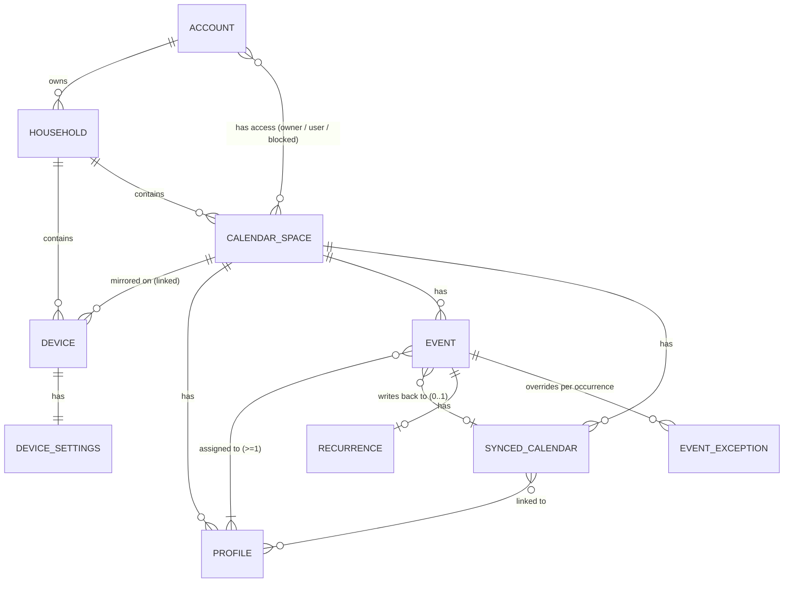

# 02: Calendar, Profiles, Device Settings, Device/App Relationship

Scope: Skylight Calendar (Calendar 2, Plus plan) as documented in the Skylight Help Center, cross-checked against help-center screenshots and the user's own device photos. Chores/routines/rewards/lists/meals/recipes are covered elsewhere and appear here only where they touch the calendar, profiles, or settings.

Source corpus: Zendesk Help Center API at `https://skylight.zendesk.com/api/v2/help_center/en-us/`, fetched 2026-11-04 (459 articles, 132 sections, 13 categories). Full map: [help-center-index.md](help-center-index.md). Raw JSON and text dumps are in the session scratchpad, not in the repo.

Conventions:
- "Device" = the wall/counter Calendar. "App" = Skylight Mobile App (iOS/Android) and Desktop App (`ourskylight.com`); their calendar settings articles are identical.
- **Inference:** marks anything not stated in an article.
- Quoted UI labels are bold, exactly as the help center spells them.

## 0. Ground truth and model notes

The user's device photos (read-only reference):

- [assets/user-device/calendar-schedule-4day.jpg](assets/user-device/calendar-schedule-4day.jpg): Calendar tab, Schedule view, 4 days (Wed 4 to Sat 7), hour axis 11 AM to 11 PM visible, per-day weather icons, today's date in a red circle, red now-line with a dot on today's column only, overlapping events split side by side, short events drawn as thin bars with clipped titles, two outlined all-day pills ("Chips", "Fruit"), profile pills with `done/total` task counts, blue round **+** button bottom right.
- [assets/user-device/tasks-day-by-profile.jpg](assets/user-device/tasks-day-by-profile.jpg): Tasks tab, Day view, one column per profile with avatar, `done/total`, star total (e.g. "28.5K"), Morning/Afternoon/Evening/Chores icons.

How the photos compare with the help center:

- Software is the same. The nav order (Home, Calendar, Lists, Tasks, Rewards, Meals, Recipes, Photos, then Sleep and Settings at the bottom), the info bar (date, time, weather; view dropdown, **Filter**, `<` **Today** `>`), the preview-bar pills, and the event cards all match the help center's 2026 screenshots. The help center documents one UI for all Calendar models (10", 15", 15" Calendar 2, 27" Max). Only two things differ by model: **Roomy** display density is Max-only, and photo auto-rotation needs a 2022-or-later device. So photos from an older model are still a valid reference for the UI.
- Hardware: the 15" Calendar and the 15.6" Calendar 2 are both 1920x1080 IPS with an ambient light sensor, no camera, and no microphone. The Calendar 2 has a "Snap Frame". The 27" Max is 2560x1440 and has speakers. Design target: 1920x1080 in landscape and portrait.
- In the user's photo every event and every profile pill is the same teal. **Inference:** the user's profiles are all set to similar colors, or most events belong to one profile. The product supports one distinct color per profile.
- "Chips" and "Fruit" are outlined pills in the all-day row. **Inference:** these are planned meals (probably Snack), because meals render as outlined pills in the help-center month screenshots ("Grilled Cheese", "Spaghetti").
- The help-center text says per-day weather icons appear in week and month views. The user's photo and the help-center Home-screen screenshot also show them in Schedule view, so the text is out of date.

---

## 1. Device shell: navigation bar, information bar, preview bar, Add button

**What it is**: The persistent frame around every device screen.

**Where in the UI**: The navigation bar is on the left in landscape and along the bottom in portrait. The information bar is across the top. The preview bar sits under the information bar on the Calendar tab. The Add (**+**) button is a blue circle at the bottom right.

**How it works**
1. The navigation bar is always visible. Each tab shows an icon and a label. Top group: **Home** (a serif "S" glyph), **Calendar**, **Lists**, **Tasks**, **Rewards**, **Meals**, **Recipes**, **Photos**. Bottom group: **Sleep** (moon), **Settings** (gear).
2. Any tab except **Settings** can be hidden in **Settings > General > Device Navigation** on the device, or in the app under **Settings > Devices > (device) > Customize > Device Navigation**. The list header reads "All Tabs On" when nothing is hidden.
3. Information bar on the Calendar tab, left side: date ("Thu, Mar 19"), time ("2:18 PM"), weather icon and temperature. If no address is set, an exclamation icon appears instead of the weather. Right side: view dropdown (label = current view), **Filter** (eye-slash icon), `<`, **Today**, `>`.
   - If **Calendar display name** is set, the name replaces the date on the Calendar tab only.
   - **Inference from screenshots:** when you page away from the current period, the date is replaced by the month and year being shown ("April 2026", "January 2026").
   - Older screenshots also show a **Magic Import** dropdown with a "Try" badge in this bar. That is a Plus feature and out of scope.
4. Preview bar on the Calendar tab: a row of pills above the events in every view.
   - Task progress pills: profile initial or avatar, name, `done/total`. The pill background fills in the profile color in proportion to `done/total`. For example, "Elena 8/9" is almost fully tinted and the user's "0/19" pills are untinted.
   - Countdown pills: emoji, title, "N days" or "Today!".
   - When there are no countdowns, a gray **Add countdown** pill appears.
   - Countdowns share the bar with task progress. When the bar is full, countdowns take the first position and rotate.
5. The **+** button opens **Add event** on the Calendar tab. On Home it can add a task or an event.

**Fields, options, defaults, limits**: There is no separate on-device status bar for Wi-Fi. An older screenshot shows a Wi-Fi-off glyph at the right end of the info bar. **Inference:** that is the offline indicator.

**Free vs Plus**: All free. Plus-only tabs (Rewards, Meals, Recipes, Photos) still appear without Plus and carry "Try"/"New" badges in older screenshots (**inference**: they act as upsell entry points).

**Edge cases & known limitations**
- What tapping a task-progress pill does is not documented (see Open questions).
- Tapping a countdown pill opens a popup listing all active countdowns.

**Images**: [device-nav-bar](assets/help-calendar/device-nav-bar.png) (nav bar on the left in landscape and at the bottom in portrait), [device-info-bar](assets/help-calendar/device-info-bar.png), [home-tab-icon](assets/help-calendar/home-tab-icon.png), [cal-add-button](assets/help-calendar/cal-add-button.png), [device-filter-button](assets/help-calendar/device-filter-button.png), [settings-show-hide-tabs](assets/help-calendar/settings-show-hide-tabs.png) (Display > Device Navigation "All Tabs On" with Home/Calendar/Lists/Tasks toggles), [month-start-current-week](assets/help-calendar/month-start-current-week.png) (preview bar with proportionally filled progress pills).

**Sources**: [Navigation and Menus](https://skylight.zendesk.com/hc/en-us/articles/36824456433051), [General Settings](https://skylight.zendesk.com/hc/en-us/articles/36835387462555), [Calendar Settings](https://skylight.zendesk.com/hc/en-us/articles/36835449004315), [Countdowns](https://skylight.zendesk.com/hc/en-us/articles/40459070511515), [Show and Hide Tabs](https://skylight.zendesk.com/hc/en-us/articles/57539257443611), [Settings (app)](https://skylight.zendesk.com/hc/en-us/articles/45795554249371).

---

## 2. Home screen (dashboard) and Timer

**What it is**: The first tab. It is a dashboard that combines a calendar pane with optional Tasks and Lists panes.

**Where in the UI**: The **Home** tab ("S" icon). The info bar has **Timer** and **Customize** buttons on the right.

**How it works**
1. Layout in landscape: the **CALENDAR** pane fills roughly the left 55%. On the right, **TODAY'S TASKS** sits on top and **LISTS** sits below. If one optional pane is hidden, the other fills the right column (**inference** from the "Tasks"/"Lists" placeholder diagram).
2. The Calendar pane has its own view dropdown (**Schedule**, **Day**, **Week**, **Month**) and its own `<` **Today** `>`. It behaves like the Calendar tab. In Month view, tapping a date opens that day's event list and tapping an event opens its details.
3. The Tasks pane shows one card per profile: avatar, name, `done/total`, star count, and today's tasks, each with an emoji icon and a round checkbox. An "Up for Grabs" card appears when there are unassigned chores. A profile with nothing due shows an emoji and "Nothing to do today." Swipe left or right, or use `<` `>`, for more profiles. Tasks can be checked off here. Profiles filtered out in the Tasks tab, and the Up for Grabs pseudo-profile when filtered, do not appear.
4. The Lists pane shows one card per list: title, item count badge, an **Add item** field, and items with checkboxes, grouped by section (e.g. "Bakery 1"). Swipe for more lists.
5. **Customize** opens a popover with **Tasks** and **Lists** toggles. The calendar pane cannot be turned off.
6. **Timer**: tap it, enter minutes on a keypad (backspace and **Clear** available), tap **Start**. A short countdown plays, then a full-screen timer shows a shrinking pie chart, large minutes and seconds, and the original duration ("15 min"). The pie changes color as time runs down: blue, then green, orange, red. **X** at top left stops it.

**Fields, options, defaults, limits**
- Timer: fewer than 999 minutes. While a timer runs the screensaver will not start, and a scheduled sleep is postponed until 5 minutes after the timer ends.
- Home calendar view options: Schedule, Day, Week, Month. Week was the only option at launch.

**Free vs Plus**: Home is free. Tasks and Lists panes are free. Timer on the Calendar is not marked Plus (Buddy timers are Buddy Plus).

**Edge cases & known limitations**: Whether Home's calendar view choice is stored separately from the Calendar tab's is not stated. **Inference:** yes, because the Home pane has its own dropdown.

**Images**: [home-screen-overview](assets/help-calendar/home-screen-overview.png) (layout diagram), [home-schedule-view](assets/help-calendar/home-schedule-view.png) (3-day schedule pane plus Today's Tasks with Mom/Olivia/Ryan/Up for Grabs), [home-month-view-detail-popup](assets/help-calendar/home-month-view-detail-popup.png) (month pane with event details popup), [home-day-view](assets/help-calendar/home-day-view.png) (Day and Week variants of the pane), [home-tasks-pane](assets/help-calendar/home-tasks-pane.png), [home-lists-pane](assets/help-calendar/home-lists-pane.png), [home-customize-menu](assets/help-calendar/home-customize-menu.png), [home-timer-button](assets/help-calendar/home-timer-button.png), [timer-running](assets/help-calendar/timer-running.jpg), [timer-stop-button](assets/help-calendar/timer-stop-button.jpg).

**Sources**: [The Home Screen](https://skylight.zendesk.com/hc/en-us/articles/49738702477723), [[Feature] Home Screen](https://skylight.zendesk.com/hc/en-us/articles/49738858986907), [[Feature] The Calendar Home Screen Supports Day View](https://skylight.zendesk.com/hc/en-us/articles/54084801528347), [[Feature] Schedule and Month View in Calendar Home](https://skylight.zendesk.com/hc/en-us/articles/55564416758427), [Timers on Calendar](https://skylight.zendesk.com/hc/en-us/articles/58089742044315), [Adjust the Display (Care)](https://skylight.zendesk.com/hc/en-us/articles/48784194278683).

---

## 3. Calendar tab: switching views and navigating time

**What it is**: The main calendar screen. It has four views and controls for paging through time.

**Where in the UI**: Calendar tab. The view dropdown is in the info bar, top right.

**How it works**
1. The view dropdown lists exactly **Schedule**, **Day**, **Week**, **Month**. There are no other views.
2. `<` and `>` page back and forward by one period.
   - In Week view, tapping the **Next Week** cell also advances one week.
   - Month view swipes horizontally: swipe right for the previous month, swipe left for the next. Swipe up and down to see more of the month.
   - Week view also pages horizontally (animated in the help center).
3. **Today** returns to the current date and time.
4. Today's date is drawn as white text in a filled coral/orange-red circle ("orange dot" in the text). The current time is a coral horizontal line with a dot at its left end, drawn across today's column only.
5. Schedule view supports pinch-to-zoom to change how many hours fit on screen.

**Fields, options, defaults, limits**: Per-view start options are in **Settings > Calendar** (see section 21).

**Free vs Plus**: Free.

**Edge cases & known limitations**
- The swipe-direction text in "The Calendar Tab" is reversed ("Swipe left to see previous dates"). The month-view article and the app articles describe the standard direction: swipe left for the future, swipe right for the past. Use the standard direction.
- One older FAQ says the view switch is at the "top left". Current UI and articles put it at the top right.

**Images**: [cal-today-date-circle](assets/help-calendar/cal-today-date-circle.png), [cal-now-line](assets/help-calendar/cal-now-line.png), [week-view-swipe-frame](assets/help-calendar/week-view-swipe-frame.png) (mid-swipe frame, header shows "April 2026"), [month-view-swipe-frame](assets/help-calendar/month-view-swipe-frame.png).

**Sources**: [The Calendar Tab](https://skylight.zendesk.com/hc/en-us/articles/36625171368987), [How do I change the view of the Calendar tab?](https://skylight.zendesk.com/hc/en-us/articles/360033104791), [[Feature] Swipe for Month View](https://skylight.zendesk.com/hc/en-us/articles/53718572814107), [[Feature] Improved Week View for Calendar](https://skylight.zendesk.com/hc/en-us/articles/49225597548699).

---

## 4. Schedule view

**What it is**: A multi-day time grid with one column per day.

**Where in the UI**: Calendar tab or Home calendar pane, view = **Schedule**.

**How it works**
1. Shows N day columns. Each column header has the weekday and date ("Thu 19", today's number in the circle) and a weather icon at the right of the header when a forecast exists.
2. The left gutter is an hour axis ("8 AM", "12 PM"). The portrait screenshot shows all 24 hours (12 AM to 11 PM). The landscape screenshot shows about 8 AM to 10 PM and scrolls vertically.
3. Timed events are rounded blocks positioned by start and end time. A block shows the title and time range ("1 - 5 PM") if tall enough. At bottom right is the profile's avatar (photo, illustrated avatar, or initial), or a gray initial circle for labels ("G"), or the label emoji.
4. Overlapping events split the column width side by side (e.g. "Car Drop-Off" next to "Pediatrician", "Band Practice" twice).
5. Short events (about 15 minutes) become thin strips with clipped titles (user photo: "Handwriting", "Break", "Maghrib", "Isha").
6. All-day events sit in a row under the day header as pills. A multi-day all-day event is one continuous bar across its columns ("Camping Trip" Sat to Sun). Older UI labeled this row "All day".
7. Pinch to zoom the hour scale: fewer events with more detail, or more of the day. Swipe up and down for more hours.

**Fields, options, defaults, limits**
- **Days displayed in schedule view**: slider from 1 to 7 days.
- The maximum depends on orientation, and landscape allows the most. The exact portrait cap is not documented.
- The help-center example and the user's device both show 4 days in landscape and portrait. Skylight Care recommends 7.
- **Start on current day**: when on, the view starts today. When off, it starts on the first day of the week.
- Defaults are not documented. **Inference:** 4 days and start on current day, since every screenshot shows that.
- Mobile/Desktop app Schedule view shows 1, 2, or 3 days, chosen under **Filter > Days in Schedule View**.

**Free vs Plus**: Free.

**Edge cases & known limitations**
- Hour-row height and the vertical start position are not documented. **Inference:** the grid auto-scrolls near the current time; the user's photo opens at 11 AM with the now-line at 11:44.
- Past events render with lighter, dimmed text when **Dim past events** is on.

**Images**: [view-schedule-landscape](assets/help-calendar/view-schedule-landscape.png) (4 days, countdown preview bar "Pediatrician Today!", striped multi-profile events, dimmed past events, now-line), [view-schedule-portrait](assets/help-calendar/view-schedule-portrait.png) (bottom nav, full 24-hour axis), [cal-schedule-multiday-allday-bar](assets/help-calendar/cal-schedule-multiday-allday-bar.png), [user device photo](assets/user-device/calendar-schedule-4day.jpg).

**Sources**: [Example Calendar Views](https://skylight.zendesk.com/hc/en-us/articles/48026687853083), [Calendar Settings](https://skylight.zendesk.com/hc/en-us/articles/36835449004315), [How do I view more days on the 'Schedule' view](https://skylight.zendesk.com/hc/en-us/articles/360059869651), [Calendar (Mobile)](https://skylight.zendesk.com/hc/en-us/articles/44738510847259).

---

## 5. Day view

**What it is**: A mini month calendar paired with a list of the selected day's events.

**Where in the UI**: view = **Day**.

**How it works**
1. The left third is a month mini-calendar ("March 2026", weekday headers starting on the configured week start). Past dates are gray, today is circled, and the mini-calendar spans 6 weeks including leading and trailing dates.
2. The right two-thirds has a heading ("Today" for the current day; **inference:** the date otherwise) above a vertical list of full-width event cards. Each card shows title, time range, and profile avatars on the right. Multi-profile cards show several avatars and diagonal color stripes.
3. If there are more events than fit, scroll the list.
4. **Inference:** tapping a mini-calendar date selects that day. This is not stated.

**Fields, options, defaults, limits**: Up to 10 events per screen in landscape and up to 16 in portrait.

**Free vs Plus**: Free.

**Edge cases & known limitations**: Where all-day events go in the list is not documented. In the help-center screenshot no all-day event is present.

**Images**: [view-day-landscape](assets/help-calendar/view-day-landscape.png), [view-day-portrait](assets/help-calendar/view-day-portrait.png).

**Sources**: [Example Calendar Views](https://skylight.zendesk.com/hc/en-us/articles/48026687853083), [Adjust the Display (Care)](https://skylight.zendesk.com/hc/en-us/articles/48784194278683).

---

## 6. Week view

**What it is**: A 7-day card grid. It is not a time grid.

**Where in the UI**: view = **Week**.

**How it works**
1. The layout is a 4x2 grid of 8 cells in both orientations. Cells 1 to 7 are the days of the week. Cell 8 is a **Next Week** preview labeled with its date range ("March 22 - 28"). Tapping it advances one week.
2. Each day cell header shows the weekday and date ("Thu 19"), an event count ("No events", "1 event", "4 events", or "12 events today" for today), **+ Add Event** (a shortcut that pre-fills that day; **inference** on the pre-fill), and a weather icon for the next 10 days.
3. Events are stacked cards with title, time range or "All day", and avatar. Past days are dimmed.
4. When **Start on current day** is on, the grid starts at today (e.g. "Thu 6 ... Wed 12, Next Week").

**Fields, options, defaults, limits**
- Up to 4 full events per day are visible. If a day has more, scroll inside that day.
- Week start: **Sunday** or **Monday**.
- **Start on current day**: on or off.

**Free vs Plus**: Free.

**Edge cases & known limitations**: Weather icons appear only for the next 10 days. Far-future and past weeks show none.

**Images**: [view-week-landscape](assets/help-calendar/view-week-landscape.png), [view-week-portrait](assets/help-calendar/view-week-portrait.png), [week-view-weather-icons](assets/help-calendar/week-view-weather-icons.png).

**Sources**: [Example Calendar Views](https://skylight.zendesk.com/hc/en-us/articles/48026687853083), [The Calendar Tab](https://skylight.zendesk.com/hc/en-us/articles/36625171368987), [[Feature] Improved Week View for Calendar](https://skylight.zendesk.com/hc/en-us/articles/49225597548699).

---

## 7. Month view

**What it is**: A standard 7-column month grid.

**Where in the UI**: view = **Month**.

**How it works**
1. Weekday header row. Each cell has its date number top right ("Mar 1" or "Apr 1" on the first of a month) and a weather icon top left for the next 10 days.
2. Events are single-line pills: timed events show a short time prefix plus title ("11:30 AM Drop Off Dry Cl..."), truncated. All-day events show the title only. Planned meals are outlined (unfilled) pills. Multi-day all-day events join into one bar ("Vacation!").
3. Cell overflow: at most 3 items show. If there are more than 3, the cell shows 2 items and an "N more" link. Tapping the link (or the date; **inference** from the Home month pane) opens a popup with the full date ("March 25"), a count ("5 events"), and full event cards.
4. When **Start on current week** is on, the grid begins at the current week instead of the 1st of the month.
5. Swipe left or right to change months, up or down to scroll rows.

**Fields, options, defaults, limits**
- 3 visible items per cell, or 2 items plus "N more".
- Weather on the next 10 days.

**Free vs Plus**: Free. The meal overlay needs Plus because meal planning is Plus.

**Edge cases & known limitations**: In portrait, cells are taller but the overflow rule is unchanged (screenshot shows "3 more", "6 more").

**Images**: [view-month-landscape](assets/help-calendar/view-month-landscape.png) (with day popup), [view-month-portrait](assets/help-calendar/view-month-portrait.png), [month-view-weather-icons](assets/help-calendar/month-view-weather-icons.png), [month-start-current-week](assets/help-calendar/month-start-current-week.png) (outlined meal pills, striped multi-profile pill, progress pills).

**Sources**: [Example Calendar Views](https://skylight.zendesk.com/hc/en-us/articles/48026687853083), [[Feature] Start the Month With the Current Week](https://skylight.zendesk.com/hc/en-us/articles/53073403311771), [[Feature] Weather in Month View](https://skylight.zendesk.com/hc/en-us/articles/52712061182875), [[Feature] Swipe for Month View](https://skylight.zendesk.com/hc/en-us/articles/53718572814107).

---

## 8. Event rendering rules (all views)

**What it is**: How color, avatars, and display toggles change the way an event looks. How events get their profiles is in section 18.

**How it works**
1. Color: every event belongs to at least one Profile or Label and takes that entity's color. Fill is a light tint of the color and text is dark.
2. Multi-profile events: when **Color code multi-profile events** is on, the event is drawn with diagonal stripes, one band per profile color ("Bookstore" with 5 avatars and 5 bands). The Care FAQ calls these "striped". When it is off, **inference:** the event uses one color, probably the first profile's.
3. Avatars: profile photo, illustrated avatar, or initial circle in the profile color. Labels show an initial in gray or color, or their emoji. Multi-profile cards show several avatars, and the app collapses extras into "+N".
4. **Dim past events**: events already over render with faded text.
5. **Shade weekends**: Saturday and Sunday get a shaded background.
6. Emoji: app screenshots show emojis before many event titles ("Basketball Practice" with a basketball). The Countdown article says Skylight adds an emoji "if it can guess which Emoji is appropriate". **Inference:** titles are auto-decorated with an emoji at creation or render time. You can also type emojis in titles with the emoji keyboard.
7. Meals (Plus) show on the calendar as outlined pills, by meal category. Categories are chosen in **Settings > Calendar > Show in Calendar > Meals**. There are four default categories (Breakfast, Lunch, Dinner, Snack).

**Images**: [app-settings-color-code-multiprofile](assets/help-calendar/app-settings-color-code-multiprofile.png), [view-day-landscape](assets/help-calendar/view-day-landscape.png).

**Sources**: [Calendar Settings](https://skylight.zendesk.com/hc/en-us/articles/36835449004315), [Settings (app)](https://skylight.zendesk.com/hc/en-us/articles/45795554249371), [FAQs (Care)](https://skylight.zendesk.com/hc/en-us/articles/48784282554907), [Countdowns](https://skylight.zendesk.com/hc/en-us/articles/40459070511515), [Profiles and Labels](https://skylight.zendesk.com/hc/en-us/articles/44740240234139).

---

## 9. Filter menu (Calendar tab)

**What it is**: A popover in the info bar that controls what the calendar shows.

**Where in the UI**: the **Filter** button (eye-slash icon) on the Calendar tab. The Tasks tab has its own Filter with different toggles.

**How it works**: Tap **Filter** to open a card of rows with toggles:
- **Tasks progress**: shows or hides the progress pills in the preview bar, in all views.
- **Countdowns**: shows or hides countdown pills in the preview bar.
- **Weather forecast**: shows or hides per-day weather icons. The article says Week or Month only. Needs an address.
- **Show Meals**: shows or hides planned meals.
- **Profiles**: one row per Profile with avatar or initial, name, a pencil (edit name or color), and a toggle. A **Select All** toggle shows or hides all of them.

**Fields, options, defaults, limits**
- Filtering works on Profiles only. There is no per-synced-calendar filter. A synced calendar is visible through the profile(s) it is linked to.
- Profiles created from newly synced calendars default to **On**.
- **Inference:** Labels appear in the same list. The legacy screenshot shows calendar-derived entries listed alongside people.

**Free vs Plus**: Free. Show Meals is meaningful only with Plus.

**Edge cases & known limitations**
- A profile hidden by the filter also disappears from the profile picker when you create events or tasks. Skylight has a support article about this ("Profiles Are Missing When Creating Events or Tasks").
- The filter stays in effect until you reverse it. **Inference:** it is stored per device and persists.
- Older UI (2024) put round profile-avatar buttons in the info bar. **Inference:** those were quick filters. The current UI has replaced them with the Filter popover.

**Images**: [device-filter-profiles-legacy-ui](assets/help-calendar/device-filter-profiles-legacy-ui.png) (2025 UI: profile rows with pencil and toggle), [countdown-filter-toggle](assets/help-calendar/countdown-filter-toggle.png) (Tasks progress and Countdowns rows with "New" badges), [sleep-legacy-ui-schedule-view](assets/help-calendar/sleep-legacy-ui-schedule-view.png) (2024 UI with avatar circles and line progress bars).

**Sources**: [The Calendar Tab](https://skylight.zendesk.com/hc/en-us/articles/36625171368987), [How To Use The Filter Function](https://skylight.zendesk.com/hc/en-us/articles/34946198734747), [Profiles Are Missing When Creating Events or Tasks](https://skylight.zendesk.com/hc/en-us/articles/37235464368795), [How do I change the color of my profiles?](https://skylight.zendesk.com/hc/en-us/articles/360032743912), [Countdowns](https://skylight.zendesk.com/hc/en-us/articles/40459070511515).

---

## 10. Event details popup (device)

**What it is**: The read view you get when you tap an event.

**Where in the UI**: Tap any event. A floating card opens.

**How it works**: The card shows, top to bottom:
1. Title in large serif type, with a pencil (edit) and a red trash (delete) button at top right.
2. Countdown status, if set ("4 days until event at 12 - 4 PM").
3. Calendar icon with "Wednesday, Sep 23 : 11 AM – 12 PM".
4. Repeat icon with a recurrence summary ("Weekly on Wed").
5. Bell icon with reminder status ("At time of event", "10 minutes before", "30 minutes before").
6. **Profiles**: a collapsible list of avatar plus name.
7. **Synced calendar**: provider icon (e.g. Google) plus calendar name.
8. Invitees.
9. Notes.
10. Weather for the event (condition, temperature, H/L, wind), if the event is within 7 days and has a valid location.

Tap outside the card to close it.

**Images**: [home-month-view-detail-popup](assets/help-calendar/home-month-view-detail-popup.png), [event-detail-reminder-status](assets/help-calendar/event-detail-reminder-status.png), [countdown-event-detail](assets/help-calendar/countdown-event-detail.png), [weather-device-event-detail](assets/help-calendar/weather-device-event-detail.png).

**Sources**: [The Calendar Tab](https://skylight.zendesk.com/hc/en-us/articles/36625171368987), [How do I set per-event reminders](https://skylight.zendesk.com/hc/en-us/articles/10070631217563), [How Can I See Weather on My Calendar?](https://skylight.zendesk.com/hc/en-us/articles/40451094691995).

---

## 11. Creating, editing, deleting events on the device

**What it is**: Entering events with the touchscreen.

**Where in the UI**: the **+** button, or **+ Add Event** in a Week cell. The **Add event** dialog opens as a side panel. The keyboard docks next to the panel instead of covering it.

**How it works**
1. A segmented row at the top offers **Type** (default), **Photo**, **Talk**, **Email**. Photo and Talk show a QR code that opens Sidekick on the phone (Plus). Email shows the household address to forward to.
2. Under **Type**:
   - **Event Title** (on-screen keyboard, emoji allowed).
   - Start and end date/time boxes, or the **All day** checkbox.
   - Profile selection (one or more; see below).
   - **Repeats** switch, which reveals frequency boxes and an optional **Repeats until** switch with an end date.
   - **Reminder** expander: **At time of event**, **Before event** with **Minutes before**, **Play sound**.
   - **Pick a Synced Calendar** dropdown, required for the event to reach a two-way-synced provider.
   - **Countdown** toggle (named in the edit flow).
3. Tap **Save** or **Add**.
4. Edit: tap the event, tap the pencil, change fields, **Save**.
5. Delete: tap the event, tap the trash icon, confirm **Delete event**. This cannot be undone.
6. Recurring events: when you edit a reminder (and **inference:** any field) on a repeating event, choose **This event**, **This and following events**, or **All events**.

**Fields, options, defaults, limits**
- At least one profile is required ("All Calendar events must belong to a Profile").
- Recurrence frequency options are not listed anywhere in the help center.
  - The app shows summaries such as "Weekly on Wed".
  - **Inference:** the editor reuses the chore recurrence component: **Every** [number] [unit of time] plus **On** [which days or dates within the unit], and **Repeats until** [date]. Units are probably Day, Week, Month, Year.
  - Chores and routines confirm only Day and Week units in text.
- Device-side reminder minutes: 1 to 120 (global setting). The per-event "Minutes before" range is not stated.
- Not documented as device fields: location, invitees, description. The device detail view *displays* invitees and notes, but the help center documents entering them only in the app. **Inference:** the device editor may lack them.

**Free vs Plus**: Typing events is free. Photo, Talk, and Email (Sidekick/Magic Import) are Plus. Parental Lock can require a PIN to add or modify events.

**Edge cases & known limitations**
- Events from one-way (read-only) sources cannot be made countdowns. **Inference:** they cannot be edited on Skylight at all.
- Per-event reminders are not supported on two-way-synced events. Those use the global reminder settings.
- A new event reaches Google or iCloud only if the synced calendar is picked, or a default is configured (section 17).

**Images**: [cal-add-event-sidekick-qr](assets/help-calendar/cal-add-event-sidekick-qr.png), [keyboard-beside-side-panel](assets/help-calendar/keyboard-beside-side-panel.png) (task side panel: Assign avatars with **Add**, Date toggle, Due Time, Reminders, **Add**; the event panel shares this style).

**Sources**: [The Calendar Tab](https://skylight.zendesk.com/hc/en-us/articles/36625171368987), [How do I set per-event reminders](https://skylight.zendesk.com/hc/en-us/articles/10070631217563), [Countdowns](https://skylight.zendesk.com/hc/en-us/articles/40459070511515), [Skylight Calendar Two-Way Sync with Google Calendar](https://skylight.zendesk.com/hc/en-us/articles/19197773155995), [The Tasks Tab: Routines and Chores](https://skylight.zendesk.com/hc/en-us/articles/36846381293979) (recurrence component).

---

## 12. Creating and editing events in the app (full field list)

**What it is**: The richest event editor. Mobile and Desktop have the same fields.

**Where in the UI**: App > Calendar > Add button. Edit: event > menu (three dots) > **Edit**. Delete: event > menu > **Delete**.

**Fields, options, defaults, limits** (in form order)

| Field | Type | Notes |
|---|---|---|
| **Title** | text | required |
| Start / end | date + time | |
| **All day** | checkbox | hides the times |
| **Repeats** | switch + frequency boxes | the options shown depend on the period chosen |
| **Repeats until** | switch + date | optional end date |
| **Countdown** | toggle | see section 14 |
| Profiles | multi-select, at least 1 | the **+** button creates a new profile inline |
| **Synced calendar** | single select | **No calendar**, one of the two-way calendars, or **Sync a calendar**. At most one calendar per event |
| **Description** | text | shown as "notes" on the device |
| **Invited Emails** | list of emails | autocompletes from phone contacts and prior invitees. Invitees get email invites and updates |
| **Location & weather** | address autocomplete | enables a per-event forecast |
| Reminder | not listed in the app form text | per-event reminder is documented for the device form |

**How it works**: Mobile views are Schedule (1 to 3 days), Week (single scrolling column of day groups), and Month (grid; tap a day for a bottom "day sheet" with Meals, All-day events, Events, and **Add Event**). The button bar has **Today**, the view selector, **Filter**, **Meals**, **Search**. Search suggests **Birthdays** and **Countdowns**.

**Free vs Plus**: Free, except Sidekick import.

**Images**: [app-cal-button-bar](assets/help-calendar/app-cal-button-bar.png), [app-cal-view-switch-icon](assets/help-calendar/app-cal-view-switch-icon.png), [app-cal-schedule-view](assets/help-calendar/app-cal-schedule-view.png), [app-cal-days-in-schedule](assets/help-calendar/app-cal-days-in-schedule.png), [app-cal-event-bubble](assets/help-calendar/app-cal-event-bubble.png), [app-cal-month-week](assets/help-calendar/app-cal-month-week.png), [app-cal-month-multiday](assets/help-calendar/app-cal-month-multiday.png), [app-cal-day-sheet](assets/help-calendar/app-cal-day-sheet.png), [app-month-day-at-a-glance-frame](assets/help-calendar/app-month-day-at-a-glance-frame.png) (and the [animated GIF](assets/help-calendar/app-month-day-at-a-glance.gif)), [app-event-preview](assets/help-calendar/app-event-preview.png), [app-cal-event-menu-icon](assets/help-calendar/app-cal-event-menu-icon.png), [countdown-app-search](assets/help-calendar/countdown-app-search.jpg).

**Sources**: [Calendar (Mobile)](https://skylight.zendesk.com/hc/en-us/articles/44738510847259), [Calendar (Desktop)](https://skylight.zendesk.com/hc/en-us/articles/45755784991131), [Use Per-Event Invitations](https://skylight.zendesk.com/hc/en-us/articles/46767217200155), [[Feature] Day at a Glance](https://skylight.zendesk.com/hc/en-us/articles/58095784867227), [[Feature] Event Preview on the Skylight Mobile App](https://skylight.zendesk.com/hc/en-us/articles/55093801405979), [[Feature] Schedule View in the Skylight Mobile and Desktop Apps](https://skylight.zendesk.com/hc/en-us/articles/55577789615771).

---

## 13. Reminders and notifications

**What it is**: On-device reminder popups and chimes for events and timed tasks, plus app push notifications.

**Where in the UI**: device **Settings > Reminders** (global defaults); the per-event **Reminder** expander in the event editor; app **My Skylight > Settings > (device) > Notifications**.

**How it works**
1. When a reminder fires, the device shows a popup listing all events and/or tasks scheduled at that moment, and plays a chime if sound is on. Volume comes from **Video and reminder volume** in General.
2. Device global settings:
   - **At time of event** (toggle).
   - **Minutes before event** (toggle plus number, 1 to 120).
   - Tasks: **When Due** (only tasks with a time).
   - **Reminder sound** (toggle).
3. Per-event override on the device: **At time of event**, **Before event** with **Minutes before**, **Play sound**. Per-event settings override the global ones. Not available for two-way-synced events.
4. App Notifications for the device:
   - **Event Reminders**: **At time of event**; **Before event** with **10 minutes before**, **30 minutes before**, **1 hour before**, or **Custom** (Amount plus one unit: Minutes, Hours, or Days before).
   - **Event Updates**: **New Events** toggle plus **Notify for events assigned to** per-profile checkboxes. Pushes go to the phone when someone adds an event via Skylight, not for events added in a remote calendar.
   - **Task Notifications**: **When Due**, **When Completed**.

**Fields, options, defaults, limits**: Reminders are off by default (Skylight Care).

**Free vs Plus**: Free.

**Edge cases & known limitations**: The device and app reminder settings overlap with different option sets (1 to 120 minutes on the device; 10/30/60/custom with days in the app). **Inference:** both write the same per-device setting, and the device UI accepts only minutes.

**Images**: [event-detail-reminder-status](assets/help-calendar/event-detail-reminder-status.png), [app-new-event-notification](assets/help-calendar/app-new-event-notification.png) (iOS push: "New Event / Brunch / Friday, Oct 30, 11:30 AM – 12:30 PM / Calendars: Dad, Mom").

**Sources**: [Reminders Settings](https://skylight.zendesk.com/hc/en-us/articles/36836043247131), [How do I set per-event reminders](https://skylight.zendesk.com/hc/en-us/articles/10070631217563), [Settings (app)](https://skylight.zendesk.com/hc/en-us/articles/45795554249371), [[Feature] Notifications For New Events](https://skylight.zendesk.com/hc/en-us/articles/57806291759259), [Adjust the Display (Care)](https://skylight.zendesk.com/hc/en-us/articles/48784194278683).

---

## 14. Countdowns

**What it is**: An event flag that shows days remaining until the event.

**Where in the UI**: The **Countdown** toggle in the event editor. Countdowns appear in the preview bar, the event details, the screensaver (Plus), and app search.

**How it works**
1. Set the toggle on any editable event: device-, app-, or two-way-created.
2. A preview-bar pill shows the event emoji, a truncated title, and "N days" or "Today!".
3. Tap the pill to open a list popup of all active countdowns. Each row shows title, "N days", and profile avatars ("+3").
4. Event details show "N days until event at <time>".
5. Hide countdowns with **Filter > Countdowns**.

**Fields, options, defaults, limits**
- **Settings > Calendar > Show countdowns**: **Always**, **3 months prior to the event**, **1 month prior to the event**.
- The screensaver has its own **Countdowns** toggle (Plus).

**Free vs Plus**: Countdowns are free. The screensaver display needs Plus.

**Edge cases & known limitations**
- One-way-synced events cannot be countdowns. The workaround is to create a local event.
- "Birthdays" is a search suggestion. **Inference:** profile birthdays generate birthday entries or countdowns. Not documented.

**Images**: [countdown-preview-bar](assets/help-calendar/countdown-preview-bar.png), [countdown-list-popup](assets/help-calendar/countdown-list-popup.png), [countdown-filter-toggle](assets/help-calendar/countdown-filter-toggle.png), [countdown-event-detail](assets/help-calendar/countdown-event-detail.png), [countdown-screensaver-row](assets/help-calendar/countdown-screensaver-row.png), [countdown-calendar-view](assets/help-calendar/countdown-calendar-view.png), [countdown-event-popup](assets/help-calendar/countdown-event-popup.png), [countdown-app-search](assets/help-calendar/countdown-app-search.jpg).

**Sources**: [Countdowns](https://skylight.zendesk.com/hc/en-us/articles/40459070511515), [[Feature] Get Excited With Countdowns](https://skylight.zendesk.com/hc/en-us/articles/43715681762587), [Calendar Settings](https://skylight.zendesk.com/hc/en-us/articles/36835449004315).

---

## 15. Weather

**What it is**: Current conditions in the info bar, per-day forecast icons, and per-event forecasts.

**Where in the UI**: the info bar (icon plus "74°"); day headers or cells in Week, Month, and Schedule; event details; the app event details.

**How it works**
1. Location defaults to an IP-based guess, which the user confirms during setup. To set a precise address on the device: **Settings > General > Enter an address for more accurate weather data**. A sidebar opens with a **Country** picker, address search, a results list with radio selection, **Done**, and **Remove address**.
2. The address can only be set on the device.
3. Per-day icons: the next 10 days. Toggle them with **Filter > Weather forecast**.
4. Per-event forecast: only if the event is within 7 days and has a valid location (location is set in the app). The forecast shows condition text ("Partly Sunny"), temperature, H/L, and wind ("SSW 5 mph").
5. With no address, the info bar shows an exclamation icon.

**Fields, options, defaults, limits**: **Temperature**: Fahrenheit or Celsius. Default is Fahrenheit for US addresses and Celsius elsewhere. The dropdown appears only after an address is entered (General Settings text). The Care/weather article says all users can choose.

**Free vs Plus**: Free. Weather on the screensaver needs Plus.

**Images**: [settings-weather-address-prompt](assets/help-calendar/settings-weather-address-prompt.png), [weather-address-sidebar](assets/help-calendar/weather-address-sidebar.png), [weather-device-event-detail](assets/help-calendar/weather-device-event-detail.png), [weather-app-event-detail](assets/help-calendar/weather-app-event-detail.png), [week-view-weather-icons](assets/help-calendar/week-view-weather-icons.png), [month-view-weather-icons](assets/help-calendar/month-view-weather-icons.png).

**Sources**: [How Can I See Weather on My Calendar?](https://skylight.zendesk.com/hc/en-us/articles/40451094691995), [General Settings](https://skylight.zendesk.com/hc/en-us/articles/36835387462555), [Configure Your Calendar](https://skylight.zendesk.com/hc/en-us/articles/37234772893851).

---

## 16. Profiles and Labels

**What it is**: The "who" (Profiles) and "what" (Labels) that every event, task, and reward is tagged with. They drive color coding and filtering.

**Where in the UI**: App home grid > **Profiles**. That screen has two lists: **Profiles** ("Manage the family members in your household") and **Labels** ("Organize calendar labels to group events such as birthdays, school, and work"). On the device, **Filter >** pencil edits name and color. Profiles are also created during onboarding and from the **+** in the event or task profile picker.

**How it works**
1. Add a Profile: **Add a Profile**, then fill in:
   - **Name**.
   - Avatar: swipe the carousel. The default is the initial in the profile color, then the included illustrated animal avatars. Or use **Add Photo** for **Take Photo** or **Choose from Library**.
   - Color: swipe the preset swatches, or open the color-wheel button for the **Custom Color Picker** (saturation/value square, hue bar, hex text field, **Save**).
   - Hat: from **Profile Hats**.
   - **Birthday** (optional).
   - **Linked Calendars**: choose one or more synced calendars.
   - Tap **Create Profile**.
2. Add a Label: **Add a Label**, then **Label Name**, **Linked Calendars**, **Color**, **Emoji** (optional), and **Create Label**.
3. Manage a Profile: tap it, then **Manage Profile**:
   - **Merge Profile**: "Reassign events, tasks, and rewards into an existing profile and remove this one". Profile-to-Profile only.
   - **Convert to Label**: "Turn this profile into a label to manage your calendar". Prompts for name, linked calendars, color, emoji.
   - **Delete Profile**: "Remove this Profile and associated events, tasks & rewards". **See exactly what's affected** previews the impact.
4. Labels have the mirror options: **Merge Label**, **Convert to Profile** (prompts for name, avatar, color, birthday, linked calendars), **Delete Label**.

**Fields, options, defaults, limits**
- Profile types: only Profile vs Label. There are no adult, child, or pet types. Chores also use an **Up for Grabs** pseudo-assignee (other researcher).
- Profile count: "You can add as many Profiles to your Skylight Calendar as you like."
- Profile fields: name, avatar (initial / built-in illustrated / photo / Disney avatar via add-on), color (preset or any hex), hat (one at a time), birthday, linked calendars (many).
- Label fields: name, color, emoji, linked calendars. A label avatar is its initial or emoji.
- Hats seen in the picker (14 plus "no hat"): beanie, party hat, chef hat, hard hat, crown, cowboy hat, fire helmet, flower crown, pirate hat, sailor hat, propeller cap, tiara, top hat, viking helmet. Seasonal Halloween hats are time-limited; one placed on a profile stays until changed. Hats show on the device, the apps, and Buddy.
- Preset color count and names are not documented. The swatch strip in the screenshot shows 7 at a time (yellow, light orange, dark orange, coral, salmon, red, gray) and scrolls.

**Free vs Plus**: Free. Disney avatars (16) need Plus or the Disney add-on and are out of scope.

**Edge cases & known limitations**
- Merge and Delete:
  - Deleting is immediate and permanent. Items tied only to that profile are deleted; shared items survive.
  - Remote calendars linked only to that profile become unsynced.
  - Merge moves all events into the target.
- Hex-named profiles: Google or iCloud events with custom colors are put into auto-created Profiles named after the hex color (e.g. "#ab58e4"). The user is expected to merge these into real profiles or convert them to labels.
- Synced calendars auto-generate Profiles (Set Up Guide). An older FAQ mentions an "Other colors" bucket and "Merge into existing profile". This is the legacy wording for the same mechanism.

**Images**: [profile-default-initial](assets/help-calendar/profile-default-initial.png), [profile-avatar-carousel](assets/help-calendar/profile-avatar-carousel.png), [profile-add-photo-button](assets/help-calendar/profile-add-photo-button.png), [profile-photo-source-panel](assets/help-calendar/profile-photo-source-panel.png), [profile-color-presets](assets/help-calendar/profile-color-presets.png), [profile-color-picker-button](assets/help-calendar/profile-color-picker-button.png), [profile-custom-color-picker](assets/help-calendar/profile-custom-color-picker.png) (hex "#EEC05A"), [profile-hats-list](assets/help-calendar/profile-hats-list.png), [profile-no-hat](assets/help-calendar/profile-no-hat.png), [profile-hat-on-device](assets/help-calendar/profile-hat-on-device.png), [app-profiles-list](assets/help-calendar/app-profiles-list.png), [app-labels-list](assets/help-calendar/app-labels-list.png), [app-delete-profile](assets/help-calendar/app-delete-profile.png).

**Sources**: [Profiles and Labels (Mobile)](https://skylight.zendesk.com/hc/en-us/articles/44740240234139), [Profiles and Labels (Desktop)](https://skylight.zendesk.com/hc/en-us/articles/50391305463579), [Change a Profile Image](https://skylight.zendesk.com/hc/en-us/articles/42814221359003), [What are Skylight Calendar Profiles?](https://skylight.zendesk.com/hc/en-us/articles/31522050025627), [What are Profiles and Labels?](https://skylight.zendesk.com/hc/en-us/articles/31522096591131), [What are profiles with a hashtag (#) in them?](https://skylight.zendesk.com/hc/en-us/articles/31522288995995), [How do I merge Profiles?](https://skylight.zendesk.com/hc/en-us/articles/42182241182363), [How to set profiles up for your family](https://skylight.zendesk.com/hc/en-us/articles/31522159833883), [How do I link multiple Profiles to one calendar?](https://skylight.zendesk.com/hc/en-us/articles/31522186019355), [[Feature] Profiles and Labels](https://skylight.zendesk.com/hc/en-us/articles/50636378891419), [[Feature] Delete Profiles and Labels](https://skylight.zendesk.com/hc/en-us/articles/55629592365083), [[Feature] Profile Hats!](https://skylight.zendesk.com/hc/en-us/articles/55019080026139), [[Feature] Halloween Profile Hats](https://skylight.zendesk.com/hc/en-us/articles/57253276879643), [Add-Ons](https://skylight.zendesk.com/hc/en-us/articles/51738602243739).

---

## 17. Synced calendars (external sources)

**What it is**: Account-level connections to external calendars. Each synced calendar is linked to one or more Profiles or Labels, which decide its color and filter visibility.

**Where in the UI**: App only: **My Skylight > Synced Calendars** (also **Settings > (device) > Calendar > Synced Calendars**). The screen shows:
- **Synced calendars** at the top, with the provider shown when names collide.
- **Calendars on your phone**: phone-native calendars not yet synced, sorted by the number of events this month.
- **Sync new calendar**.

**How it works**: Provider flows:

| Source | Direction | Setup |
|---|---|---|
| Google | Two-way or one-way (chosen at setup) | enter Google email > **One-way sync** / **Two-Way Sync** > **Approve access** (OAuth) > tick calendars (**Reload** if the list is wrong) > **Done** |
| Apple iCloud | Two-way | needs Apple 2FA > create an app-specific password at appleid.apple.com > enter Apple ID email and app-specific password > **Sign in** > tick calendars > **Sync (N) Calendars**. Changing which calendars sync means removing and re-adding the account |
| Apple iCloud | One-way | in iOS Calendar, make the calendar **Public Calendar** > **Share Link...** (`webcal:`) > paste into **Paste the URL here**, or email it to the household address |
| Outlook / Hotmail / Live | One-way | enter Outlook email > **Approve access** via Microsoft (Office 365 OAuth) or MS Exchange (Basic) > tick calendars. Work accounts may need admin approval. Fallback: publish an ICS URL in Outlook web and use **Calendar URL** |
| Cozi | One-way | my.cozi.com > Settings > Shared Cozi Calendars > copy the ICS URL > **Calendar URL** |
| Yahoo | Broken | "you will not be able to sync your Yahoo! calendar". The old flow used an app password |
| TeamSnap | One-way | Schedule > Subscribe/Export URL > **TeamSnap** option > paste, or email it to the household address |
| Any iCal/ICS URL | One-way | **Calendar URL** > paste into **Calendar public share URL** |
| US Holidays | One-way, provided by Skylight | **Other > US Holidays > Sync calendar** |
| Readdle Calendars 5 | Per-event only | add the household email as an invitee to individual events |

Further rules:
1. Edit a synced calendar: tap it, change **Name**, use **Link profiles** to add or remove profile links, **Save**.
2. **Delete** removes the sync connection only. The remote calendar is untouched.
3. Two-way write-back: an event created in Skylight reaches Google or iCloud only if it is assigned to that synced calendar (**Pick a Synced Calendar** on the device, **Synced calendar** in the app). Once assigned, edits made in the app, on the device, or in Google stay in sync both ways.
4. Default write-back calendar: **Settings > (device) > Calendar > By default, events sync back to...** with exactly one calendar. This is per device, and it can be overridden per event.

**Fields, options, defaults, limits**
- Sync latency: "a few minutes". For iCloud two-way, "up to 15 minutes". Initial import "can take a few minutes".
- An event can sync to only one remote calendar.
- A profile can link many synced calendars, and a synced calendar can link many profiles.

**Free vs Plus**: All free.

**Edge cases & known limitations**
- Two-way setup does not convert an existing one-way sync. Having both creates duplicate events. To switch, delete and re-sync (events are re-imported).
- Events created on the device before two-way sync was set up are not pushed to the remote calendar.
- Per-event reminders are not supported on two-way events.
- You must be the calendar owner, not a viewer of a shared calendar. Workplace Google accounts may block OAuth; the workaround is to share the work calendar into a personal Google account.
- iCloud one-way can silently stop updating. The fix is a public/private toggle and an iCloud calendar off/on cycle, then re-adding.
- "Action required" migration (June 2025, Outlook): the app showed a banner and per-calendar badges; **Proceed** unsynced the calendar and copied the household email to the clipboard. After re-sync, profiles must be re-linked by hand.
- Time-zone mismatches with the remote calendar (notably Yahoo and AOL) show events at the wrong time.

**Images**: [app-icloud-two-way-choice](assets/help-calendar/app-icloud-two-way-choice.png) ("Two-way sync: Changes on Skylight Calendar are sent back to iCloud Calendar"), [app-action-required-banner](assets/help-calendar/app-action-required-banner.png), [app-synced-calendar-action-required](assets/help-calendar/app-synced-calendar-action-required.png).

**Sources**: [What does Skylight Calendar sync with?](https://skylight.zendesk.com/hc/en-us/articles/35986090425627), [Synced Calendars](https://skylight.zendesk.com/hc/en-us/articles/45664100041883), [How do I view and manage calendars synced](https://skylight.zendesk.com/hc/en-us/articles/360034185252), [How do I delete a Synced Calendar?](https://skylight.zendesk.com/hc/en-us/articles/360034960351), [Google Two-Way](https://skylight.zendesk.com/hc/en-us/articles/19197773155995), [Google One-Way](https://skylight.zendesk.com/hc/en-us/articles/4411075030939), [iCloud Two-Way](https://skylight.zendesk.com/hc/en-us/articles/41912365519131), [iCloud One-Way](https://skylight.zendesk.com/hc/en-us/articles/41912303413659), [iCloud stopped syncing](https://skylight.zendesk.com/hc/en-us/articles/5368773834395), [Outlook](https://skylight.zendesk.com/hc/en-us/articles/4410168052635), [Cozi](https://skylight.zendesk.com/hc/en-us/articles/360033343292), [Yahoo](https://skylight.zendesk.com/hc/en-us/articles/360034578432), [Yahoo 2-step](https://skylight.zendesk.com/hc/en-us/articles/360040027071), [TeamSnap](https://skylight.zendesk.com/hc/en-us/articles/4402368036877), [Readdle](https://skylight.zendesk.com/hc/en-us/articles/360024418492), [Subscribed calendars](https://skylight.zendesk.com/hc/en-us/articles/4416124481819), [Add US Holidays](https://skylight.zendesk.com/hc/en-us/articles/35817911161755), [Company Account](https://skylight.zendesk.com/hc/en-us/articles/37235557617947), [Action Required](https://skylight.zendesk.com/hc/en-us/articles/37905442712091), [Wrong time](https://skylight.zendesk.com/hc/en-us/articles/360033876271).

---

## 18. Event-to-profile association

**What it is**: The rules that decide which Profile(s) or Label(s) an event belongs to, and so its color, avatars, and filter visibility. Every event must belong to at least one ("All Calendar events must belong to a Profile"; "Each event needs to be tagged to a specific Profile").

### 18.1 Synced calendar to profile mapping (default assignment for synced events)

- **Where the mapping lives**: on the synced-calendar connection. App > **Synced Calendars** > (calendar) > **Link profiles**. The same relation is editable from the other side at Profile > **Linked Calendars**.
- **Cardinality is many-to-many.**
  - "You can link a remote calendar to multiple Skylight Profiles."
  - "Each Profile can link with multiple calendars synced with remote calendar providers."
- **Granularity is the whole remote calendar.** Every event in a synced calendar gets that calendar's linked profile set. There is no rule-based mapping by title, attendee, or keyword.
- **The one per-event exception is Google/iCloud event colors.**
  - Events with an explicitly set custom color are put into auto-created Profiles named after the hex color ("#ab58e4", "#33ff66"). The user then merges each into a real Profile or converts it to a Label.
  - The hashtag article links to Google's per-event "labels" (named event colors) help page. The sync articles say "customized colors for your calendars". **Inference:** the trigger is Google's per-event color.
- **First sync**: "Synced personal calendars will automatically generate Profiles." The alternative flow is to create the Profile first, then sync from its **Linked Calendars** (onboarding offers "Sync a Calendar To Your Profile"). Legacy wording: an unmapped calendar sits under "Other colors" until you choose "Merge into existing profile", which "will turn the calendar's event color into the profile's color".
- **Shared family calendar**: "If your external calendar belongs to multiple family members, tap into one of the corresponding profiles... in 'Linked calendars', select the external calendar. Repeat this process for every family member." **Inference:** every event of that calendar is then a multi-profile event, drawn striped (18.3).
- **Persistence**:
  - Links do not survive deleting and re-adding a sync: "After resyncing a remote calendar, you can manually re-add the calendar to Profiles as needed."
  - Deleting a Profile unsyncs remote calendars linked only to that Profile.
- **What this means for one household Google account**: Skylight cannot split a single Google calendar across people except through per-event colors (hex profiles) or separate Google calendars per person. A web app that adds per-event profile assignment on top of one Google calendar is a superset of Skylight's model, not a copy of it.

### 18.2 Per-event assignment when creating or editing

- **Device**: the Add event steps say "Select a Profile". Multi-select is supported:
  - The Care guide (device-focused) says "Add multiple profiles to show shared responsibilities through color-coding".
  - Device Day-view screenshots show events with two avatars.
  - The device task side panel is a multi-select avatar grid with an **Add** tile. **Inference:** the event picker is the same.
- **App**: "Select one or more Profiles. Select the plus (**+**) button to add a new profile."
- **Email/Sidekick (Plus)**: put Profile names in the subject line, comma-separated ("Jake, Emma"); "The imported events will be assigned to both of the Profiles." Sidekick import will not continue until at least one Profile is chosen.
- **Profiles and the synced calendar are independent fields.** Profiles (one or more) say who the event is for. **Synced calendar** (zero or one) says where it is written back.
  - The default write-back calendar is a per-device setting.
  - Nothing documents forcing these to agree. A screenshot shows Profiles: Mom and Synced calendar: Mom (Google), but that is user choice. **Inference:** not enforced.
- **Re-assigning a synced Google event to a different profile**: not explicitly documented.
  - One-way events are read-only in Skylight. They "are not eligible for Countdowns"; the workaround is to create a new local event. **Inference:** you cannot re-profile an individual one-way event. You can only change the calendar's **Link profiles** or merge/convert the profile.
  - Two-way events are editable on the device and in the app, and "Any changes you make to these events in-app, on device, or on your Google Calendar will be in sync." Profiles have no Google field.
  - **Inference:** a profile change on a two-way event is stored only in Skylight and does not appear in Google.
  - Undocumented: whether that per-event override survives later Google-side edits, or whether the event reverts to the calendar's linked profiles.
- **Bulk re-assignment**:
  - **Merge Profile** / **Merge Label** move all events, tasks, and rewards to the target and delete the source.
  - **Convert to Label** / **Convert to Profile** change the kind and keep the events.
  - **Delete Profile** deletes events tied only to that Profile. Events shared with other Profiles survive with the remaining assignees.

### 18.3 How a multi-profile event is drawn

It is always **one item per event**. Skylight never duplicates an event per profile, and there are no profile columns (18.5).

| Surface | Rendering |
|---|---|
| Schedule (device) | One block in the day column. With **Color code multi-profile events** on: diagonal color bands, one per profile color ("Pediatrician", "Lunch"). Avatar(s) at right when the block is wide enough |
| Day (device) | One full-width card with diagonal bands and one avatar per profile at right (two avatars on "Pediatrician", "Lunch") |
| Week (device) | One card with the same bands and avatars |
| Month (device) | One single-line pill with the bands ("Family movie n...", "Bowling") |
| Event details | **Profiles** section lists each avatar plus name |
| App | Diagonal bands ("Bookstore": 5 bands, 5 avatars). Day sheet and countdown list collapse extra avatars to "+2"/"+3" |
| Push notification | "Calendars: Dad, Mom" (profiles named as "Calendars") |

With **Color code multi-profile events** off, **inference:** a single color is used. Which profile's color is not documented. Care FAQ: "When multiple profiles are assigned to an event, it will appear striped."

### 18.4 What the Filter does with profiles

- The Filter has per-profile toggles plus **Select All**. It hides or shows events by Profile. On the device it also drives the task-progress pills. The Tasks tab has its own profile filter.
- There is no per-calendar filter. A synced calendar is visible exactly when its linked Profile(s) are.
- Profiles created by a new sync default to **On**.
- A hidden Profile is also removed from the profile picker when creating events and tasks.
- Undocumented: what happens to a multi-profile event when only some of its profiles are hidden. **Inference:** it stays visible while any assigned profile is visible.
- The device and the app each have their own Filter. **Inference:** filter state is per client.

### 18.5 By-profile column layout

There is none in the calendar. Day view is a mini month plus one list. Schedule columns are days. Per-profile columns exist only in the **Tasks** tab Day view (and the Home "Today's Tasks" cards). In the Calendar tab, the only per-profile element is the row of task-progress pills.

### 18.6 "Family" / "Everyone" concept

- There is no built-in Everyone or Family profile for events. The documented options:
  - A Profile that stands for a group ("You can also use a Profile for a group of people... a vacation, or a sporting event... the event can go into a single group profile").
  - Preferred: assign several Profiles to the event ("it's often easier to add multiple Profiles to an event, rather than creating a new Profile for a group").
  - A Label for non-person events (holidays, trash night, sports team).
- Screenshots show a "Gardener Family" Label (gray "G" avatar) on shared events, in a household named "gardener-family", and a "Baker Family" entry on a "Picnic" event. **Inference:** these are user-created or calendar-derived. Nothing documents an automatic household profile.
- "Everyone" exists only in Messages (**Send To** > **Everyone**). Tasks have **Up for Grabs** (unassigned, claimable chores).
- A device task-assign screenshot shows an "Uncategorized" entry with a "?" avatar. **Inference:** a fallback bucket for items with no profile. Not documented.

**Images**: [view-day-landscape](assets/help-calendar/view-day-landscape.png), [view-schedule-landscape](assets/help-calendar/view-schedule-landscape.png), [month-start-current-week](assets/help-calendar/month-start-current-week.png), [app-settings-color-code-multiprofile](assets/help-calendar/app-settings-color-code-multiprofile.png), [app-cal-day-sheet](assets/help-calendar/app-cal-day-sheet.png), [home-month-view-detail-popup](assets/help-calendar/home-month-view-detail-popup.png) (Profiles: Mom; Synced calendar: Mom), [app-event-preview](assets/help-calendar/app-event-preview.png) ("Gardener Family" chip), [event-detail-reminder-status](assets/help-calendar/event-detail-reminder-status.png) ("Baker Family"), [keyboard-beside-side-panel](assets/help-calendar/keyboard-beside-side-panel.png) ("Uncategorized" in the assign grid), [app-new-event-notification](assets/help-calendar/app-new-event-notification.png), [device-filter-profiles-legacy-ui](assets/help-calendar/device-filter-profiles-legacy-ui.png).

**Sources**: [The Calendar Tab](https://skylight.zendesk.com/hc/en-us/articles/36625171368987), [Skylight Calendar Set Up Guide](https://skylight.zendesk.com/hc/en-us/articles/30561875063707), [How do I link multiple Profiles to one calendar?](https://skylight.zendesk.com/hc/en-us/articles/31522186019355), [How to link multiple calendars to one profile](https://skylight.zendesk.com/hc/en-us/articles/31522216486811), [How to set profiles up for your family](https://skylight.zendesk.com/hc/en-us/articles/31522159833883), [What are profiles with a hashtag (#) in them?](https://skylight.zendesk.com/hc/en-us/articles/31522288995995), [Google Two-Way](https://skylight.zendesk.com/hc/en-us/articles/19197773155995), [Google One-Way](https://skylight.zendesk.com/hc/en-us/articles/4411075030939), [Synced Calendars](https://skylight.zendesk.com/hc/en-us/articles/45664100041883), [Seeing "Action Required"](https://skylight.zendesk.com/hc/en-us/articles/37905442712091), [Profiles and Labels](https://skylight.zendesk.com/hc/en-us/articles/44740240234139), [What are Skylight Calendar Profiles?](https://skylight.zendesk.com/hc/en-us/articles/31522050025627), [Calendar (Mobile)](https://skylight.zendesk.com/hc/en-us/articles/44738510847259), [Email Events, Recipes, Menus, and Photos With Sidekick](https://skylight.zendesk.com/hc/en-us/articles/47278643288091), [Import Calendar Events](https://skylight.zendesk.com/hc/en-us/articles/39335538450587), [Countdowns](https://skylight.zendesk.com/hc/en-us/articles/40459070511515), [How To Use The Filter Function](https://skylight.zendesk.com/hc/en-us/articles/34946198734747), [Profiles Are Missing When Creating Events or Tasks](https://skylight.zendesk.com/hc/en-us/articles/37235464368795), [Features at a Glance (Care)](https://skylight.zendesk.com/hc/en-us/articles/48784200873371), [FAQs (Care)](https://skylight.zendesk.com/hc/en-us/articles/48784282554907), [Send Messages](https://skylight.zendesk.com/hc/en-us/articles/57589666969371), [Google: Use labels to track calendar entries](https://support.google.com/calendar/answer/12377581).

---

## 19. Household email: adding events by email, single-event invites

**What it is**: Every household gets a fixed address `<name>@ourskylight.com`, called "Household Email", "Family Email", or "device email address" in different articles.

**How it works**
1. The name is chosen during setup (letters, numbers, `-`, `_`; must be unique). It cannot be changed in the app.
2. Uses:
   - Forward emails or attachments with event info. The device **Add event > Email** shows the address. Parsing is Magic Import (Plus).
   - Invite the address to a single Google, Outlook, or Readdle event to copy that event into Skylight. The first time, Skylight emails you to approve the sending address.
   - Email an iCloud or TeamSnap calendar URL to subscribe to it.
   - Send photos, menus, lists, recipes.
   - Other people join a device by entering the name part of the address, then wait for approval.
3. Per-event invitations go the other direction: Skylight emails invitations and updates to external addresses listed in **Invited Emails**.

**Free vs Plus**: Single-event invites are free (**inference**). Document and email parsing is Plus.

**Sources**: [Sending a single event from Google Calendar](https://skylight.zendesk.com/hc/en-us/articles/360024417792), [Readdle](https://skylight.zendesk.com/hc/en-us/articles/360024418492), [Sign Up Without a Device](https://skylight.zendesk.com/hc/en-us/articles/40925182674331), [Linked Devices](https://skylight.zendesk.com/hc/en-us/articles/49478106126747), [Use Per-Event Invitations](https://skylight.zendesk.com/hc/en-us/articles/46767217200155), [How do I get my Skylight Cal's email address](https://skylight.zendesk.com/hc/en-us/articles/360032201972).

---

## 20. Device Settings: General, Display, Parental Lock, Volume, Other, Reset

**What it is**: Per-device configuration on the device's **Settings** tab.

**Where in the UI**: **Settings** has sub-pages **General**, **Calendar**, **Photos**, **Reminders**, **Add ons**. General contains everything below.

**Fields, options, defaults, limits**

| Group | Setting | Options / behavior |
|---|---|---|
| General | **Wi-Fi** | network list (**Reset** refreshes), password with show/hide eye, **Connect**, info button shows MAC, **Refresh** reconnects |
| General | **Time zone** | searchable list of IANA zones shown as "America/New_York (-04:00)". Not every city is listed; pick the nearest. **Save** |
| General | **Language** | English, German, Spanish (US). Device only. A bilingual undo toast appears bottom left |
| General | Weather address | see section 15. **Temperature**: Fahrenheit / Celsius |
| General | **New Feature Announcements** | **Immediately** / **Weekly** (one digest on Mondays) / **Never** |
| Display | **Device Navigation** | show or hide each tab. **Settings** cannot be hidden |
| Display | **Text size** | **Small**, **Medium**, **Large** |
| Display | **Display density** | **Cozy**, **Snug**; **Roomy** on Calendar Max only |
| Display | **Automatic brightness** | toggle (ambient light sensor) |
| Display | **Brightness** | percentage slider, active when auto is off, applies live |
| Parental Lock | **Parental lock** | 4-digit PIN on a number pad (green check). Checkboxes: **Add events and tasks**, **Modify events and tasks** (at least one required to **Confirm**). **Turn parental lock on after inactivity**: 1 to 10 minutes. Disabling needs the PIN. **Forgot PIN?** > **Send email** sends a magic link to the account email. The PIN belongs to this device only |
| Volume | **Video and reminder volume** | percentage slider, plays a chime on change |
| Volume | **Keyboard clicks** | toggle |
| Other | **Device name** | read-only on the device |
| Other | **Connection to Skylight servers** | status plus **Refresh** |
| Other | **Software Version**, **Firmware Version**, **MAC address** | read-only |
| Reset | **Reset device** > **Reset** > **Reset** | erases user data from the device and keeps Wi-Fi. Account data is not deleted, only unlinked. Reactivate with a new code (codes are single-use) |

**Free vs Plus**: All free.

**Edge cases & known limitations**
- The weekly digest time conflicts: General Settings says "Monday at 8pm", the What's New article says "Mondays at 8am".
- Skylight Care recommends **Roomy** for the 15" Care device, which contradicts "Roomy is Max-only".
- The 12/24-hour clock is not configurable: "Skylight Calendar can only display time in twelve hour time format". Date format is not configurable either (no setting exists). Shown formats: "Thu, Mar 19", "2:18 PM", "11:30 AM - 12 PM" (minutes dropped on the hour, range dash, AM/PM collapsed when shared: "8 - 9:30 AM").

**Images**: [settings-show-hide-tabs](assets/help-calendar/settings-show-hide-tabs.png), [settings-weather-address-prompt](assets/help-calendar/settings-weather-address-prompt.png), [setup-confirm-location](assets/help-calendar/setup-confirm-location.png).

**Sources**: [General Settings](https://skylight.zendesk.com/hc/en-us/articles/36835387462555), [How do I reset the Parental Lock?](https://skylight.zendesk.com/hc/en-us/articles/35089525796251), [Supported Languages](https://skylight.zendesk.com/hc/en-us/articles/35783081774619), [Does Skylight Calendar show military time?](https://skylight.zendesk.com/hc/en-us/articles/36058190127899), [Resetting your Skylight Calendar](https://skylight.zendesk.com/hc/en-us/articles/32084484108187), [[Feature] Choose How Often New Features Are Announced](https://skylight.zendesk.com/hc/en-us/articles/56891404396571), [Adjust the Display (Care)](https://skylight.zendesk.com/hc/en-us/articles/48784194278683).

---

## 21. Device Settings: Calendar

**Where in the UI**: **Settings > Calendar**. Some settings are mirrored in the app under **Settings > (device) > Calendar**.

**Fields, options, defaults, limits**

| Setting | Options | Also in app |
|---|---|---|
| **Calendar display name** | text. Replaces the date in the info bar; erase to restore the date | no |
| **Start week on** | **Sunday** / **Monday** | no |
| **Show countdowns** | **Always** / **3 months prior to the event** / **1 month prior to the event** | no |
| **Color code multi-profile events** | toggle (striped multi-color events) | yes |
| **Shade weekends** | toggle | yes |
| **Dim past events** | toggle | yes |
| Show in Calendar > **Meals** | per-category toggles (4 categories) | yes (**Show meals**) |
| Week View > **Start on current day** | toggle | no |
| Month View > **Start on current week** | toggle | no |
| Schedule View > **Days displayed in schedule view** | slider, 1 to 7 | app has its own 1 to 3 for the phone |
| Schedule View > **Start on current day** | toggle | no |
| **By default, events sync back to...** | one synced calendar | app only |
| **Synced Calendars** | management | app only |

Defaults are not documented. Care's recommended values: color-code On, Show countdowns Always, Dim past events On, Shade weekends On, Start week on Sunday.

**Sources**: [Calendar Settings](https://skylight.zendesk.com/hc/en-us/articles/36835449004315), [Settings (app)](https://skylight.zendesk.com/hc/en-us/articles/45795554249371), [Adjust the Display (Care)](https://skylight.zendesk.com/hc/en-us/articles/48784194278683).

---

## 22. Sleep mode

**What it is**: Screen-off mode, either scheduled or manual, to save power and avoid light at night.

**Where in the UI**: the **Sleep** tab (moon icon, bottom of the nav). It opens a **Sleep Mode** modal rather than a full page.

**How it works**
1. The modal shows the text "Sleep Mode automatically turns off your device between the scheduled hours. Tap the screen anytime to wake Skylight up."
2. **Sleep Mode Schedule** toggle (On/Off), then **From** and **To** time dropdowns, then **Save**.
3. **Enter Sleep Mode Now** blanks the screen immediately.
4. Tap the screen to wake. If it does not wake, check the power connection.

**Fields, options, defaults, limits**
- A single daily window. There are no per-weekday schedules (the screensaver schedule has weekday/weekend lists, but that is a separate Plus feature).
- The help-center modal shows 9:00 PM to 6:00 AM. **Inference:** those are the defaults.
- Sleep can be configured only on the device. Correct time zone is required.
- A running timer delays scheduled sleep until 5 minutes after the timer ends.

**Free vs Plus**: Conflict. The device articles do not mention Plus, but "Calendar Features" lists "Sleep Mode... (Plus subscription required)". **Inference:** free, since the setup and Care guides treat it as standard. Flagged as an open question.

**Edge cases & known limitations**: After a manual "Enter Sleep Mode Now" outside the schedule, the device stays asleep until tapped (**inference**). Whether scheduled wake also ends a manual sleep is not documented.

**Images**: [sleep-popup-schedule-on](assets/help-calendar/sleep-popup-schedule-on.png), [sleep-popup-schedule-off](assets/help-calendar/sleep-popup-schedule-off.png), [sleep-legacy-ui-schedule-view](assets/help-calendar/sleep-legacy-ui-schedule-view.png) (all from the 2024 UI with purple accents; the current UI uses blue).

**Sources**: [Sleep Mode (Calendar User Guide)](https://skylight.zendesk.com/hc/en-us/articles/37235485034779), [Sleep Mode (FAQ)](https://skylight.zendesk.com/hc/en-us/articles/32083925485723), [Timers on Calendar](https://skylight.zendesk.com/hc/en-us/articles/58089742044315), [Calendar Features](https://skylight.zendesk.com/hc/en-us/articles/48778850390171).

---

## 23. On-device keyboard and voice

**What it is**: The device's own touch keyboard. The device has no microphone.

**How it works**
1. Layout: QWERTY with number hints on the top row, backspace, shift on both sides, a teal check key (submit), **?123**, comma, globe (language), space, period, emoji key. A chevron at top left dismisses it.
2. When a side panel is open, the keyboard sits beside the panel instead of covering it.
3. Emoji keyboard: **Search Emoji** field, **Tone** selector, a grid you swipe horizontally, category icons (recents, smileys, people, animals, food, travel, activities, objects, symbols, flags), **ABC** to return. Typing in search shows matching emojis above the keyboard.
4. Voice: there is no on-device voice input. **Add event > Talk** shows a QR code to use the phone's microphone through Sidekick (Plus). The Alexa skill only adds list items.

**Images**: [keyboard-onscreen](assets/help-calendar/keyboard-onscreen.png), [keyboard-beside-side-panel](assets/help-calendar/keyboard-beside-side-panel.png), [keyboard-emoji](assets/help-calendar/keyboard-emoji.png).

**Sources**: [The Calendar Keyboard](https://skylight.zendesk.com/hc/en-us/articles/54029071887899), [Technical Specifications for 15" Calendar 2](https://skylight.zendesk.com/hc/en-us/articles/39982504808219), [Using Alexa With Skylight](https://skylight.zendesk.com/hc/en-us/articles/39334445093403).

---

## 24. Messages on the device (Plus)

**What it is**: Text or voice notes sent from the app that pop up full-screen on the device.

**How it works**
1. In the app: **Messages** > Add > **Type** (up to 220 characters) or voice.
2. Options: **Read Aloud When Delivered**; **Send To** **Everyone** or selected profiles; **Show On** **All Devices** or selected devices; optional **From** profile.
3. **Send Now**, or schedule for later.
4. On the device the message is a full-screen yellow sticky note with "To: Mom, Dad, Ryan, Olivia" and their avatars, the message text, **Ok!**, and a play button. Play speaks a text message with TTS or plays the recorded audio. **OK** dismisses it.

**Free vs Plus**: Plus.

**Images**: [message-text-popup](assets/help-calendar/message-text-popup.png), [message-play-button](assets/help-calendar/message-play-button.png).

**Sources**: [Messages on Calendar](https://skylight.zendesk.com/hc/en-us/articles/57861287205147), [Send Messages](https://skylight.zendesk.com/hc/en-us/articles/57589666969371), [[Feature] Messages!](https://skylight.zendesk.com/hc/en-us/articles/57770548678043).

---

## 25. Device Linking (multiple devices sharing one calendar)

**What it is**: Two or more physical Calendars mirroring one data set, for example kitchen and upstairs hallway.

**Where in the UI**: App **My Skylight > Linked Devices** (some articles say **App Settings > Linked devices**). Devices are grouped by Household.

**How it works**
1. Tap Add (or **Add a Device**) > **Calendar** > **Select a device** (the activated device to mirror) > **Link Device**. Enter a name for the new device, such as "Upstairs" or "Leah". **Next**.
2. Choose **Not activated** or **Activated**. An already-activated device must first be reset on the device: **Settings > Reset device > Reset > Reset > Continue**.
3. Power on and connect Wi-Fi. Enter the activation code shown in the app on the new device (valid for one day; **Share activation code** is available). **Done**.
4. Linked devices share all data: events, chores, lists, meals, and more. Partial sharing is not possible. A change on one device appears on the others automatically.
5. Unlink: device menu > **Remove & Reset device** > confirm.

**Fields, options, defaults, limits**
- Calendars link only with Calendars, and Frames only with Frames.
- There is no limit on the number of linked devices.
- Linked devices can be in different time zones, but event times are not converted (noon on A shows as noon on B). Skylight recommends one time zone.
- Settings stay per device ("Settings are per-device settings"). **Inference:** display options, sleep, parental lock PIN, filters, text size, and default sync calendar do not mirror; data does.
- One Calendar Plus subscription covers every Calendar in the household.

**Edge cases & known limitations**: A household can also hold several *unlinked* Calendars, each with its own data. The "Permissions" article says a device shows only events, tasks, and rewards for "Profiles that are available on the Calendar" and the lists, recipes, menus, and photos "associated with the Calendar". The Care FAQ suggests sharing events across separate Calendars by syncing one external calendar to each.

**Images**: [setup-activation-code](assets/help-calendar/setup-activation-code.png) ("Activate Your Skylight" with QR and code, "App showing a code to enter? Tap here!"), [app-my-skylight-menu](assets/help-calendar/app-my-skylight-menu.png).

**Sources**: [Linking Skylight Calendars](https://skylight.zendesk.com/hc/en-us/articles/37835217893787), [Link Two Skylight Calendars](https://skylight.zendesk.com/hc/en-us/articles/37835556346011), [Removing and Resetting a Calendar](https://skylight.zendesk.com/hc/en-us/articles/37835680255131), [Linked Devices](https://skylight.zendesk.com/hc/en-us/articles/49478106126747), [Skylight Permissions](https://skylight.zendesk.com/hc/en-us/articles/48160248556827), [FAQs (Care)](https://skylight.zendesk.com/hc/en-us/articles/48784282554907), [What is Calendar Plus?](https://skylight.zendesk.com/hc/en-us/articles/32171114576283).

---

## 26. Account, household, sharing, permissions

**What it is**: How people get access to manage a Calendar.

**How it works**
1. Account: email and password, with two-step verification on by default for new accounts (6-digit emailed code valid 10 minutes). The profile holds a name, phone, and birthday (month and day only). **Export my data** sends two emails with zip links (account data, photos). **Delete account** wipes all devices.
2. Household: a "Household Nickname" (e.g. "Jones Family") that groups devices and family profiles. It is editable. The household email is fixed.
3. **Invite Others**: generates an invite link to share through the phone's share sheet. "Anyone who uses the invite link will be able to view and manage all of the information on your Calendar device." Choose which Calendars to share; the link grants nothing else.
4. **Manage Users** (per device): invite by email (**Enter email address** > **Send**). The **Has access** list has **Block**, and the **Blocked** list has **Unblock**.
5. **Transfer Ownership**: enter the new owner's email. They get sole admin rights, and you keep only the ability to send content.
6. Device-level access: anyone standing at the device sees everything tied to that device, including synced events. There are no per-person logins on the device. Parental Lock is the only restriction (add and/or modify).

**Fields, options, defaults, limits**: There are no roles beyond owner and "has access". Access is all-or-nothing per Calendar.

**Free vs Plus**: Free.

**Sources**: [Sharing Access To Calendar](https://skylight.zendesk.com/hc/en-us/articles/32077029247643), [Invite Others](https://skylight.zendesk.com/hc/en-us/articles/45667401818523), [Settings (app)](https://skylight.zendesk.com/hc/en-us/articles/45795554249371), [Account](https://skylight.zendesk.com/hc/en-us/articles/45795664927003), [Two-step Verification](https://skylight.zendesk.com/hc/en-us/articles/56356817050651), [Set Up Your Skylight Account](https://skylight.zendesk.com/hc/en-us/articles/46069157807259), [Transfer Ownership](https://skylight.zendesk.com/hc/en-us/articles/44215589734299), [Skylight Permissions](https://skylight.zendesk.com/hc/en-us/articles/48160248556827), [Linked Devices](https://skylight.zendesk.com/hc/en-us/articles/49478106126747).

---

## 27. Device vs app: who controls what, and how they stay in sync

All data lives in the Skylight cloud account ("Real-time updates: Changes sync instantly"). The device and the apps are clients of that account. Settings are stored per device but can be edited from either side, depending on the setting.

| Capability | Device | App |
|---|---|---|
| View and create events, edit, delete | yes | yes |
| Event location, invitees, description | display only (**inference**) | yes |
| Countdown toggle | yes | yes |
| Per-event reminder | yes | not documented |
| Create profile / label | via the **+** in pickers (**inference** from screenshot) | yes (primary) |
| Edit profile name and color | yes (Filter pencil) | yes, plus avatar, photo, hat, birthday, linked calendars, merge, convert, delete |
| Synced calendars, default sync calendar | no | yes |
| Wi-Fi, time zone, language, weather address, brightness, text size, density, volume, parental lock, sleep | yes (device only) | no |
| Device Navigation (tab visibility) | yes | yes |
| Shade weekends, dim past, color-code multi-profile, show meals | yes | yes |
| Start week, show countdowns, per-view start options, schedule days | yes | no |
| Event reminder and notification settings | yes (Reminders page) | yes (Notifications) |
| Device nickname, users, ownership, privacy, linked devices, household | no | yes |
| Search | no | yes |
| Language | per device | follows phone language |

```mermaid
flowchart LR
  subgraph Cloud[Skylight account / household]
    D[(Events, Profiles, Labels, Tasks, Lists, Meals)]
    S[(Per-device settings)]
    SC[(Synced calendar connections)]
  end
  Dev1[Calendar device A] <--> D
  Dev2[Linked Calendar device B] <--> D
  App[Mobile / Desktop app] <--> D
  Dev1 <--> S
  App <--> S
  App --> SC
  SC <-->|two-way| Ext2[Google, iCloud]
  Ext1[Outlook, Cozi, TeamSnap, ICS URL, US Holidays, Google or iCloud in one-way mode] -->|one-way| SC
  Mail[name@ourskylight.com] -->|email in| D
```

**Sources**: [Calendar Features](https://skylight.zendesk.com/hc/en-us/articles/48778850390171), [Settings (app)](https://skylight.zendesk.com/hc/en-us/articles/45795554249371), [General Settings](https://skylight.zendesk.com/hc/en-us/articles/36835387462555), [Calendar Settings](https://skylight.zendesk.com/hc/en-us/articles/36835449004315).

---

## 28. Offline behavior

Wi-Fi is required for setup. On a configured Calendar without Wi-Fi you can view upcoming events and event details, tasks, meals, recipes, and photos. Editing while offline is not addressed. **Inference:** it is not supported, or not reliable. The time zone must be right for synced event times to display correctly. **Connection to Skylight servers** under Settings > Other shows the link state.

**Sources**: [Can I Use My Calendar Without Wi-Fi Access?](https://skylight.zendesk.com/hc/en-us/articles/47603193659035), [General Settings](https://skylight.zendesk.com/hc/en-us/articles/36835387462555).

---

## 29. Setup and activation flow (device side)

1. Power on. The Wi-Fi list appears and you connect.
2. **Confirm Location**: City (address search with country picker) and Time Zone (IANA, searchable), both pre-filled from the IP address. **Continue**.
3. **Activate Your Skylight**: QR code plus an activation code. Scan or type it in the app.
4. The app, meanwhile, walks through account, household nickname, the first Profile (color, picture, name, birthday), an optional calendar sync, more profiles, a Plus upsell, and a survey.
5. The device shows **Welcome to your Skylight Calendar** > **Let's go!**.

**Images**: [setup-confirm-location](assets/help-calendar/setup-confirm-location.png), [setup-activation-code](assets/help-calendar/setup-activation-code.png).

**Sources**: [Configure Your Calendar](https://skylight.zendesk.com/hc/en-us/articles/37234772893851), [Skylight Calendar Set Up Guide](https://skylight.zendesk.com/hc/en-us/articles/30561875063707), [How do I connect my Skylight Cal to Wi-Fi?](https://skylight.zendesk.com/hc/en-us/articles/360032201932).

---

## 30. Companion-app extras (brief)

- App home: device selector (household name dropdown); icon grid (Calendar, Tasks, Rewards, Lists, Meals, Recipes, Photos, Profiles, Sidekick, Messages); a Buddy tile; and an upcoming-events snapshot. See [app-device-home](assets/help-calendar/app-device-home.png) and [app-home-icon-grid](assets/help-calendar/app-home-icon-grid.png).
- **My Skylight** menu: Account, Settings, Linked Devices, Invite Others, Synced Calendars, "Alexa, tell Skylight to...", Activity, Give $40 get $40, Help & Support, Manage Subscriptions, App Theme (**Light** / **Dark** / **Device settings**), Language. See [app-my-skylight-menu](assets/help-calendar/app-my-skylight-menu.png).
- Phone widgets (not on the device):
  - iOS Calendar widgets: small (one column), medium and large (two columns, with "N more").
  - Configurable calendar source and **Hide All-Day Events**.
  - Android 4x4 shows a 4-day schedule starting today.
  - List and Tasks widgets also exist.
- Sources: [Navigation (Mobile)](https://skylight.zendesk.com/hc/en-us/articles/44736181569051), [My Skylight Menu](https://skylight.zendesk.com/hc/en-us/articles/44736784432411), [App Theme](https://skylight.zendesk.com/hc/en-us/articles/53610048152731), [Mobile App Widgets](https://skylight.zendesk.com/hc/en-us/articles/46260591900443), [Widgets for iOS](https://skylight.zendesk.com/hc/en-us/articles/40688329580059), [Widgets for Android](https://skylight.zendesk.com/hc/en-us/articles/43652529058331), [[Feature] A New Look for Skylight Apps](https://skylight.zendesk.com/hc/en-us/articles/42815236998299).

---

## 31. Free vs Plus (this slice)

| Free | Plus (Calendar Plus) |
|---|---|
| Calendar tab, all 4 views, Home screen, Filter | Rewards |
| Local events, all syncs (one-way and two-way) | Meal planning (and meals on the calendar), Recipes |
| Profiles and Labels (avatar, color, hat, photo) | Photo Screensaver (and its schedule; weather, events, countdowns on the screensaver) |
| Chores, routines, lists | Sidekick / Magic Import (Photo, Talk, Email in **Add event**) |
| Countdowns, reminders, weather, timers | Messages |
| Parental lock, device linking, sharing | Disney Mode add-on, Instacart |
| Sleep mode (conflicting sources; see section 22) | Buddy Plus is included |

One Plus subscription covers every Calendar in the household. Plus is included in a Skylight Assistant subscription.

Sources: [Does Skylight Calendar require a subscription?](https://skylight.zendesk.com/hc/en-us/articles/36009559376795), [Calendar Plus](https://skylight.zendesk.com/hc/en-us/articles/57326775089691), [About Skylight Plus](https://skylight.zendesk.com/hc/en-us/articles/57327250122395), [What is Calendar Plus?](https://skylight.zendesk.com/hc/en-us/articles/32171114576283), [Calendar Features](https://skylight.zendesk.com/hc/en-us/articles/48778850390171).

Out of scope (one line each): Photo Screensaver and Photos tab ([Photo Settings](https://skylight.zendesk.com/hc/en-us/articles/36835919949339)); Disney Mode ([Add-Ons](https://skylight.zendesk.com/hc/en-us/articles/51738602243739)); Magic Import / Sidekick ([Import Calendar Events](https://skylight.zendesk.com/hc/en-us/articles/39335538450587)).

---

## 32. Help-center contradictions to resolve with the real device

1. Two-way sync: the Set Up Guide says "only Google Calendar supports two-way syncing". Newer articles add iCloud two-way. The newer articles are correct.
2. Sleep Mode needs Plus? "Calendar Features" says yes; the device articles are silent.
3. Feature-announcement digest time: Monday 8pm vs Monday 8am.
4. Roomy density: Max-only vs recommended for the 15" Care device.
5. Weather icons: the text says Week/Month only; screenshots show Schedule too.
6. Calendar-tab swipe direction text is reversed relative to every other article.
7. The temperature unit dropdown appears only after an address is set (General Settings) vs "all users have the ability to choose" (Weather article).
8. Older articles call the app's views "week and month" even though the app now also has Schedule and Day.

---

## 33. Inferred data model

**Inference throughout.** Field names are mine. Enumerations come from the articles where noted.



- **Account**: id, email, password_hash, name, phone, birthday (month and day), two_step_enabled, marketing_opt_in.
- **Household**: id, nickname, household_email_local_part (unique, immutable, `[A-Za-z0-9_-]`), owner_account_id.
- **CalendarSpace** (the shared data set that linked devices mirror): id, household_id, plus_active.
- **Device**: id, household_id, calendar_space_id, nickname, model (`cal10`, `cal15`, `cal15v2`, `max27`), activation_code (single use, expires after 1 day), software_version, firmware_version, mac, last_seen.
- **Access**: account_id, calendar_space_id, role (`owner` | `user`), status (`active` | `blocked`), invite_link_token.
- **Profile**:
  - id, calendar_space_id, kind (`person` | `label`), name, color_hex.
  - avatar: { type `initial` | `builtin` | `photo` | `disney`, ref }; persons only.
  - emoji: labels only.
  - hat_id (nullable; persons only), birthday (persons only), sort_order, created_from (`manual` | `sync_color` | `sync_calendar`).
  - visible_on_device: a filter flag, stored per device in DeviceSettings.
- **SyncedCalendar**:
  - id, calendar_space_id, provider (`google` | `icloud` | `outlook` | `exchange` | `cozi` | `teamsnap` | `ics_url` | `us_holidays` | `yahoo`), direction (`one_way` | `two_way`).
  - display_name, remote_id or url, account_email, auth (oauth token / app-specific password).
  - status (`ok` | `action_required` | `error`), last_synced_at, linked_profile_ids[].
  - color_buckets: map of remote event color hex to profile_id (the "#ab58e4" auto-profiles; **inference**).
- **Event**:
  - id, calendar_space_id, title, emoji (auto), start, end, all_day, time_zone (**inference**: floating local time, since linked devices do not convert).
  - profile_ids[] (min 1; for synced events defaulted from SyncedCalendar.linked_profile_ids or the color-bucket profile), profile_source (`calendar_link` | `color_bucket` | `manual`; **inference**), synced_calendar_id (nullable), remote_event_id, source (`local` | `email` | `sidekick` | `remote_one_way` | `remote_two_way`), editable (false for one-way).
  - description, location { address, lat, lng }, invited_emails[], is_countdown.
  - reminder_override { at_start: bool, before_minutes: int|null, play_sound: bool } | null (not allowed when two-way).
  - created_by_account_id, created_at, updated_at.
- **Recurrence**: freq (`daily` | `weekly` | `monthly` | `yearly`; unconfirmed), interval (Every N), by_day[] (weekly "On"), month rule (by date or nth weekday; unconfirmed), until (date | null). Edit scope on change: `this` | `this_and_following` | `all`. **Inference:** this maps cleanly onto an iCalendar RRULE subset.
- **EventException**: event_id, original_start, cancelled | overridden fields.
- **DeviceSettings**:
  - General: wifi, time_zone (IANA), language (`en` | `de` | `es-US`), weather_address, temperature_unit (`F` | `C`; default by country), feature_announcements (`immediately` | `weekly` | `never`).
  - Display: hidden_tabs[], text_size (`small` | `medium` | `large`), density (`cozy` | `snug` | `roomy`), auto_brightness, brightness_pct.
  - Parental lock: parental_lock { pin_hash, require_for_add, require_for_modify, relock_after_min 1..10 }.
  - Volume: volume_pct, keyboard_clicks.
  - Calendar: display_name, week_start (`sun` | `mon`), show_countdowns (`always` | `3mo` | `1mo`), color_code_multi_profile, shade_weekends, dim_past_events, meal_categories_shown[], week_start_on_today, month_start_on_current_week, schedule_days 1..7, schedule_start_on_today, default_writeback_calendar_id.
  - Reminders: at_start, before_enabled, before_minutes 1..120, task_when_due, sound.
  - Sleep: sleep { enabled, from, to }.
  - View state: filter { profile_visibility map, tasks_progress, countdowns, weather, meals }, calendar_tab_view, home_view, home_show_tasks, home_show_lists.
- **NotificationPrefs** (per account per device): new_events, notify_profile_ids[], task_due, task_completed.
- **Timer** (device-local, ephemeral): duration_min (< 999), started_at.

---

## 34. Open questions

1. Exact event **Repeats** options: units, the "On" choices for weekly and monthly, "every other", nth weekday, yearly, and custom. The help center never lists them. Ask the user for screenshots of the device and app repeat pickers.
2. What tapping a task-progress pill in the Calendar preview bar does (jump to Tasks for that profile? toggle the profile filter?). Not documented. Test on the device.
3. Can the device editor set location, description, or invitees? It displays them but they are documented only for the app.
4. Defaults for: days in schedule view, start on current day/week, week start, text size, density, color-code multi-profile, shade weekends, dim past events, sleep window.
5. Portrait maximum for days in schedule view.
6. Whether Labels appear in the device Filter list and the event profile picker. **Inference:** yes for both.
7. Whether the device can create a new Profile (the task side-panel screenshot shows an **Add** avatar).
8. Is Sleep Mode free or Plus?
9. Behavior when **Color code multi-profile events** is off: which single color is used?
10. Recurring-event edit-scope prompt for non-reminder edits and for deletes (only documented for reminders).
11. Offline editing and conflict resolution between the device and the app.
12. Whether profile birthdays create calendar events or countdowns (app search has a "Birthdays" suggestion).
13. Preset color palette: count and hex values. Built-in avatar set: count and subjects.
14. How events with a time zone different from the device zone are shown. Linked devices do not convert; whether synced remote events are converted to the device zone is implied but not stated.
15. Does a per-event profile change on a two-way Google event persist after the event is edited in Google, or revert to the calendar's linked profiles?
16. After merging a hex-color profile into a real profile, do future Google events with that color land in the target profile?
17. Filter semantics for a multi-profile event when only some of its profiles are hidden (any vs all).
18. Is the "Uncategorized" assign option a real fallback profile, and when does it appear?
