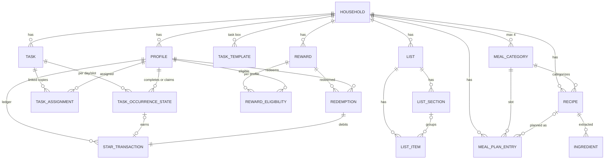

# 03 - Tasks, Rewards, Lists, Meal Planning, Recipes

Research slice for a web clone of Skylight Calendar 2 with the Plus plan. Covers
Tasks Manager (chores, routines, Up for Grabs, habit tracking), Rewards (stars),
Lists, Meal Planning and Recipes, plus the Sidekick AI features that feed them.
Calendar views, event sync, profiles and settings are covered by another
researcher; they appear here only where they intersect this slice.

Research date: 2026-11-04. Primary source is the Skylight Zendesk help center
(`skylight.zendesk.com/hc/en-us`, 459 articles enumerated via
`/api/v2/help_center/en-us/articles.json`). Most articles in this slice were
updated between May and November 2026, so they describe the current software.

Evidence tags used below:

- **[Doc]** stated in a Skylight help article.
- **[Img]** visible in a Skylight screenshot (help article, blog or marketing).
- **[User]** visible in the user's own device photos
  (`assets/user-device/`). The user says the photos may be of an older
  hardware model; the software shown matches the current help screenshots.
- **[Blog]** Skylight's own blog or marketing page (myskylight.com).
- **[Rev]** third-party review.
- **[Inf]** inference, not confirmed by any source.

Out of scope, one line each: Disney Mode (character avatars and celebrations,
paid add-on), Magic Import as a calendar-event importer, Photo Screensaver.

---

## 0. Shared UI conventions in this slice

These apply to every feature below and should be built once.

- **Navigation rail** [Doc][Img][User]: left edge in landscape, bottom edge in
  portrait. Current tab order: Home, Calendar, Lists, Tasks, Rewards, Meals,
  Recipes, Photos, then Sleep and Settings pinned at the bottom. Each tab is an
  outline icon over a small label; the selected tab gets a white tile, the rail
  background is pale blue-gray. A serif "S" logo sits on top (it doubles as the
  Home tab label "Home"). Tabs can be hidden per device (Settings > General >
  Device Navigation, or from the app); Settings cannot be hidden.
- **Information bar** [Doc][Img]: top row. Left: large serif date
  ("Wed, Nov 4"), time, weather icon and temperature. Right: view switcher
  (Day | Week segmented pill on Tasks), Filter dropdown (eye-slash icon),
  `<`, Today (or "This Week"), `>`.
- **Profile colors** [Doc][Img]: every task, reward and profile column is tinted
  with the profile color. Column background is a very light tint, cards a
  slightly stronger tint, completed check circles and Redeem buttons the
  saturated color.
- **Floating Add button** [Img]: blue circle with white `+`, bottom right.
- **Typography** [Img]: serif display face for headings (dates, profile names,
  list titles, recipe titles); geometric sans for body and buttons. Cards and
  pills use large corner radii (fully rounded pills, ~24 px cards).
- **Side panels** [Img]: Add/Edit flows open as a right-side sheet over the
  view with a back arrow and serif title ("Select Breakfast", "Edit recipe").
- **Keyboard** [Doc]: on-device text entry uses an on-screen keyboard
  confirmed with a green check button.
- **Parental Lock** [Doc]: optional 4-digit device PIN that restricts adding or
  modifying events or tasks; configurable inactivity timeout; reset by emailed
  magic link. Checking off tasks and redeeming rewards are not listed as
  PIN-protected [Inf].

### User device photos (ground truth reference)

`assets/user-device/tasks-day-by-profile.jpg` [User]: Tasks Day view, four
profile columns (Asiyah, Mamma, Baba, Hashim! with a small hat emoji on the
name). Each column header: dark green initial avatar, serif name, a "check 0/19"
pill (done/total for today) and a "star 28.5K" pill (star balance, abbreviated
with K). Under it a row of round section buttons labelled Morning, Afternoon,
Evening, Chores; Baba shows only Morning, Evening, Chores because he has no
afternoon items. Task cards: large emoji centered on top, bold title bottom
left, white completion circle bottom right. Cards without an emoji collapse to a
single short row (Mamma's "Dinner"). A chore card in Baba's Chores section reads
"Dhuhr" with a repeat icon and "1:30 PM, Daily". Header right: Day | Week,
Filter, `<` Today `>`. All columns use the same pale blue-green tint in this
household, so profile colors are close to each other.

`assets/user-device/calendar-schedule-4day.jpg` [User]: Calendar Schedule view,
4 days. Under the info bar a row of wide profile pills shows each profile's task
progress ("Asiyah 0/19", "Baba 0/6", "Hashim! 0/19", "Mamma 0/13"); this is the
Calendar Filter "Tasks progress" toggle [Doc]. At the top of Fri and Sat, above
timed events, are white pills with an orange-brown outline reading "Chips" and
"Fruit". These are planned meals: the outline color matches the default Snack
category color (sampled about `#cf812d` vs. outline in photo, see
`assets/help-tasks/user-device-calendar-snack-meal-pills-crop.png`), "Fruit" is a
pre-loaded snack recipe [Img], and the help center states planned meals show in
the Schedule view [Doc]. The "Dinner" and "Prep dinner" blocks at 6-8 PM are
ordinary timed events (filled teal), not meal-plan entries.

Differences noticed between the user's device and current help screenshots:

- All four section buttons are active and Afternoon/Evening sections are visible
  at 11:41 AM; help says non-current routine sections auto-hide [Doc]. Likely
  the user toggled them on and the toggle state persists [Inf].
- The user's balances are in the tens of thousands (11.7K to 32.5K); help
  examples show 10 to 108. See the star economy discussion in section 7.

---

## 1. Tasks overview and section grouping

**What it is.** "Tasks" is the umbrella for two types: **Chores** (one-off or
repeating, optionally dated and timed, assignable to profiles or Up for Grabs)
and **Routines** (repeating habits bound to a part of the day). Completing either
can earn stars (Plus) [Doc].

**Where in the UI.**

- Device: Tasks tab (check-mark icon) [Doc]. Also the "Today's Tasks" pane on
  the Home tab [Doc] and the task-progress pills on the Calendar tab [Doc][User].
- Mobile app: Tasks tile on the app home grid (green check) [Img]. Desktop app:
  Tasks in the side navigation [Doc]. Android has a Tasks widget; iOS has
  small/medium Tasks widgets showing today's tasks only [Doc].

**How the Morning / Afternoon / Evening / Chores grouping is defined** [Doc]

- Each **routine** carries a set of time-of-day slots (any combination of
  Morning, Afternoon, Evening). A routine appears once in each selected
  section. Example: "Brush Teeth" listed in both Morning and Evening of the same
  week grid, each with its own check circles [Img].
- Every **chore** goes in the **Chores** section regardless of its due time.
  Chores have no time-of-day slot; a due time only affects the subtitle and
  reminders.
- Section headings ("Morning", "Afternoon", "Evening", "Chores") render in the
  serif face inside the column, in that fixed order [Img][User].
- Default visibility by clock time:

  | Time | Routine section shown by default |
  |---|---|
  | Midnight - Noon | Morning |
  | Noon - 6 PM | Afternoon |
  | 6 PM - Midnight | Evening |

  Other routine sections are hidden by default; Chores are shown. Tapping a
  section button toggles that section's visibility at any time [Doc]. In the
  mobile app a routine set for the evening does not appear until 6 PM unless the
  Evening button is tapped [Doc].
- Section buttons only appear for sections that have items for that profile on
  that day [Img][User]. A profile with only chores shows no button row at all
  and no "Chores" heading, just the chore list (Frank in
  `device-tasks-day-view-sections-and-chores-only-column.png`) [Img].
- Each section button has a circular progress ring around its emoji icon
  (sun-behind-cloud for Morning, sun for Afternoon, crescent moon for Evening,
  broom for Chores) that fills as that section's tasks are completed [Doc][Img].
  Active (visible) sections render on a white disc; hidden sections are dimmed
  [Img].
- The column header pill "check N/M" counts done/total for the day across all
  sections; skipped tasks are removed from the total [Doc].

**Views on the device** [Doc][Img]

- **Day view**: one column per profile, horizontally scrollable. Up for Grabs is
  the left-most column when enabled. Long-press a profile name and drag to
  reorder columns; the Up for Grabs column can be dragged too.
- **Week view**: one profile at a time. Top row: profile avatar picker on the
  left (each avatar ringed with that profile's progress), section toggles and
  the profile's star total on the right. Grid: rows are tasks grouped under
  section headings, seven day columns. Cell states: green or profile-colored
  filled circle with check = done; white empty circle = scheduled, not done;
  blank = not scheduled that day. Today's column header has a red number badge.
  Week starts Sunday in the help text; one screenshot starts Monday, so it
  likely follows Settings > Calendar > Start week on [Inf]. Navigation button
  reads "This Week".
- **Filter menu** (Tasks): toggles for Completed tasks, Late chores, Skipped
  tasks, Up for Grabs, and one toggle per profile. A profile hidden here is also
  hidden in the Home "Today's Tasks" pane [Doc].

**Mobile app views** [Doc][Img]: Day view shows one profile at a time (or all if
none selected) with a top button row Previous, Today, Next, Day/All, Filter,
Search; a horizontal profile picker starts with an Up for Grabs icon. "All"
view lists every task once (next occurrence), grouped "Routines" / "Chores",
each row showing emoji, title, "Today, Morning" style subtitle, assignee avatar
and completion circle. Search matches task names and descriptions across all
profiles.

**Free vs Plus.** All of tasks is free; only star values and Rewards need Plus
[Doc].

**Images**

- `assets/help-tasks/device-tasks-day-view-profile-columns.png` - Day view,
  4 columns (Alex green, Brian teal, Elena coral, Frank blue). Alex header:
  "1/20" progress pill with partial fill, star pill "10". Routine cards: large
  emoji (toothbrush, shirt) over title, circle at right. Elena's Chores section:
  compact rows with "Today" subtitles; three are completed, shown as stronger
  coral fill with a white check inside a coral circle. Frank: compact chores with
  due times "9 AM", "4 PM", "6 PM", "Today".
- `assets/help-tasks/device-tasks-day-view-sections-and-chores-only-column.png`
  - Earlier layout. Alex column is orange-tinted; Morning button has an orange
  progress arc; "Brush teeth" card shows an outline star badge "10". Elena shows
  only Morning and Evening buttons. Frank (chores only) has no section row.
- `assets/help-tasks/device-tasks-week-view-single-profile.png` - Week view for
  Alex, Mon 10 to Sun 16, today Wed 12 red badge. Rows: Brush teeth, Get
  dressed, Make bed (star badge 10), Take medication (only Mon and Thu cells),
  then Chores: "Clean toy room" with repeat icon "Weekly", one green check on
  Wed. Right side: Morning/Afternoon/Evening/Chores toggles and star icon "10".
- `assets/help-tasks/device-tasks-week-view-habit-streaks.png` - Week view for
  Olivia (lavender), Sun 17 to Sat 23. Cards show badges: gold star "2" plus
  lightning "6" (streak). Profile picker includes an "Uncate..." profile with a
  "?" avatar. Star total "108" top right. Sleep and Settings at rail bottom.
- `assets/help-tasks/device-tasks-onboarding-intro.png` - first-run Tasks
  intro: miniature of the columns on the left, three bullets on the right
  ("Establish routines.", "Keep track of chores.", "Build healthy habits.") and a
  blue Continue pill.
- `assets/help-tasks/mobile-tasks-day-single-profile.png` - mobile Day view,
  "Mon, Jun 8", button row with a red NEW badge on Search, profile picker (Up
  for Grabs, Dad, Mom, Olivia, Ryan selected), Ryan card "0/4" and star "34",
  only Morning and Chores buttons.
- `assets/help-tasks/mobile-tasks-all-view.png` - mobile All Tasks view,
  "Routines" group, rows with emoji disc, "Today, Morning"/"Today, Afternoon"
  subtitles, assignee avatar and circle; row tint follows the assignee color.
- `assets/help-tasks/mobile-search-tasks.png` - "Search Tasks" with query
  "walk": "Walk the Dog" (dog emoji, "Today" plus repeat icon) and "Prep for
  Charity Walk" (no emoji so a broom placeholder icon, "Sat, May 30").
- `assets/help-tasks/blog-device-portrait-tasks.jpg` - portrait device on a
  wall: nav rail moved to the bottom, Calendar header shows profile pills with
  counts ("Ella 3/20"), chore rows subtitled "Any day" or "Today".

**Sources**

- https://skylight.zendesk.com/hc/en-us/articles/36846381293979 (Tasks Tab, device)
- https://skylight.zendesk.com/hc/en-us/articles/44738601403931 (Tasks, mobile)
- https://skylight.zendesk.com/hc/en-us/articles/45761249913499 (Tasks, desktop)
- https://skylight.zendesk.com/hc/en-us/articles/35335515611803 (What Are Tasks)
- https://skylight.zendesk.com/hc/en-us/articles/32082293222043 (Types of Tasks)
- https://skylight.zendesk.com/hc/en-us/articles/48832338430363 (Week View for Tasks)
- https://skylight.zendesk.com/hc/en-us/articles/51496539685787 (All Tasks View)
- https://skylight.zendesk.com/hc/en-us/articles/50876637244571 (Search for Tasks)
- https://skylight.zendesk.com/hc/en-us/articles/49738702477723 (Home Screen)
- https://skylight.zendesk.com/hc/en-us/articles/36625171368987 (Calendar Tab, Tasks progress filter)
- https://skylight.zendesk.com/hc/en-us/articles/40688329580059 (iOS widgets)

---

## 2. Chores

**What it is.** A task assignable to one or more profiles (or Up for Grabs) that
tracks a single or repeating job, not tied to a part of the day [Doc].

**Where in the UI.** Created from the `+` button on the Tasks tab or Home tab
(device), Tasks > Add > Add Task (mobile, desktop). Displayed in the Chores
section of each assignee's column [Doc].

**How it works (create)** [Doc][Img]

1. Tap `+`. The Add Task sheet opens. Mobile shows two tabs/buttons at top:
   Chore (broom icon) and Routine (sun icon), plus a Task Box button.
2. Title (required). Optional emoji via an emoji picker button (smiley with `+`)
   next to the title. Emoji search exists [Doc: Improved Emoji Search].
3. Optional Description (short text or a list of steps).
4. Assign: tap profile avatars to toggle; at least one profile required unless
   Up for Grabs is enabled. An "Add" button creates a new profile inline.
5. Choose Chore.
6. **Date** toggle (default on with today's date in the blog screenshot; the
   help text says "enable Date" to set a due day) [Img][Doc]. Tap the date for a
   date picker.
7. **Due Time** toggle (labelled "Time" in some versions). Time picker with
   hours, minutes, AM/PM. A due time enables "When Due" reminders.
8. **Repeats** toggle, then **Based On**:
   - *Scheduled Date*: Every `N` + unit of time, On (which weekdays / which day
     within the unit), optional Repeats until date. Next instance is created on
     schedule even if the previous one is not done.
   - *Completed Date*: After = Immediately or Custom (`N` + unit). The next
     instance is scheduled only after completion, offset from the completion
     date.
9. **Stars** (Plus): numeric field, digits only.
10. Optional "Save to task box" checkbox.
11. Tap Add.

**Edit** [Doc]: tap the chore, the Details popup opens; adjust fields; Save. For
a task assigned to several profiles (a "linked task") a dialog "Edit Task For"
offers "All assigned profiles" or "<Name> only". Editing for one profile unlinks
that profile's copy. Tasks created before 2026-08-31 with several profiles are
not linked [Doc]. Chores can be converted to routines and back from Edit; the
date/time options are lost on conversion to routine [Doc].

**Delete** [Doc]: Details > Delete > choose "only this instance", "all future
tasks", or "all tasks" > Delete.

**Display** [Img][User]

- Chores with an emoji render as large emoji cards; without one, as compact
  rows (title plus subtitle, circle at right).
- Subtitle shows the due context: "Today", a date ("Sat, May 30"), a time
  ("9 AM"), "Any day" (no date set), and a repeat summary with a repeat icon
  ("Weekly", "1:30 PM, Daily").
- Late chores: stay visible after their due day (toggle "Late chores" in
  Filter). A review describes a red "one day late" indicator [Rev]; Buddy shows
  late chores in red with "N days late" [Doc].

**Fields, options, defaults, limits**

| Field | Type | Default | Notes |
|---|---|---|---|
| title | text | - | required |
| emoji | single emoji | none | optional |
| description | text | empty | optional, searchable |
| assignees | profile[] | none | >= 1 unless Up for Grabs |
| up_for_grabs | bool | off | chores only |
| date | date | off / today | toggle |
| due_time | time | off | enables reminder |
| repeats | bool | off | |
| repeat.based_on | scheduled \| completed | scheduled | "New" in Aug 2026 |
| repeat.every / unit | int + day/week/month (year not confirmed) | 1 | blog: daily, weekly, monthly, custom |
| repeat.on | weekdays or day-in-unit | - | depends on unit |
| repeat.after | immediately \| custom(N unit) | immediately | completed-date mode |
| repeat.until | date | off | |
| stars | int | none | Plus only; max not documented |
| save_to_task_box | bool | off | |

**Free vs Plus.** Free, except Stars [Doc].

**Edge cases & known limitations** [Doc]

- Completing a late chore records completion on the day it was checked, not the
  original due day. Skipped tasks show on the day they were skipped.
- Chores cannot be reordered (only routines can).
- Skip is only offered for repeating chores and routines.
- Assigning one chore to several profiles creates a separate completable copy
  per profile [Blog]; skip applies per profile [Doc].
- Undated chores ("Any day") presumably stay in the list every day until done
  [Inf].

**Images**

- `assets/help-tasks/blog-add-task-mobile-and-device-panel.jpg` - phone "Add
  task" screen (tabs Add task | Task box; Title; "Emoji (optional)"; Profile(s)
  avatars Ella, Harper, Lila, Mom, Add; Chore | Routine segmented; date row
  "Tue, Mar 24" with toggle on; Time and Repeats toggles off; teal Add button).
  Behind it the device shows the same sheet docked on the right with a hint
  "To assign star values, use the app" (pre-October 2026 behavior).
- `assets/help-tasks/mobile-add-task-type-title-description.png` - current
  mobile Add Task: Chore (selected, outlined) and Routine buttons, Task Box
  button at right, title field "Unclog the Dishwasher", emoji-add button,
  Description field with keyboard icon.
- `assets/help-tasks/mobile-edit-task-repeat-based-on.png` - Edit Task: Repeats
  toggle on, "Based On" with coral "New" badge, segmented Scheduled Date |
  Completed Date (Completed selected), "When" segmented Immediately | Custom.
- `assets/help-tasks/mobile-edit-linked-task-scope-dialog.png` - "Edit Task
  For" sheet: radio rows "All assigned profiles" (two avatars) and "Elena only",
  blue "Edit Task" and gray "Cancel" pills.
- `assets/help-tasks/task-chore-routine-type-toggle.png` - Chore (broom,
  outlined = selected) vs Routine (sun with slash) round buttons.
- `assets/help-tasks/blog-chore-cards-with-stars.jpg` - marketing: two pink
  chore cards floating over a photo, "Walk Max" (dog emoji, star pill 25) and
  "Poo Patrol" (poop emoji, star 15), each with a coral check circle.

**Sources**

- https://skylight.zendesk.com/hc/en-us/articles/36846381293979
- https://skylight.zendesk.com/hc/en-us/articles/44738601403931
- https://skylight.zendesk.com/hc/en-us/articles/53932501748251 (Repeat a Chore After Completion)
- https://skylight.zendesk.com/hc/en-us/articles/55207742218267 (Linked Tasks)
- https://skylight.zendesk.com/hc/en-us/articles/55094042291739 (Late Chores)
- https://skylight.zendesk.com/hc/en-us/articles/35340626864027 (Convert Chores/Routines)
- https://skylight.zendesk.com/hc/en-us/articles/50338871278107 (Task Description)
- https://skylight.zendesk.com/hc/en-us/articles/50548329972379 (Chores on Buddy, late display)
- https://myskylight.com/how-to-manage-chores-and-family-tasks-with-skylight-calendar
- https://chrislovesjulia.com/skylight-calendar-review/ [Rev]

---

## 3. Routines and habit tracking

**What it is.** A repeating task meant to build a habit, shown in the Morning,
Afternoon and/or Evening section [Doc]. Routines differ from chores:

| | Routine | Chore |
|---|---|---|
| Repeats | always (daily or weekly cadence) | optional |
| Date / due time | none | optional |
| Placement | one or more of Morning/Afternoon/Evening | Chores section |
| Reorderable | yes, within its section per profile | no |
| Up for Grabs | no | yes |
| Habit tracking (streaks) | yes | no |
| Delete options | all future, all | this, all future, all |
| Buddy timer | yes ("Add a Timer on Buddy", min:sec) | not documented |

Routines are not ordered multi-step objects. Each routine is one checkable item;
"steps" are modelled as several routines in the same section, ordered by drag
[Doc]. The description field can hold a list of steps as text [Doc]. Routines
are not time-boxed on the Calendar device; the only timer is Buddy's optional
per-routine timer, after which the task can be checked off [Doc].

**How it works (create)** [Doc]: `+` > title, optional emoji, optional
description, Assign profiles > Routine > optional Track Habit toggle > Repeat:
"Every [1]" + Day | Week; for Week choose days of week (multi-select); "In the":
Morning / Afternoon / Evening (multi-select) > Stars (Plus) > optional Save to
task box > Add.

**Reorder** [Doc][Img]: long-press a routine, drag within the same section,
release. Cannot cross sections or profiles. Available on device (since
Oct 2025) and mobile Day view (since Jun 2026).

**Habit tracking** [Doc][Img]

- Per-routine toggle "Track Habit" (lightning icon).
- A badge with a lightning bolt and a number (current streak, consecutive
  scheduled days completed) appears on the card next to the star badge.
- Skipping a day keeps the streak intact but does not advance it.
- Celebrations: a full-screen card for extended streaks ("You're Doing Great!",
  "12x Streak", big clapping-hands emoji on a scalloped lavender badge with a
  speech-bubble number, profile avatar, Continue button). Weekly: "Amazing
  Week" if done every scheduled day, "Strong Week" if one day was missed (for
  routines happening at least 3 times a week). Exact streak thresholds for the
  card are not documented.

**Fields, options, defaults, limits**

| Field | Type | Default | Notes |
|---|---|---|---|
| title, emoji, description, assignees | as chore | | |
| repeat.every | int | 1 | "Tap in the 1 field" |
| repeat.unit | day \| week | day | |
| repeat.weekdays | set of Sun..Sat | - | week unit only |
| parts_of_day | set of morning/afternoon/evening | - | at least one [Inf] |
| track_habit | bool | off | |
| stars | int | none | Plus |
| buddy_timer | duration | off | Buddy hardware only |
| sort_order | int | creation order [Inf] | per profile per section |

**Free vs Plus.** Free, except Stars.

**Edge cases** [Doc]: Skip/Unskip available for routines. A skipped instance
earns no stars and is excluded from the totals and the progress ring. If a
routine is assigned to several profiles, skip and completion are per profile.

**Images**

- `assets/help-tasks/device-tasks-reorder-routine-frames.png` - three frames:
  Morning list "Brush Teeth, Make Coffee"; "Brush Teeth" lifted with a teal
  outline and shadow; final order "Make Coffee, Brush Teeth".
- `assets/help-tasks/mobile-reorder-routines-frames.png` - same on mobile with
  the profile picker above (Olivia selected), Evening section.
- `assets/help-tasks/task-track-habit-toggle.png` - row with lightning icon,
  "Track Habit", blue toggle on.
- `assets/help-tasks/task-card-star-and-streak-badges.png` - "Crafting Time"
  with ball-of-yarn emoji and two small pills: outline star "4", lightning "9".
- `assets/help-tasks/task-streak-celebration-modal.png` - streak celebration
  card described above.

**Sources**

- https://skylight.zendesk.com/hc/en-us/articles/35336169688475 (Create Routines)
- https://skylight.zendesk.com/hc/en-us/articles/50672917447067 (Track Your Habits)
- https://skylight.zendesk.com/hc/en-us/articles/50672642373019 (feature note)
- https://skylight.zendesk.com/hc/en-us/articles/42816601850523 (Reorder Routines, device)
- https://skylight.zendesk.com/hc/en-us/articles/52180531245339 (Reorder Routines, mobile)
- https://skylight.zendesk.com/hc/en-us/articles/50541178669979 (Routines on Buddy)

---

## 4. Up for Grabs chores

**What it is.** A chore anyone in the household can claim when done [Doc].

**Where in the UI.** Device: left-most column titled "Up for Grabs" with a teal
house-with-people icon and a progress pill; draggable like other columns; also
appears in the Home "Today's Tasks" pane. Mobile: first icon in the profile
picker. Filter toggle "Up for Grabs" shows/hides it [Doc][Img].

**How it works** [Doc][Img]

1. Create a chore with the Up For Grabs toggle on (only chores qualify). Same
   fields as a chore, no assignees.
2. When someone has done it, tap the task. A sheet "Complete Task / Who
   completed it?" lists every profile as a radio row with avatar.
3. Pick a profile, tap Complete. The task moves into that profile's column as
   completed, with a small house-people badge on the card. Stars go to that
   profile [Inf: "credit the complete task"].
4. Mark as Incomplete returns it to the Up for Grabs column.
5. Skip is available for repeating Up for Grabs chores.

**Edge cases.** A review notes families use it as "first to claim earns the
stars" [Rev]. Only one profile can be credited per instance [Inf].

**Images**

- `assets/help-tasks/device-tasks-up-for-grabs-column.png` - columns "Up for
  Grabs" (teal, "0/1", coral "New" badge, chore "Car Wash / Today"), "Baker
  Family" (yellow, "0/0", star 50), "Dad" (teal, "0/0").
- `assets/help-tasks/device-tasks-up-for-grabs-who-completed-dialog.png` -
  "Complete Task" sheet, rows Baker Family, Dad (selected, black outline, blue
  radio), Mom, Olivia.
- `assets/help-tasks/device-tasks-up-for-grabs-claimed-card.png` - Dad column
  "1/1", "Car Wash / Today" with teal check and a house-people chip.
- `assets/help-tasks/device-tasks-up-for-grabs-drag-and-empty-state.png` -
  Up for Grabs column being dragged across; Mom's empty column shows a large sun
  illustration and "Nothing to do today."
- `assets/help-tasks/device-home-tasks-pane-up-for-grabs-and-empty.png` - Home
  pane: Up for Grabs card with "Car Wash", Mom card with raised-hands emoji and
  "Nothing to do today."

**Sources**

- https://skylight.zendesk.com/hc/en-us/articles/49525040352795
- https://skylight.zendesk.com/hc/en-us/articles/54868108596507
- https://skylight.zendesk.com/hc/en-us/articles/36846381293979

---

## 5. Task Box (task templates)

**What it is.** A library of saved chores and routines for re-adding to
profiles, useful for non-scheduled recurrences (e.g. "Book Report") [Doc].
Ships with pre-made chores and routines, which can be edited or deleted [Doc].

**Where in the UI.** Mobile/desktop: Add > Task Box. Also the "Save to task box"
checkbox during task creation [Doc]. On device, the Add sheet in older
screenshots shows a "Task box" tab [Img]; current device support is not
explicitly documented [Inf].

**How it works** [Doc]: Task Box shows tabs Routine / Chores and a search bar
that filters as you type. Tap a template > select profiles > Add. Each template
has an ellipsis menu: Edit (title, emoji, chore/routine type, stars) or Delete
(irreversible).

**Sources**

- https://skylight.zendesk.com/hc/en-us/articles/39074226341659

---

## 6. Completion flow, skip, reminders, notifications, celebrations

**Check off** [Doc][Img]

- Tap the white circle at the right of the card, or tap the card to open
  Details and tap "Mark as Complete". The circle fills with the profile color
  and a white check; the card fill deepens to a stronger tint of the profile
  color. Completed tasks can be hidden via Filter > Completed tasks.
- Undo: tap the check again, or Details > "Mark as Incomplete". Stars for an
  un-checked task are removed from the balance [Doc].
- Tasks can be checked from the Home screen pane, the Tasks tab (day and week
  grid) and the apps [Doc].
- Completing all of a profile's tasks for the day triggers a full-screen "emoji
  rain" (Skylight blog: "the screen bursts into an explosion of emojis"),
  randomized and sometimes seasonal [Doc][Blog]. It also plays in the mobile app
  [Doc: Disney celebration FAQ says app users "see the standard emoji rain"].
  No sound is documented for completion [Inf: none].
- No per-check animation beyond the fill is documented [Inf].

**Details popup** [Doc]: title, emoji, description, schedule, assignees, and
buttons Mark as Complete / Mark as Incomplete, Skip / Unskip (repeating only),
Edit, Delete.

**Skip** [Doc]: no stars; removed from counts and progress ring; does not break
streaks; per profile. Shown or hidden with the Skipped tasks filter. Unskip
restores.

**Reminders** [Doc]

- Only for chores with a due time. Device: Settings > Reminders > "When Due"
  shows a "Reminders" popup listing due events and tasks (each row with icon,
  title, time, profile avatar) and a Dismiss button; optional chime ("Reminder
  sound").
- Phone: Settings > Notifications > Task Notifications: "When Due" and "When
  Completed" push notifications. Completion push reads "Dry the Dinner Dishes /
  Completed by Olivia (2 stars)".

**Images**

- `assets/help-tasks/device-reminders-popup-with-task.png` - "Reminders" card:
  light-blue event row "Soccer Practice 5:00-6:00 pm" with calendar icon, darker
  blue task row "Pack Library Book 5:30 pm" with check icon, avatars at right,
  blue Dismiss pill.
- `assets/help-tasks/mobile-task-completed-push-notification.png` - iOS banner
  described above.
- `assets/help-tasks/task-skip-button.png` - white pill with curved arrow
  "Skip".

**Sources**

- https://skylight.zendesk.com/hc/en-us/articles/48841217883675 (Skip Tasks)
- https://skylight.zendesk.com/hc/en-us/articles/52390654789659 (Task Due Reminders)
- https://skylight.zendesk.com/hc/en-us/articles/54930439904923 (Completion Notifications)
- https://skylight.zendesk.com/hc/en-us/articles/36836043247131 (Reminders Settings)
- https://skylight.zendesk.com/hc/en-us/articles/45795554249371 (Mobile Settings)
- https://skylight.zendesk.com/hc/en-us/articles/52079895032475 (task celebrations, emoji rain)
- https://skylight.zendesk.com/hc/en-us/articles/52081384964891
- https://myskylight.com/how-to-manage-chores-and-family-tasks-with-skylight-calendar

---

## 7. Rewards and the star economy

**What it is.** Plus feature. Profiles earn stars by completing tasks that carry
a star value, plus manual grants; stars are spent on Rewards that parents
define [Doc]. Fully rolled out December 2024 [Doc].

**Where in the UI.** Device: Rewards tab (star outline icon). Mobile: Rewards
tile (yellow star). Desktop: Rewards. Star totals also appear in task column
headers, the Tasks week view and Buddy [Doc][Img].

**Earning stars** [Doc]

- Each task has an optional integer star value; it is credited to the
  completing profile when checked and removed if un-checked. Skipped tasks earn
  nothing.
- Star value editing: historically app only ("To assign star values, use the
  app" banner on the device); since 2026-10 also on the device via a "Stars"
  row in the task editor [Doc][Img].
- Manual adjustments (mobile/desktop only): **Give stars** and **Remove
  stars**. Select one or more profiles, enter a number, review a "Profile /
  Before / After" table, Confirm. Older docs say to remove by entering a negative
  number in Give stars. A removal example takes Dad from 4 to 0; whether a
  balance can go negative is not documented.
- Guidance: Skylight suggests 1, 2, 3 or 5 stars per chore and rewards worth
  10, 20 or 50 [Doc FAQ]; another article suggests 5-10 for daily routines and
  up to 100 for a big chore [Doc].

**Balances** [Doc][Img][User]: per profile, an integer shown in a pill with a
gold star. Abbreviated over 1000 ("28.5K") [User]. A profile with zero stars
shows no star pill in the task header [Img]. Week view shows a star total for
the selected profile [Img]. Star badges on task cards appear outline when not
earned and gold-filled once earned today [Img; Inf on meaning].

**Star economy at the user's scale** [Inf]: balances of 11.7K-32.5K with
6-19 tasks per profile per day are consistent with roughly 5 stars per task
accumulated over most of a year (19 x 5 x 300 = 28.5K), or with high per-task
values. The documented reward cost range is 1-500 stars, so at this scale every
reward is always redeemable. The clone should use 64-bit-safe integers, compact
number formatting, and should not assume the 500 cap is still enforced.

**Rewards: create** [Doc] (mobile/desktop; not on device)

| Field | Type | Notes |
|---|---|---|
| title | text | shown on the reward card |
| description | text | optional, shown in reward details |
| emoji | single emoji | optional, shown on card |
| renew_after_redeeming | bool | "recurring reward": resets after each redemption and is immediately available again if balance allows |
| stars_required | int | 1-500 [Doc] |
| eligible profiles | profile[] | >= 1; progress tracked separately per profile |

**Rewards: view and redeem on the device** [Doc][Img]

1. Tap Rewards. One card per profile (swipe if they do not fit), tinted with the
   profile color: avatar, serif name, star balance pill.
2. Each eligible reward is a white card with its title. If balance >= cost, a
   full-width pill button in the profile color reads "Redeem [star] 5". If not,
   a progress bar pill shows "[star] 50/100", filled proportionally.
3. Tap Redeem: the cost is deducted from that profile's balance. Non-renewing
   rewards disappear from the tab after redemption [Inf from "Unredeemed rewards
   will be visible... unless deleted"]; renewing ones reset to show new
   progress.
4. No approval step or PIN is documented on the device; anyone at the device
   can redeem [Inf]. Buddy (kid device) cannot redeem: it shows "Get reward in
   the app" and a QR code that opens the reward in a parent's mobile app ready to
   redeem [Doc].
5. A redemption celebration is documented only for Disney Mode (out of scope)
   [Doc].

**Mobile/desktop Rewards screen** [Img]: header "Rewards" with round buttons
Give stars, Filter (and Remove Stars in newer builds); horizontal avatar strip
with balance chips under each avatar; selected profile card below with reward
cards. Edit/Delete via the reward's details menu (desktop help).

**History.** No redemption or star-transaction history screen is documented. An
App Store reviewer complained it is "difficult to figure out what my kids have
redeemed stars on" [Rev, via search snippet]. Resetting balances has no
dedicated control; use Remove stars [Inf].

**Free vs Plus.** Plus only: assigning stars, creating rewards. Without Plus the
Rewards tab is not usable [Doc].

**Edge cases** [Doc]

- Every reward must be assigned to at least one profile; multi-profile rewards
  track progress per profile independently.
- Unredeemed rewards stay visible until deleted in the app.
- Deleting a profile deletes rewards associated only with that profile.

**Images**

- `assets/help-tasks/device-rewards-redeem-and-progress.png` - Robin card
  (green): star pill 50; "Small Book" with green Redeem pill "star 5"; "Large
  Book" with progress pill "50/100" half filled.
- `assets/help-tasks/mobile-rewards-profile-picker.png` - mobile Rewards:
  Give stars and Filter buttons, avatar strip (Baker Family selected with 50,
  others 0), Baker Family card with "Waffle Night" and a pale yellow "Redeem 50"
  pill.
- `assets/help-tasks/desktop-rewards-view.png` - desktop version of the same.
- `assets/help-tasks/mobile-give-stars-before-after-table.png` - table:
  Dad 0 -> 4, Ryan 15 -> 19.
- `assets/help-tasks/mobile-remove-stars-before-after-table.png` - Dad 4 -> 0.
- `assets/help-tasks/device-task-stars-field.png` - device task editor: blue
  info banner with coral "New" chip "You can now add stars directly on your
  calendar device." above a "Stars" row with outline star.

**Sources**

- https://skylight.zendesk.com/hc/en-us/articles/36846860676123 (Rewards Tab)
- https://skylight.zendesk.com/hc/en-us/articles/36846200077723 (Stars, Tasks, and Rewards)
- https://skylight.zendesk.com/hc/en-us/articles/44739096640667 (Create and Redeem Rewards, mobile)
- https://skylight.zendesk.com/hc/en-us/articles/45763229367451 (Rewards, desktop)
- https://skylight.zendesk.com/hc/en-us/articles/30450528727835, /30456865333403, /30479963424667, /30486916645531, /30485221515163, /30453539229979, /30450768494235, /30453626667547, /30453280620187, /30453883731739, /30453438405531, /30453829370011 (Rewards FAQ)
- https://skylight.zendesk.com/hc/en-us/articles/57807019023259 (Add Stars on the Device)
- https://skylight.zendesk.com/hc/en-us/articles/50338072005147 (Remove Stars)
- https://skylight.zendesk.com/hc/en-us/articles/52478755577755 (Stars and Rewards on Buddy)
- https://myskylight.com/lp/rewards/
- https://appshunter.io/ios/app/1438779037/reviews [Rev, not fetched; search snippet]

---

## 8. Lists

**What it is.** Shared household lists: To Do, Grocery, Other. Free [Doc].

**Defaults.** Pre-made lists for groceries and to-dos (device help says
"Shopping and To-Dos", app help says "Grocery and To-Dos") [Doc]. The list named
exactly **"Grocery List"** is the target of every "Add to Grocery List" action
and of Alexa adds without a list name [Doc].

**Where in the UI.** Device: Lists tab (horizontal row of list cards, swipe for
more) and the Home "Lists" pane. Mobile/desktop: Lists tile shows lists with
item counts; tap to open one. iOS/Android list widgets [Doc].

**How it works** [Doc][Img]

- Device list card: list-colored background, serif title, count badge, ellipsis
  menu (Add Item, Edit List, Add Section, Clear Completed), "Add item" field at
  top, items as rounded rows with a checkbox on the right.
- Add item: tap "Add item", type, green check.
- Check off: tap the checkbox. On device, if completed items are visible they
  show a filled checkbox, gray strikethrough text; Filter > Completed toggles
  them. On mobile, the item disappears immediately and a snackbar offers Undo.
- Reorder (device, since Jun 2026): long-press an item, it lifts (outline,
  orange pointer at left), drag, release. Mobile: drag between sections.
- Sections: Add Section (name, green check); mobile requires adding an item to
  create it. Sections are collapsible headers with a count badge and chevron
  [Img]. Delete a section by clearing its name on device.
- Clear Completed: confirmation shows how many items and sections will be
  deleted.
- Mobile/desktop bulk edit: Select > Select all or per-item checkboxes > Move
  (to an existing or new section by name) or Delete.
- Create list: `+` > Add List dialog with tabs Type | Photo | Talk. Type: Title,
  List type (To Do / Grocery / Other), Color chooser, Add. Photo and Talk on the
  device show a QR code deep link (`skylight-family://calendar/<id>/sidekick/?action=lists`)
  that opens Sidekick on the phone.
- Edit list: title, type, color. Delete list: irreversible confirm.
- **Hide on Device** (mobile toggle): list exists only in the apps (gift lists).
- Mobile app lists are viewable and editable offline; changes sync on
  reconnect.

**Grocery list behavior** [Doc][Img]

- Any list can be typed Grocery; multiple grocery lists are allowed.
- **Organize** (sparkle icon, mobile/desktop): removes duplicates and sorts items
  into aisle categories (sections such as "Bakery", "Dairy"). Implementation not
  documented; likely an AI/classifier call [Inf].
- **Order** (Instacart carrot icon): US only; copies items into an Instacart
  cart ("Get Ingredients"), opens the Instacart app. Device shows an Instacart
  icon that displays a QR code to continue on the phone. Instacart may not match
  items or quantities exactly.
- Recipe ingredients are added from recipes and meal plans (section 9/10).

**Fields, options, defaults, limits**

| Entity | Fields |
|---|---|
| List | title, type (todo/grocery/other), color, hidden_on_device, sort order (swipe order) [Inf] |
| Section | name, order |
| Item | text (may begin with an emoji [Img]), completed, section, order |

No per-item quantity, notes, assignee or due date is documented [Inf: none].
Lists are household-wide, not per profile [Inf].

**Free vs Plus.** Lists free; Sidekick photo/voice import Plus; Organize/Order
availability on Free not stated [Inf: likely free, as it is described as a
grocery list feature without a Plus banner].

**Edge cases.** Device and mobile help disagree on the default list name
("Shopping" vs "Grocery"). The desktop and mobile articles each claim group
selection is exclusive to them; both have it [Doc].

**Images**

- `assets/help-tasks/device-home-lists-pane-grocery-sections.png` - Home
  "LISTS" pane with `<` `>` pager: "Garden Center" (blue card, badge 2, items
  Vermiculite, Potting Mix) and "Grocery List" (salmon card, badge 26) with
  collapsible sections "Bakery 1" (Hot dog buns) and "Dairy 2"; blue FAB.
- `assets/help-tasks/device-list-reorder-item-frames.png` - Garden Center list
  with an active "Add item" field; "Mushroom Compost" lifted and moved to top.
- `assets/help-tasks/mobile-list-select-move-delete.png` - "Back-to-School
  Shopping List": round buttons Select, Select all (blue count badge 3), Move,
  Delete (red); pink rows with checkboxes on the left and emoji-prefixed names
  (Books, Scissors, Composition Book checked).
- `assets/help-tasks/list-type-selector.png` - segmented To Do | Grocery
  (selected) | Other.
- `assets/help-tasks/mobile-add-list-sidekick-bar.png` - lavender "SIDEKICK"
  bar with Photo and Talk pills.
- `assets/help-tasks/mobile-list-hide-on-device-toggle.png` - eye-slash "Hide
  on Device" toggle.

**Sources**

- https://skylight.zendesk.com/hc/en-us/articles/37275069922971 (Lists Tab)
- https://skylight.zendesk.com/hc/en-us/articles/44739335665051 (Organize with Lists, mobile)
- https://skylight.zendesk.com/hc/en-us/articles/45766906299035 (desktop)
- https://skylight.zendesk.com/hc/en-us/articles/360041476692 (grocery list)
- https://skylight.zendesk.com/hc/en-us/articles/47929314290203 (multiple grocery lists, Organize, Order)
- https://skylight.zendesk.com/hc/en-us/articles/47603555960475 (Hide lists, Clear Completed)
- https://skylight.zendesk.com/hc/en-us/articles/51482785426075 (device list improvements)
- https://skylight.zendesk.com/hc/en-us/articles/39335191603867 (Instacart)
- https://skylight.zendesk.com/hc/en-us/articles/39336282810779 (Import Lists)
- https://skylight.zendesk.com/hc/en-us/articles/39334445093403 (Alexa)
- https://skylight.zendesk.com/hc/en-us/articles/40688329580059 (widgets)

---

## 9. Meal Planning

**What it is.** Plus feature. A 7-day grid of meals by category, shown to the
whole family and optionally on the calendar [Doc].

**Where in the UI.** Device: Meals tab (fork and knife). Mobile/desktop: Meals
tile (vertical scrolling list by day). Calendar Schedule view (device) and
month/day sheets (mobile) show planned meals [Doc][Img][User].

**The grid** [Doc][Img]

- Seven day columns (help: "the next seven days"; 2024 screenshots show a
  Sun-Sat week with today badged in red), up to four rows, one per enabled meal
  category, with the category name written vertically at the left.
- Default categories and colors (sampled from screenshots): Breakfast `#f56852`
  (cells `#fab4a8`), Lunch `#a7d3d4` (cells `#d3e9e9`), Dinner `#fdc36d` (cells
  `#fee1b6`), Snack `#cf812d` (cells `#e6c096`). Each category has a letter
  avatar (B, L, D, S).
- Each cell lists its recipe names; several recipes stack vertically within one
  cell. Empty cells are a paler tint; the selected empty cell gets a red outline.
  Marketing shots show an emoji before each meal name, presumably the recipe or
  meal emoji or auto-chosen [Img][Inf].
- Navigation `<` Today `>` buttons are present [Img]; they presumably move by
  week [Inf].
- Filter (formerly "Categories") menu: per category a letter avatar, name,
  show/hide toggle and pencil to rename and recolor. Maximum four categories;
  no add/remove beyond the four [Doc].

**Adding a meal** [Doc]

1. Tap an empty meal cell (or long-press a filled one to add another recipe),
   or tap `+` in the app.
2. Panel "Add meal" / "Plan Meal": **From Recipes** (list filtered by category
   chips; tap one) or **New Entry**.
3. Plan entry fields: date (tap to move to another day), category, **Repeats**
   toggle (frequency and end), **Instructions or ingredients** notes for this
   instance, and a **Save to Recipes** (device) / **Update Recipe** (app) toggle
   that writes changes back to the recipe. Tap Add / Plan.
4. New Entry tabs: Type | Website | Photo | Talk | Fridge. Type fields: "What
   are we eating?" (name), date, category, Repeats, Instructions or ingredients,
   Save to Recipes toggle. A New Entry with Save to Recipes off is a one-off meal
   not kept in the recipe box [Inf]. Website/Photo/Talk/Fridge on device show a
   QR code to continue in Sidekick on the phone
   (`skylight-family://calendar/<id>/meals/add?recipeBox=false`).
5. In the app, choosing a recipe that has ingredients prompts "Add to Grocery
   List?" ("Easily add Pizza ingredients to your Grocery List with one tap.")
   with Add to Grocery List / No Thanks.

**Meal popup** [Doc][Img]: tap a planned meal: serif title, pencil (edit) and
red trash (delete) buttons, "Add to List" (cart) and "Open Recipe" (book)
buttons, date row, category with letter avatar, notes/ingredients text. Open
Recipe jumps to the Recipes tab full screen. Delete removes it from the plan only
(not from the recipe box).

**On the calendar** [Doc][User]

- "Meals will display in the calendar in the Schedule view." On the user's
  device they render as white pills with a category-colored outline in the
  all-day area at the top of each day column, showing the recipe name only.
- Visibility controls: Settings > Calendar > Show in Calendar > Meals (per
  category toggles); Calendar Filter > "Show Meals" toggle; mobile Settings >
  Calendar > Show Meals. Mobile calendar has a Meals button; mobile month view
  "Day at a Glance" sheets list a day's meals [Doc][Img].
- A reviewer shows only Dinner on the calendar [Rev].
- Menus imported by email can be tagged with names from the subject line,
  rendered as "Emma, Jake: Grilled Cheese & Chicken Tenders" [Doc].

**Recurring meals** [Doc]: per-entry Repeats with frequency and end (e.g.
weekly pizza night). Exact repeat options not documented; assume same repeat
editor as events [Inf].

**Free vs Plus.** Plus only (grid, recipes, Sidekick) [Doc].

**Edge cases & limitations** [Doc][Rev]

- Four categories maximum; a recipe belongs to exactly one category.
- Deleting a recipe offers "This recipe" (planned meals remain) or "This recipe
  and planned meals".
- No calorie/nutrition, servings scaling or per-profile meal assignment in the
  manual planner [Inf: none documented].
- Reviewers: pre-loaded recipes are basic; ingredients go only to Skylight's own
  list (no AnyList) [Rev].

**Images**

- `assets/help-tasks/device-meals-grid-categories-menu-2024.png` - full week
  Sun 23 to Sat 29 with Breakfast/Lunch/Dinner/Snack rows, stacked entries
  (Bagels / Eggs; Carrots and Hummus / Extra food), Categories dropdown open
  with B/L/D/S toggles and pencils. Uses the 2024 nav (Calendar, Chores, Meals,
  Photos, Lists).
- `assets/help-tasks/device-meals-select-breakfast-panel-2024.png` - grid with
  Sat 29 breakfast cell outlined red, right panel "Select Breakfast" with an
  "Add recipe" field and recipe rows (Bagels, Eggs, Fruit, Milk & Cereal,
  Oatmeal, Pancakes, Toast) each with an ellipsis.
- `assets/help-tasks/device-meals-delete-recipe-dialog-2024.png` - dimmed grid,
  "Edit recipe" panel ("What are we eating?" Salmon, Category Lunch,
  Description, red Delete), modal "Delete recipe" with radio rows "This recipe"
  / "This recipe and planned meals", red Delete and gray Cancel.
- `assets/help-tasks/device-meals-filter-categories.png` - current Filter popover
  with B/L/D/S rows, blue toggles and pencil buttons.
- `assets/help-tasks/mobile-meals-filter-categories.png` - same in the app.
- `assets/help-tasks/device-meal-popup-add-to-list-open-recipe.png` - "Bagels"
  popup with edit/delete, Add to List, Open Recipe, "Wednesday, March 11",
  Category Breakfast, "Ingredients: - Bagels - Cream cheese - Strawberry jam
  (optional)".
- `assets/help-tasks/mobile-add-to-grocery-list-prompt.png` - prompt described
  above, blue primary and gray secondary pills.
- `assets/help-tasks/blog-meals-grid-and-sidekick-create-meal-plan.jpg` - device
  grid with custom colors (Breakfast peach, Lunch cyan, Dinner lavender, Snack
  pink) and emoji-prefixed entries (Blueberry Pancakes, Eggs Benedict, TACOS!,
  Pretzels, Apple); phone shows Sidekick "Create meal plan".
- `assets/help-tasks/blog-meals-select-dinner-panel.jpg` - person tapping the
  grid with a "Select Dinner" side panel listing recipes.
- `assets/help-tasks/user-device-calendar-snack-meal-pills-crop.png` - crop of
  the user's photo: "Chips" (Fri 6) and "Fruit" (Sat 7) outlined pills.

**Sources**

- https://skylight.zendesk.com/hc/en-us/articles/41418036777371 (Meals Tab)
- https://skylight.zendesk.com/hc/en-us/articles/44739809442587 (Meal Planner, mobile)
- https://skylight.zendesk.com/hc/en-us/articles/45767619462683 (desktop)
- https://skylight.zendesk.com/hc/en-us/articles/26901740297627, /26902065343771, /26902149028379, /26933067959963 (2024 articles)
- https://skylight.zendesk.com/hc/en-us/articles/42181628465435 (ingredients to shopping list)
- https://skylight.zendesk.com/hc/en-us/articles/36625171368987 (Calendar Tab, Show Meals)
- https://skylight.zendesk.com/hc/en-us/articles/36835449004315 (Calendar Settings, Show in Calendar)
- https://skylight.zendesk.com/hc/en-us/articles/58095784867227 (Day at a Glance)
- https://skylight.zendesk.com/hc/en-us/articles/47278643288091 (menus by email)
- https://myskylight.com/how-to-meal-plan-with-skylight-calendar-time-saving-tips-for-families/
- https://www.reviewed.com/smarthome/content/skylight-calendar-2-review [Rev]
- https://www.slashgear.com/2105122/skylight-calendar-2-review-features-specs-price [Rev]

---

## 10. Recipes

**What it is.** Plus feature. The household recipe box (renamed "Recipes";
"Recipe Box" is the old name), used by the meal planner [Doc].

**Where in the UI.** Device: Recipes tab (open book icon), added Dec 2025.
Mobile/desktop: Recipes tile [Doc].

**How it works** [Doc][Img]

- Device Recipes tab: two panels. Left: category filter chips (B/L/D/S colored
  discs; tap to filter, tap again to clear) and the recipe list (rows with a
  category letter avatar and name). Right: selected recipe on a pale blue card -
  serif title, pencil and red trash buttons top right, "Plan Meal" button,
  Category, then the recipe text ("Ingredients:" list and "Instructions:"
  numbered steps). The screensaver is paused while a recipe is shown, with a
  snackbar "Screensaver is paused while you're in Recipes. Dismiss".
- Plan Meal: dialog with Date, Category, Repeats; Plan Meal; optional Add to
  Grocery List.
- Add Recipe (`+`): Type | Website | Photo | Talk | Fridge (same as meal New
  Entry; Sidekick options hand off by QR code
  `skylight-family://calendar/<id>/sidekick/?action=recipes`).
- Edit recipe: Name, Category (exactly one), "Instructions or ingredients"
  free-text, Delete, Save.
- Delete: "This recipe" vs "This recipe and planned meals"; not restorable.
- Mobile: search box ("Matching recipes will move to the top of the list"),
  detail view with Add to List and Plan Meal buttons, ellipsis menu for
  Edit/Delete.

**Fields, options, defaults, limits** [Doc][Img]

| Field | Notes |
|---|---|
| name | required |
| category | one meal category |
| body ("Instructions or ingredients") | single free-text field; Sidekick imports format it as "Ingredients:" and "Instructions:" sections |
| source_url | Sidekick keeps the URL for email-imported recipe URLs [Doc]; display location not documented |

Not documented and probably absent: structured ingredient objects with
quantities, servings, prep/cook time, photos, tags, nutrition [Inf]. "Add to
Grocery List" works only "if the recipe has ingredients", so ingredients are
extracted from the text, probably server-side [Inf].

**Pre-loaded recipes** [Img][Doc "pre-loaded list of meals"]: Bagels, Eggs,
Fruit, Milk & Cereal, Oatmeal, Pancakes, Toast; Grilled Cheese, Salad, Soup,
Wraps; Burgers, Spaghetti, Tacos, Pizza, Eat Out; Granola Bar, Fruit, Yogurt,
Carrots and Hummus, Cheese and Crackers, Extra food (assignment to categories
inferred from 2024 grid screenshots) [Inf].

**Free vs Plus.** Plus only [Doc].

**Images**

- `assets/help-tasks/device-recipes-tab-two-panel.png` - "Pizza Salami" detail
  (Dinner) with ingredient lines, list on the left (Acai bowl, Avocado and
  poached egg toast, Banana bread, Chia seed oatmeal, Cornflakes).
- `assets/help-tasks/device-recipes-tab-category-filter.png` - Breakfast chip
  selected (others faded), Bagels selected with black outline, detail shows
  Ingredients and Instructions.
- `assets/help-tasks/device-edit-recipe-panel-top.png` - "Edit recipe" sheet top
  with Name "Bagels" and Category fields.
- `assets/help-tasks/mobile-recipes-list.png` - app list with B/L/D/S chips,
  Search field, rows with letter avatars and ellipses.
- `assets/help-tasks/mobile-recipe-detail.png` - app detail: back arrow,
  "Bagels", ellipsis, Add to List and Plan Meal pills, blue "Category" label,
  body text.
- `assets/help-tasks/device-recipes-screensaver-paused-snackbar.png` - dark
  snackbar with blue Dismiss.

**Sources**

- https://skylight.zendesk.com/hc/en-us/articles/43810243302811 (Recipes Tab)
- https://skylight.zendesk.com/hc/en-us/articles/44338446585115 (Keep Track of Recipes, mobile)
- https://skylight.zendesk.com/hc/en-us/articles/45771395406875 (desktop)
- https://skylight.zendesk.com/hc/en-us/articles/44968283948699 (Where is the Recipe Box)
- https://skylight.zendesk.com/hc/en-us/articles/43810503136667 (Easier Recipe Access)
- https://skylight.zendesk.com/hc/en-us/articles/47693297240347 (Menu to Recipe)
- https://skylight.zendesk.com/hc/en-us/articles/46241312049435 (No Screensaver While Showing a Recipe)

---

## 11. Sidekick and other AI features in this slice

**What it is.** Plus. An AI assistant that lives in the mobile app (Sidekick tile,
purple sparkles). On the device, Sidekick entry points are tabs in the Add
List / Add Meal / Add Recipe dialogs that show a QR code to continue on the
phone [Doc]. Introduced around December 2024, described then as beta [Rev].

**Sidekick home** [Img]: "Meet Sidekick, the easiest way to stay organized."
Cards: Import events, Plan meals, Import a recipe, Import a list (plus Fridge
Photo, Plan an Activity, Manage Imports) [Doc].

**Plan Meals** [Doc][Img]

1. Pick meal kind: Breakfast, Lunch, Dinner or Snack.
2. "What sounds good?" notes (diet, ingredients on hand, cuisine).
3. "Which days this week?": buttons Today, then the next six weekday names,
   and All.
4. "How many mouths to feed?": slider 1-12.
5. "Which recipes?": Only my existing recipes / Generate new recipes / Both.
6. Checkbox "Add Ingredients to Grocery List". Button "Create Meal Plan".
7. Review: one recipe preview (editable) or a list of one recipe per selected
   day with include/exclude; confirm adds entries to the meal plan, new recipes
   to Recipes, and ingredients to the Grocery List if checked.

Reviewers: took about two minutes; produced a 7-day dinner plan for a diabetic
family member and added ingredients to the list [Rev].

**Fridge Photo** [Doc][Img]: recipe type (category), up to five photos (camera
or library; tap a thumbnail to preview, tap again to show a trash icon),
"How many people?" stepper, "Craving something specific?" keyword chips
(Chicken, Ground beef, Pork, Salmon, Tofu, Rice, Potato, Pasta, Soup, Asian,
Italian, Mexican, One-Pot, <30 min; multi-select, selected = black outline),
"Anything else?" notes (allergies, cuisine, extra ingredients), Create. Result is
saved directly to Recipes with a toast ("One-Pot Chicken and Veggie Pasta is
saved to your Dinner recipes.").

**Import a recipe** [Doc]: choose category, then Website (Paste URL, or Find
Online in an in-app browser, then "Send to Sidekick"), Photo (one photo per
recipe), Talk (record title, ingredients and steps), Email (send text, URLs or
images to `<device>@ourskylight.com`; one text recipe per email; failure
notification by email), or Fridge. A draft is shown for review (title,
category, notes editable), then "Save to Recipes".

**Import a list** [Doc]: Photo (take/choose), Talk, or Upload; choose a new or
existing list; Sidekick can auto-assign items to sections; review/edit draft;
"Go to Lists".

**Email import** [Doc]: one device email address accepts events, recipes,
menus (text, URLs, PDFs, images, zip, spreadsheets). Confirmation email lists
imported items with per-item trash and "Undo Import". Sidekick > Manage Imports
lists past imports with Undo. Misrouting happens (menus read as events, photos
with dates read as events).

**Skylight Assistant** [Doc]: separate SMS-based AI subscription (includes
Calendar Plus): nightly rundown at a chosen time, reminders, meal and dinner
suggestions, routines and packing lists via plain-language texts ("add soccer
practice Friday at 4pm"). Human oversight; no purchases. Possible model for a
chat assistant in the clone.

Plan an Activity (local events search) is a Sidekick calendar feature, out of
this slice.

**Images**

- `assets/help-tasks/blog-sidekick-home.jpg` - phone "Sidekick" screen with the
  four cards.
- `assets/help-tasks/mobile-sidekick-recipe-import-bar.png` - lavender
  "SIDEKICK" bar with Website, Photo, Talk, Fridge round buttons.
- `assets/help-tasks/sidekick-meal-plan-which-days.png` - 4x2 grid: Today, Sat,
  Sun, Mon / Tue, Wed, Thu, All.
- `assets/help-tasks/sidekick-meal-plan-servings-slider.png` - blue slider at 4
  with ticks 1-12.
- `assets/help-tasks/mobile-sidekick-fridge-photo-flow.png` - four frames:
  camera, Fridge Photo form (people 6, keyword chips), keyboard with
  "Kid-friendly, dairy", Recipes list with the saved-toast.
- `assets/help-tasks/mobile-sidekick-fridge-photo-thumbnails.jpg` - "What's in
  your fridge or pantry?" large preview and three thumbnails, the selected one
  with a trash icon.
- `assets/help-tasks/mobile-home-feature-grid.png` - app home: household
  switcher "gardener-family", 3x3 tiles Calendar (red), Tasks (green), Rewards
  (yellow), Lists (gold), Meals (orange), Recipes (blue), Photos (blue),
  Profiles (gray), Sidekick (purple); Buddy banner; date card.

**Sources**

- https://skylight.zendesk.com/hc/en-us/articles/39335273393947 (Sidekick)
- https://skylight.zendesk.com/hc/en-us/articles/39336509179931 (Sidekick Meal Planning)
- https://skylight.zendesk.com/hc/en-us/articles/39336437922843 (Import Recipes)
- https://skylight.zendesk.com/hc/en-us/articles/43147348740123 (Fridge Photo)
- https://skylight.zendesk.com/hc/en-us/articles/43170901644059
- https://skylight.zendesk.com/hc/en-us/articles/39336282810779 (Import Lists)
- https://skylight.zendesk.com/hc/en-us/articles/47278643288091 (Email to Sidekick)
- https://skylight.zendesk.com/hc/en-us/articles/57326960213659, /51832697833499, /51833892349851 (Skylight Assistant)
- https://www.digitaltrends.com/home/skylight-ai-assistant-sidekick-meal-prep/ [Rev]

---

## 12. Home screen panes (intersection)

[Doc][Img] Home = Calendar pane (left, large; any calendar view) plus "Today's
Tasks" pane and "Lists" pane (right, stacked), toggled via Customize (Tasks,
Lists switches). Tasks pane: one card per profile (avatar, name, done/total
pill, star pill), compact rows with small inline emoji and check circles,
`<` `>` pager. Lists pane: list cards with Add item. Info bar adds a Timer
button (minutes keypad, under 999 minutes; countdown pie that shifts blue,
green, orange, red; blocks screensaver; delays sleep by up to 5 minutes after
finishing).

**Images**

- `assets/help-tasks/device-home-screen-layout.png` - wireframe: Calendar box
  left, Tasks and Lists boxes right, Timer and Customize buttons top right.
- `assets/help-tasks/device-home-todays-tasks-pane.png` - Olivia (0/7, 48 stars)
  and Ryan (0/2, 10 stars) cards.
- `assets/help-tasks/device-home-customize-menu.png` - Customize popover with
  Tasks and Lists toggles.

**Sources**

- https://skylight.zendesk.com/hc/en-us/articles/49738702477723
- https://skylight.zendesk.com/hc/en-us/articles/58089742044315 (Timers)

---

## 13. Free vs Plus and device vs app matrices

| Capability | Free | Plus |
|---|---|---|
| Chores, routines, Up for Grabs, Task Box, habit tracking, skip | yes | yes |
| Star values on tasks, Rewards, Give/Remove stars | - | yes |
| Lists (create, sections, check-off, hide on device) | yes | yes |
| Sidekick list import (photo/voice) | - | yes |
| Grocery Organize / Instacart Order | not stated | yes |
| Meal planning, Recipes tab, recipe box | - | yes |
| Sidekick recipe import, Fridge Photo, Plan Meals, email import | - | yes |

Plus price per reviews: $79/year [Rev]; one Plus subscription covers all
Calendars in the household and includes Buddy Plus [Doc].

| Function | Calendar device | Mobile / desktop app |
|---|---|---|
| Create/edit/delete tasks | yes | yes |
| Set task star value | yes (since Oct 2026) | yes |
| Give / remove stars | no | yes |
| Create / edit / delete rewards | no | yes |
| View / redeem rewards | yes | yes |
| Task search, All view | no [Inf] | yes |
| Lists CRUD, sections, reorder | yes | yes |
| Hide list on device, bulk select/move, Organize, Order | no (Order via QR) | yes |
| Meal grid CRUD, recipes CRUD | yes | yes |
| Sidekick flows | QR hand-off only | yes |

---

## 14. Inferred data model

All of this section is inference from the documented behavior, shaped for a
clean web implementation. Names are suggestions.

**Profile** (owned by the profiles researcher): `id, name, color, avatar,
star_balance (derived from ledger, cached), sort_order_tasks`.

**Task** (one row for both chores and routines)

- `id, household_id, kind: chore|routine, title, emoji?, description?,
  up_for_grabs: bool (chore only), stars: int|null, created_at, deleted_at?`
- Chore schedule: `due_date?, due_time?, repeat?: {based_on: scheduled|completed,
  every: int, unit: day|week|month|year, on: {weekdays?: [0..6], month_day?:
  int, nth_weekday?: ...}, after: immediately|{every, unit}, until?: date}`.
- Routine schedule: `every: int, unit: day|week, weekdays?: [0..6],
  parts_of_day: subset of [morning, afternoon, evening], track_habit: bool,
  buddy_timer_seconds?`.
- `linked: bool` - when one Task has several assignments, edits default to all.
  "Edit for <profile> only" forks a new Task for that profile.

**TaskAssignment** `task_id, profile_id, sort_order (per part_of_day, routines
only)`. For Up for Grabs, no assignment rows; claims are recorded on the
occurrence.

**TaskOccurrenceState** (sparse; occurrences are computed from the schedule and
only state is stored): `task_id, profile_id (claimer for Up for Grabs), date,
part_of_day? (routine slot), status: done|skipped, completed_at,
stars_awarded`. Late chore = scheduled date < today and no done/skipped state;
completion stored with `completed_at` date (counts on the day checked). For
`based_on: completed`, the next due date is derived from the last
`completed_at` plus `after`.

**Streak** (derived): consecutive scheduled occurrences of a `track_habit`
routine with status done, skipping over `skipped` without increment.

**TaskTemplate** (Task Box): `id, kind, title, emoji, description, stars,
schedule fields`; seeded with defaults.

**StarTransaction** (ledger, enables history the original lacks): `id,
profile_id, delta: int, reason: task_completion|task_uncompletion|manual_give|
manual_remove|redemption, ref_id?, created_by_user?, created_at`. Balance =
sum(delta). Un-check posts a reversing entry.

**Reward** `id, title, description?, emoji?, stars_required: int (1-500 in
original), renews: bool, archived_at?`. **RewardEligibility** `reward_id,
profile_id, redeemed_at? (non-renewing)`.

**Redemption** `id, reward_id, profile_id, stars, created_at, undone_at?`.

**List** `id, title, type: todo|grocery|other, color, hidden_on_device: bool,
sort_order, is_default_grocery: bool` (the original keys on the name "Grocery
List"; a flag is cleaner). **ListSection** `id, list_id, name, sort_order,
collapsed?`. **ListItem** `id, list_id, section_id?, text, completed_at?,
sort_order, created_at`.

**MealCategory** `id, key: breakfast|lunch|dinner|snack, name, color, visible:
bool, show_on_calendar: bool, sort_order` (exactly four rows).

**Recipe** `id, name, category_id, body_text, source_url?, created_via:
manual|sidekick_url|photo|voice|email|fridge|plan, emoji? [Inf], created_at`.
**Ingredient** (derived, cached parse of `body_text`) `recipe_id, text,
grocery_section?`.

**MealPlanEntry** `id, date, category_id, recipe_id?, title (copy, for
one-off entries), notes?, repeat? (rule), name_tags?: [string] (email menus),
sort_order (within the cell)`. "Save to Recipes/Update Recipe" writes the title
and notes back to the Recipe.

---

## 15. Open questions

1. Device redemption UX: is there a confirmation dialog or celebration outside
   Disney Mode? Does Parental Lock gate redemption? Not documented; needs a
   hands-on check on the user's device.
2. What happens to a non-renewing reward after redemption: hidden, deleted, or
   shown as redeemed? Inferred hidden.
3. Is the 1-500 reward cost range still enforced, and is there any cap on task
   star values? The user's 28.5K balances suggest large values or long use.
4. Can a balance go negative via Remove stars?
5. Exact chore repeat units and "On" options (year? nth weekday of month?).
6. Exact streak thresholds for the celebration card.
7. Undated chores ("Any day"): do they recur daily until done, and do they count
   as late?
8. How Organize assigns grocery aisles (fixed taxonomy vs AI) and the category
   list.
9. How ingredients are extracted from free-text recipe bodies for Add to Grocery
   List (and whether quantities are kept or merged).
10. Meal-plan Repeats options, and whether a repeating meal can be edited per
    instance.
11. Whether the meal grid always starts on today or on the configured week
    start (help says "next seven days"; screenshots show Sunday start).
12. Whether meal pills on the calendar are tappable on the device and what
    popup they open.
13. Whether the user's always-visible Afternoon/Evening sections at 11:41 AM
    are a persisted toggle or a changed default.
14. Whether the Task Box is reachable on the Calendar device today.
15. Whether recipe photos or source URLs are shown anywhere in the recipe view.
