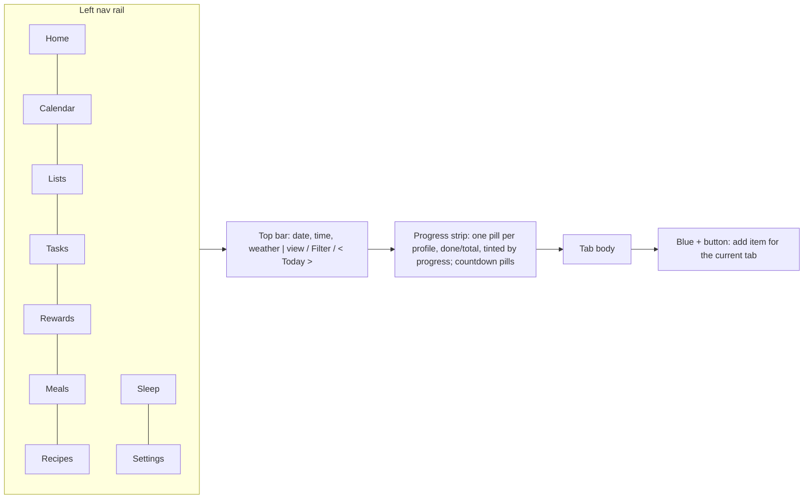
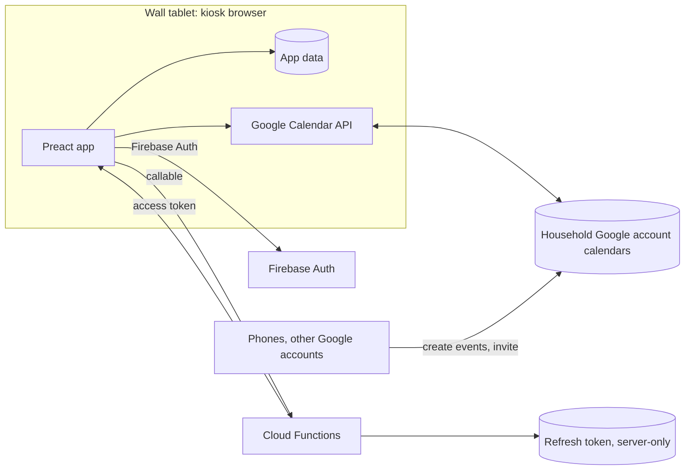

# Research: a Skylight Calendar 2 + Plus equivalent for a wall tablet

Research compiled 2026-11-04 for **Manwar**, a family wall-calendar web app
modeled on the [Skylight Calendar 2 with Plus](https://myskylight.com/products/the-skylight-calendar-2-classic-white-with-plus-plan).
In scope: **Calendar, Lists, Tasks, Rewards, Meals, Recipes**, plus the Home,
Sleep and Settings chrome. Out of scope: Disney Mode, Magic Import and the
Sidekick AI importers, Photos/photo screensaver.

## Reports

| File | What it covers | Images |
|---|---|---|
| [00-user-device.md](00-user-device.md) | The family's own device, photographed 2026-11-04: Calendar Schedule view and Tasks Day view | `assets/user-device/` (2) |
| [01-product-and-plans.md](01-product-and-plans.md) | Hardware, pricing, Free vs Plus matrix, features as marketed, image catalog, FAQ facts | `assets/product/` (104) |
| [02-calendar-profiles-settings.md](02-calendar-profiles-settings.md) | Shell, Home, the four views, event editor, reminders, countdowns, weather, profiles and labels, sync, event-to-profile association, settings, sleep, parental lock, linking | `assets/help-calendar/` (90) |
| [03-tasks-rewards-lists-meals.md](03-tasks-rewards-lists-meals.md) | Chores, routines, Up for Grabs, Task Box, completion and celebrations, stars and rewards, lists, meal planning, recipes | `assets/help-tasks/` (66) |
| [04-ui-gallery-and-design.md](04-ui-gallery-and-design.md) | Frames from 12 videos and the app-store listings; layout tokens, palette, typography, components, interactions, animations | `assets/frames/` (149), `assets/appstore/` (37) |
| [05-reviews-feedback-competitors.md](05-reviews-feedback-competitors.md) | 19 reviews, 500 App Store reviews coded, complaints, requests, competitors (Hearth, Cozyla, DAKboard, Cozi, open-source), kiosk notes, recommendations | `assets/reviews/` (13) |
| [help-center-index.md](help-center-index.md) | All 459 Skylight help-center articles by category and section | - |

Primary sources: the Skylight help center (Zendesk API, all 459 articles,
mostly updated May to Nov 2026), myskylight.com, 12 YouTube walkthroughs and
reviews (2025-12 to 2026-10), the iOS and Google Play listings, and the
user's device. Each report marks inference separately from sourced fact and
lists contradictions found in Skylight's own material.

## What the product is, in one screen

Everything is tagged with **Profiles** (who: name, color, avatar or photo,
birthday) and, for events, optionally **Labels** (what: holidays, school).
Each profile color is used three ways: solid (avatar, checks), mid tint
(event blocks, completed cards), light tint (tracks, column wash).

## Screen inventory and key behaviors

| Screen | Behavior to reproduce | Report |
|---|---|---|
| **Home** | Calendar pane (any view) beside Today's Tasks (one card per profile, plus Up for Grabs) and Lists panes; Customize toggles the side panes; Timer | 02 s2, 04 Home |
| **Calendar: Schedule** | Time grid of 1-7 day columns (slider; 4 on the family's device), optional start on today; hour axis, per-day weather icon, today in a red circle, red now-line on today only, overlapping events split into lanes, short events as thin clipped bars, all-day row with multi-day bars, meals as outlined pills; pinch to zoom hours | 02 s4, 00 |
| **Calendar: Day** | Mini month (left third) plus a scrolling list of that day's event cards with avatars | 02 s5 |
| **Calendar: Week** | 4x2 card grid: 7 day cells (count, "+ Add Event", weather, stacked events) plus a "Next Week" cell | 02 s6 |
| **Calendar: Month** | 7-column grid; 3 items per cell, or 2 plus "N more" opening a day popup; start-on-current-week option; swipe paging | 02 s7 |
| **Event detail** | Anchored popover: serif title, edit and delete, when, repeat summary, reminder, profiles, source calendar, notes, location weather | 02 s10 |
| **Event editor** | Right side sheet: title, start/end or all day, profiles (at least one), repeats (every N unit, on days, until), reminder, write-back calendar, countdown; edits to a series ask This / This and following / All | 02 s11-12 |
| **Filter** | Toggles: task progress, countdowns, weather, meals, each profile (Select All). Hidden profiles also leave the pickers | 02 s9 |
| **Tasks: Day** | One column per profile (plus Up for Grabs): avatar, done/total, star balance, section buttons Morning / Afternoon / Evening / Chores; emoji cards or compact rows with a completion circle; late chores show "N days late" | 03 s1-2, 00 |
| **Tasks: Week** | Per-profile habit grid | 04 Tasks |
| **Chores vs routines** | Chores: due date/time, repeat on a schedule or N after completion, star value, Up for Grabs. Routines: parts of day, daily/weekly on chosen weekdays, ordered by drag, streaks. Both: emoji, assignees (linked copies), skip | 03 s2-5 |
| **Completion** | Card fills with the profile tint, check, stars fly to the balance pill, Undo toast; section confetti; whole day done triggers emoji rain; unchecking takes stars back | 03 s6, 04 Completion |
| **Rewards** | Column per profile with balance; rewards show a progress bar until affordable, then a Redeem pill; redeemed dialog with Done/Unredeem; rewards cost 1-500 stars, can renew | 03 s7, 04 Rewards |
| **Lists** | Multiple lists (To Do, Grocery, Other), collapsible sections, add item inline, check off, drag to reorder, hide on device | 03 s8 |
| **Meals** | 7 days x up to 4 renamable, recolorable categories (Breakfast, Lunch, Dinner, Snack); tap a cell to plan from recipes or a new entry; repeat; add ingredients to the grocery list; meals appear on the calendar as outlined pills | 03 s9 |
| **Recipes** | Master-detail list: name, meal category, one free-text body; add to meal plan, add to grocery list | 03 s10 |
| **Sleep** | One daily From/To window plus "Enter sleep mode now"; tap to wake | 02 s22 |
| **Settings** | General (time zone, weather address, units, language), Display (show/hide tabs, text size, density, brightness), Parental Lock (4-digit PIN for add/modify, relock after 1-10 min idle), Volume, Calendar (week start, days in schedule, start on today, dim past events, shade weekends, color-code multi-profile events, countdown window, what shows on the calendar), Reminders | 02 s20-21 |

## Where Skylight falls short (from 05)

Ranked complaints: paywall and upsell screens inside a paid device; buggy
releases (a June 2026 update broke navigating past the current month);
two-way sync only for Google and iCloud, and every synced calendar becomes its
own profile; stars, rewards and profiles editable only from the phone;
cramped month view and small text; recurrence drift; every app user is an
admin; no offline mode, no dark mode, too bright at night; 12-hour clock only.

Most-requested: dark/night mode, notification when someone adds an event,
more reminders per event, parent/kid roles with kid check-only, pictures on
chores for pre-readers, staples grocery list with quantities, copy events and
tasks, 24-hour time, offline viewing.

## Proposed architecture

- **Static app on Firebase Hosting** (`manwar-home`), installable as a PWA,
  offline-capable through a service worker and a local snapshot.
- **Events live in the household Google account's calendars** through the
  Google Calendar API. Events created on the tablet are written there; events
  created on phones, invitations from other Google accounts, and calendars
  shared to the household account all appear on the tablet.
- **Google connection**: a one-time "Connect Google" on the tablet runs an
  OAuth code flow with offline access. A Cloud Function exchanges the code,
  stores the refresh token server-side (no client access), and signs the
  tablet into Firebase Auth as that household. Afterwards the tablet asks a
  callable Function for short-lived Calendar access tokens and calls Google
  directly. No hourly re-consent.
- **Per-event profile assignment** (beyond Skylight, which only maps whole
  calendars to profiles): the profile ids are stored in the Google event's
  private extended properties, so the assignment travels with the event to
  any device running the app and stays invisible in Google Calendar. Events
  with no assignment fall back to rules, then to "Everyone". To verify during
  the build: that the household account can write private properties on its
  copy of an event it was invited to; otherwise a small assignment table keyed
  by event id holds them.
- **Tasks, rewards, lists, meals, recipes, profiles, settings**: in the app
  data store (local or Firestore, see decisions). The data model follows
  03 s14: a star ledger (append-only transactions, balance = sum) instead of
  a mutable balance, which gives history and undo for free.

## Decisions (user, 2026-11-04)

| Topic | Decision |
|---|---|
| Scope | Calendar, Lists, Tasks, Rewards, Meals, Recipes, Home, Sleep, Settings. No Photos, Disney, Magic Import, Sidekick |
| App data | Firestore with offline persistence (not tablet-only storage) |
| Household Google account | `household@example.com`; events created on the tablet are written to its calendars |
| Event-to-profile association | Per event, stored by the app (Firestore, keyed by Google event id; series-level for recurring events). No automatic rules: unassigned events go to a **triage queue** where a parent assigns them |
| Tablet | Android, landscape, Fully Kiosk Browser |
| Additions beyond Skylight | Night/dark mode, star history ledger with undo, parent PIN with kid check-only mode |
| Smaller Skylight features in v1 | Countdowns, Messages, Timer |
| Deferred | Automatic prayer times, recipe import from URL, reminders by push |
| Calendar views | Skylight's four only: Schedule, Day, Week, Month |
| Research images | Committed publicly (the user has permission for non-commercial research use) |

## Backend provisioned (2026-11-04)

| Piece | Value |
|---|---|
| Firebase / GCP project | `manwar-home` (number 1056874888372), owner faisal.shah@gmail.com |
| Billing | Blaze, "My Billing Account"; budget alert "manwar-home monthly" at $10 (50/90/100%) |
| Hosting | `manwar-home.web.app`, `manwar-home.firebaseapp.com` |
| Firestore | `(default)`, `nam5`, rules deny all client access for now |
| Auth | Identity Platform initialized; authorized domains localhost, web.app, firebaseapp.com |
| APIs | Calendar, Functions, Cloud Build, Artifact Registry, Run, Eventarc, Secret Manager, Scheduler, IAM credentials, STS, Budgets |
| Deploy identity | `github-deployer@manwar-home.iam.gserviceaccount.com` via Workload Identity Federation pool `github`, provider `github`, restricted to `faisal-shah/manwar` |
| Functions runtime | `manwar-functions@manwar-home.iam.gserviceaccount.com` (Firestore user, Secret accessor, token creator on itself for custom tokens) |
| Still needed | An OAuth client (Web) and consent screen in the Cloud Console; Google offers no API for creating them |
